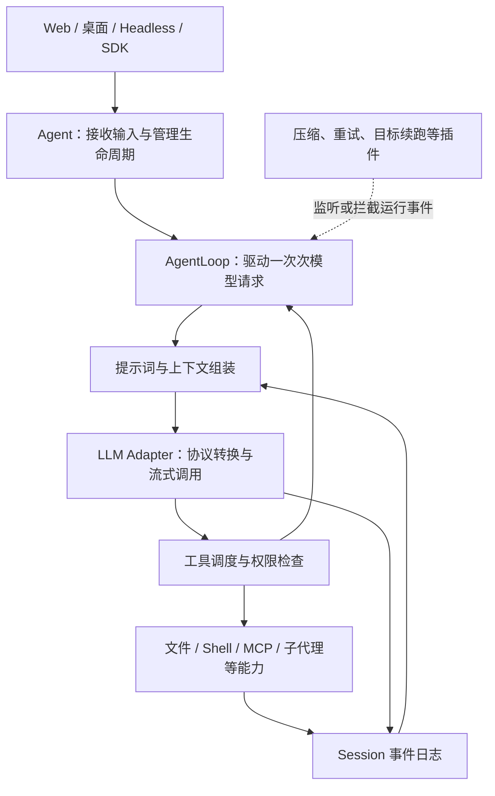

# Review DeepSeek harness 与天枢

整理日期：2026-10-16（Asia/Shanghai）。原活动：`01a13e52-2f9c-74b2-b127-3b933885b6eb`。

包括 DeepSeek、Tianshu、Codex 架构对照，以及工作流、协议审查和候选稿讨论。Tianshu 仅在历史讨论中保留，未加入参考子模块。

本文件整理活动接口返回的用户与助手可见消息，保持轮次顺序；不包含隐藏推理、工具内部日志或环境注入。语音消息拆出请求与补充转写，保留原措辞及重复。它是历史讨论记录，当前方向见 [CURRENT-DIRECTION](../CURRENT-DIRECTION.md)。

## 2026-10-15 14:49:01（北京时间）

轮次：`01a13e52-4558-74f3-a93a-2caca9db3a7a`。

### 用户

帮我 review 下 项目下的  两个 harness 的源码 ,先不看 codex , 你先看 DeepSeek 官方的 你整理下 介绍下 它的架构实现 以及 agent runtime的 机制 ,另外 就是 tianshu ,我需要你看下 它 对于  DeepSeek harness 的区别 以及本质它 做了什么工作

### 助手（进展说明）

我会先只读梳理 `deepseek-harness` 和 `Tianshu-harness`，暂不看 `codex` 源码。先确认仓库来源和当前版本，再沿着入口、模型调用、工具执行、会话状态与 agent 循环追踪，最后说明 DeepSeek 的 runtime 如何工作，以及 Tianshu 在此基础上具体改了什么。这次会按 `technical-report-writing` skill 组织源码解读。

### 助手（进展说明）

已确认本地两个仓库都没有未提交改动：DeepSeek 指向官方 `deepseek-ai/deepseek-harness`，Tianshu 指向 `huiliyi37/Tianshu-harness`。目前看到两点需要重点核实：DeepSeek 将 agent loop 本身也做成可替换插件；Tianshu 公开仓声明只是开发仓的部分同步投影。因此我会把实际代码、文档宣称和公开仓看不到的实现分开说明。

### 助手（进展说明）

DeepSeek 的主循环已经核实：它用 Session 事件日志重建模型上下文，工具调用、工具结果、压缩和恢复都围绕这份日志工作。另一个关键点是：模型停止输出并不立即意味着 turn 结束，插件还可以在停止阶段注入后续工作。我正在核对工具调度、权限检查和子代理，确认这些行为分别由哪一层负责。

### 助手（进展说明）

两者的差异开始清楚了：DeepSeek 更强调运行时各部分可以替换、事件可以追溯；Tianshu 则在自己的主循环里加入了更多针对编码任务的目标、证据、验证和收尾策略。同时发现一个重要限制：Tianshu 的“有证据才完成”并非所有结束路径上的统一硬门禁，我正在逐条确认哪些路径会阻断，哪些只是提醒或附加报告。

### 助手（进展说明）

核心调用链已梳理完。Tianshu 的实质工作可以归为三类：记录任务和工程证据；据此提醒、续跑或阻断部分动作；通过稳定提示词前缀和压缩控制长会话成本。公开仓也确实包含工具、并行 worker、持久化和界面接入，但部分高级能力只留下加载接口。我会在结论里明确这些边界，以及源码不能证明的效果宣称。

### 助手

看完这两个仓库的主要执行链后，我的判断是：**DeepSeek Harness 的重点是把 agent 做成一套可组合、可替换、可追溯的运行时；Tianshu 的重点是在自己实现的运行时中，把编码任务的目标管理、验证、文件归属、交付和长会话策略做得更具体。**

Tianshu 做了相当多实际工程工作。从当前源码和依赖关系看，它维护的是另一套 agent runtime，没有看到它直接依赖官方 `dsh` packages，不能把它理解成“在 DeepSeek Harness 上加了一层界面或几个插件”。代码里有参考官方行为的痕迹，但不足以认定它是官方仓库的 fork。

这次审阅基于你本地的以下版本，没有查看 `codex` 仓库：

| 仓库 | 本次源码基线 | 包版本 |
|---|---|---|
| [DeepSeek 官方 Harness](https://github.com/deepseek-ai/deepseek-harness) | `master` · `d74326738864`，提交日期 2026-10-09 | `0.2.1-alpha.2` |
| [Tianshu Harness](https://github.com/huiliyi37/Tianshu-harness) | `main` · `05cef587f241`，提交日期 2026-10-13 | `3.30.0` |

两个工作树在审阅前后都干净。下面是固定版本的源码解读，不代表最新远端版本的运行验证。

**先看 DeepSeek：它把“让模型持续完成任务”拆成了若干具有明确职责的服务。**

这里的 harness，可以理解为模型外围的执行系统：模型提出下一步动作，harness 负责准备上下文、调用模型、执行工具、处理权限、记录结果，并决定是否继续。

DeepSeek 用 **Cordis** 组织这些服务。Cordis 提供共享 `Context`、依赖注入、事件和插件生命周期；模型适配器、工具注册表、Session、系统提示词，甚至 agent loop 自身都是插件。启动时，`dsh` 根据 profile 和 bundle 组合插件树，再应用用户配置覆盖。

例如 Web、headless、SDK 等入口共用大量基础能力，入口差异主要由不同 bundle 装配。桌面端则是 Electron 承载同一套 Web/Host 应用。可以从 [profile 启动入口](/Users/yueminjun/WorkPlace/deepseek-harness/apps/cli/src/profile-boot.ts:244) 和 [基础插件配置](/Users/yueminjun/WorkPlace/deepseek-harness/packages/bundle/base/cordis.patch.yml:15) 直接看到这种组织方式。

它的核心关系可以简化为：



这里有三个值得理解的设计。

**第一，Agent、AgentLoop 和 Session 各自负责不同的事情。**

| 对象 | 实际职责 |
|---|---|
| `Agent` | 一个活跃执行实例的公共接口：接收消息、插入下一步输入、取消、等待空闲，以及持有当前 Session |
| `AgentLoop` | 默认执行器：组织 turn/step、请求模型、执行工具、处理结束和错误 |
| `Session` | 事件记录及其派生视图：保存发生了什么，并据此重建模型历史 |
| `SystemPrompt` | 汇总插件提供的提示词片段、动态上下文和工具 schema |
| `Tools` | 管理工具定义、作用域、参数与结果，以及执行前后的策略 |
| `LLM` | 屏蔽具体 provider 的协议、流格式、能力和错误差异 |

因此，替换模型适配器通常不需要改 agent loop；增加一个工具，也不需要在主循环里新增一个 `if/else` 分支。每个 agent 还拥有独立的注册作用域，可以覆盖提示词或限制工具。**这种作用域是逻辑隔离；是否有操作系统级隔离，要看实际执行工具所使用的 sandbox。**

核心代码入口是 [AgentLoop 工厂](/Users/yueminjun/WorkPlace/deepseek-harness/packages/core/agent-loop/src/index.ts:341) 和 [ReactLoopAgent 执行器](/Users/yueminjun/WorkPlace/deepseek-harness/packages/core/agent-loop/src/agent.ts:98)。

**第二，它的上下文以事件日志为依据，模型请求不是靠各模块随意修改一个 messages 数组拼出来的。**

Session 记录 `user/message`、`assistant/message`、`tool/call`、`tool/result`、`turn/start`、`turn/end` 等事件。`deriveMessages()` 从这些事件的当前可见视图中生成模型历史，再冻结本次请求。

这带来几个实际效果：

- 可以查清某次请求为什么看到了这些内容。
- 恢复会话、分叉会话、界面展示和上下文压缩，可以共享同一份事件依据。
- 压缩时保留原始事件，通过新的替换记录改变模型当前看到的内容。
- 模型流式输出与持久记录有所区分：界面接收实时 chunk，结束或失败后再记录完整消息或 attempt。

这里不能把“写入 Session”直接等同于“已经同步刷到磁盘”。Session 记录和持久化后端是两个职责，落盘、flush 和关闭排空由对应实现承担。关键实现见 [模型历史推导](/Users/yueminjun/WorkPlace/deepseek-harness/packages/core/session/src/index.ts:966)、[构建并冻结模型请求](/Users/yueminjun/WorkPlace/deepseek-harness/packages/core/agent-loop/src/agent.ts:615)。

**第三，它的扩展点能改变实际执行，但通用运行时不替业务判断任务是否真的做好了。**

以“修复一个失败测试”为例，实际执行过程是：

1. **接收用户输入。** `followup()` 放入下一 turn，`steer()` 放入下一 step，`inject()` 只追加上下文，不主动唤醒。
2. **准备一次 step。** 汇总提示词、工具和上下文，经过 `agent/pre-step`；插件可以接受、改写或拒绝这一步输入。
3. **确定模型路由。** 经 `agent/request` 和 `prepareCall()` 确定 provider、模型及其能力，然后生成请求。
4. **接收模型输出。** 处理流式内容，记录完整 assistant 消息；如果模型要求读文件、改代码或跑测试，就进入工具执行。
5. **检查并执行工具。** 经过执行前策略、权限批准和不可被后续插件取消的拒绝检查，再执行工具、处理结果并回写 Session。
6. **继续或结束。** 普通工具调用完成后再请求模型；没有工具调用且没有待处理输入时，准备结束，但 `agent/turn-stopping` 仍允许插件追加工作。

对应主流程在 [turn 驱动](/Users/yueminjun/WorkPlace/deepseek-harness/packages/core/agent-loop/src/agent.ts:298) 和 [step 执行及结束判断](/Users/yueminjun/WorkPlace/deepseek-harness/packages/core/agent-loop/src/agent.ts:400)。

这里的 **step 是一次模型请求及其工具执行，turn 可以包含多个 step**。模型没有再调用工具，只能说明默认循环准备停下来，并不能证明测试通过、需求满足或交付正确。

工具执行也做了较完整的调度：允许并发的工具使用有上限的池，独占工具形成串行屏障；即使执行并发，结果仍按模型发出的顺序提交。取消时停止启动新调用，并等待已经开始的调用收尾，给被跳过的调用补上错误结果，保持历史中的调用与结果配对。见 [工具调度器](/Users/yueminjun/WorkPlace/deepseek-harness/packages/core/agent-loop/src/tool-calls.ts:60)、[工具权限与执行管线](/Users/yueminjun/WorkPlace/deepseek-harness/packages/core/tools/src/index.ts:1499)。

**DeepSeek 的 runtime 已经覆盖了很多高级机制，不能把它看成一个只有 Function Calling 的基础循环。**

- **上下文压缩：** 在 step 前检查压力，也能在上下文溢出后尝试恢复；保留近期内容，避免切断 tool-call/result 配对，摘要通过事件记录替换当前可见区间。见 [自动压缩接入](/Users/yueminjun/WorkPlace/deepseek-harness/packages/compaction/compaction-basic/src/index.ts:160)、[摘要提交](/Users/yueminjun/WorkPlace/deepseek-harness/packages/compaction/compaction-basic/src/region.ts:491)。
- **前缀缓存友好处理：** 根据模型能力决定系统提示词更新是追加到历史，还是重建前部；不是每一步都任意重写旧上下文。见 [SystemPromptProjection](/Users/yueminjun/WorkPlace/deepseek-harness/packages/core/agent-loop/src/runtime-context.ts:57)。
- **子代理：** `spawn` 从新上下文开始；`fork` 继承父会话已结束 turn 的历史，不复制正在执行的半个 turn。见 [spawn provider](/Users/yueminjun/WorkPlace/deepseek-harness/packages/subagent/subagent-spawn-in-process/src/index.ts:39)、[fork provider](/Users/yueminjun/WorkPlace/deepseek-harness/packages/subagent/subagent-fork-in-process/src/index.ts:39)。
- **目标续跑：** `goal-round-driver` 在 agent 空闲、目标仍激活且满足条件时，生成后续消息继续执行，有轮数限制和持久化检查。见 [目标驱动器](/Users/yueminjun/WorkPlace/deepseek-harness/packages/goal/goal-round-driver/src/index.ts:137)。
- **两种工具呈现：** native 模式直接给模型工具 schema；PTC 模式给模型 `run_code` 和生成的工具 SDK，让它写一段程序组合调用工具。Node PTC 在子进程中执行，并接入 sandbox 和资源限制。见 [工具模式说明](/Users/yueminjun/WorkPlace/deepseek-harness/packages/core/tools/README.md:64)、[PTC 子进程启动](/Users/yueminjun/WorkPlace/deepseek-harness/packages/ptc-runtime/ptc-runtime-node/src/index.ts:209)。
- **多 provider：** 当前原生 DeepSeek adapter 使用 Messages 接口和 SSE；此外还有 `pi-ai` 适配层。所以官方 runtime 也不局限于单一 DeepSeek 模型。见 [原生适配器](/Users/yueminjun/WorkPlace/deepseek-harness/packages/llm/llm-deepseek/src/adapter.ts:124)、[多 provider 插件](/Users/yueminjun/WorkPlace/deepseek-harness/packages/llm/llm-pi-ai/src/index.ts:1)。

**再看 Tianshu：它把更多“如何完成工程任务”的判断直接放进了运行时。**

它的主要链路是：

`CLI/TUI 或 sidecar → createAgentRuntime → AgentLoop → TurnOrchestrator → PromptEngine → Provider Client → ToolExecution → SessionContext`

`bootstrap` 负责装配工具、模型、持久化、文件归属和代理协调器；`TurnOrchestrator` 负责压缩、感知、收敛检查、请求模型、执行工具及结束。它支持多种模型协议，TUI 与 sidecar 复用同一 runtime 工厂。见 [运行时装配](/Users/yueminjun/WorkPlace/Tianshu-harness/src/bootstrap.ts:929)、[主执行流程](/Users/yueminjun/WorkPlace/Tianshu-harness/src/agent/turn-orchestrator.ts:491)。

它所称的 **CVM，落到公开源码中，是一层管理任务状态、观察行为、施加策略并反馈给模型的控制逻辑**。它没有替换模型权重，也没有提供一种新的神经网络推理引擎。

最有实质内容的是下面几组工作：

| Tianshu 做的工作 | 源码中的实际机制 | 解决的问题与限制 |
|---|---|---|
| 将任务目标独立保存 | `TaskContract` 保存目标、范围、约束、成功条件、阶段和计划引用 | 帮助跨轮次和压缩后恢复目标；自动提取主要依赖首行、正则和关键词，不等于完整理解需求 |
| 将工程事实独立保存 | `EvidenceTracker`、任务与文件归属台账，记录读写、验证、影响范围和证据有效性 | 新改动可使旧验证失效，避免拿改动前的结果证明改动后正确；覆盖判断仍依赖命令分类和范围归因 |
| 在执行过程中纠偏 | 生命周期 hooks、行为轨迹、收敛检测、统一提醒与控制信号 | 可以提醒、续轮、阻断部分工具、切分会话或中止；不同策略的强度不同 |
| 将交付做成明确操作 | `deliver_task` 生成交付报告，可执行限定文件范围的 commit | 提交前检查验证、文件归属和冲突；普通最终回答不必全部经过同一硬门禁 |
| 控制长会话成本 | 冻结提示词前缀、用户消息快照、动态 appendix、边界压缩 | 减少无谓的历史改写，让 provider 更容易命中缓存；不能保证某个固定命中率 |
| 管理多代理工程协作 | Coordinator、worker 工具限制、预算、任务依赖、分批执行和文件归属 | 把派发和合并做成可执行机制；最终结果仍需要主控核验 |

任务与证据实现可直接看 [TaskContract](/Users/yueminjun/WorkPlace/Tianshu-harness/src/context/task-contract.ts:11)、[EvidenceTracker](/Users/yueminjun/WorkPlace/Tianshu-harness/src/agent/evidence.ts:98)、[交付评估](/Users/yueminjun/WorkPlace/Tianshu-harness/src/agent/delivery-gate-v2.ts:333)。

其中，**“修改之后使旧验证失效”和“只提交当前任务归属的文件”是很具体的工程价值**。这些机制把模型容易遗漏的工作纪律转成状态和检查，减少完全依赖模型记忆与自述的部分。

**CVM 的 hooks 需要按实际作用理解。**

源码定义了五个阶段：`preTurn`、`afterPerception`、`postTool`、`postTurn`、`postSession`。Hook 可以更新运行状态、注入提示、提交控制信号或更新界面；管线按阶段串行运行，并提供超时和异常记录。

但它们并不都属于强制拦截：

- 有些只记录观测数据，处于 shadow 模式。
- 有些只是提醒模型补验证、更新 todo 或调整策略。
- 有些根据依赖、配置或开关才装配。
- 工具层另外实现权限、计划模式、验证纪律、重复失败等实际阻断。

因此，README 的“75 个 hooks”不能解读为“每次会话都有 75 道硬检查”。实际应看装配清单和配置。见 [Hook 类型与作用接口](/Users/yueminjun/WorkPlace/Tianshu-harness/src/agent/runtime-hooks.ts:8)、[Hook 执行与超时处理](/Users/yueminjun/WorkPlace/Tianshu-harness/src/agent/runtime-hooks.ts:334)、[条件装配](/Users/yueminjun/WorkPlace/Tianshu-harness/src/agent/create-runtime-hooks.ts:342)。

它的收敛检测则根据工具重复、读写与验证活动、无工具轮次、文本变化、任务阶段等信号判断是否停滞，进而提醒、切分或中止。**这是一套有保护条件的启发式控制，不是一个独立证明“任务有没有完成”的裁判。** 相关决策见 [收敛检测结果](/Users/yueminjun/WorkPlace/Tianshu-harness/src/agent/convergence-detector.ts:1237)。

**缓存部分也是真实实现，重点在控制请求内容的稳定性。**

Tianshu 会冻结已发送用户消息附带的上下文，在新的用户消息边界才更新基础内容；同一用户请求内部连续调用工具时，尽量复用已有前缀。动态 appendix 可以只发变化的子块，压缩也会考虑破坏热缓存的代价。

所以它所谓的“缓存引擎”，主要是**在客户端安排请求内容，让服务端已有的前缀缓存更容易复用**。它自己不持有模型服务端的 KV cache。见 [用户边界更新](/Users/yueminjun/WorkPlace/Tianshu-harness/src/prompt/engine.ts:630)、[增量 appendix](/Users/yueminjun/WorkPlace/Tianshu-harness/src/prompt/engine.ts:1464)。

两者的架构区别，可以这样对照：

| 维度 | DeepSeek Harness | Tianshu |
|---|---|---|
| 组织中心 | Cordis 插件树、服务接口和事件 | 自有 `AgentLoop`、控制器和策略装配 |
| 扩展方式 | 替换 provider/service，注册工具和事件监听 | 扩展工具、hooks、控制器及已有策略入口 |
| 上下文依据 | Session 事件日志派生模型可见历史 | SessionContext 消息，加任务状态、台账、冻结快照等 |
| 压缩与持久化 | 通过追加事件改变当前模型可见视图，保留原事件 | 消息持久化配合元数据、冻结快照；压缩存在受控历史重写 |
| 默认工程策略 | 已有权限、计划、目标续跑、压缩和重复调用提醒等 | 更细地管理编码任务的验证义务、文件归属、交付、停滞和策略纠偏 |
| 多代理 | 通用 provider 接口，spawn/fork 等后端 | Worker、模型分工、依赖分批执行和协作纪律更贴近编码流程 |
| 主要取舍 | 可替换性强，需要理解插件组合和生命周期 | 开箱策略更具体，策略之间的相互影响及误判更需要维护 |

Tianshu 的持久化并非只是简单保存聊天文本：有带校验的 JSONL、元数据、冻结提示词快照和写入屏障；但与 DeepSeek 的事件派生方式确实不同。见 [Session 文件布局](/Users/yueminjun/WorkPlace/Tianshu-harness/src/agent/session-persist.ts:160)、[持久化监听与压缩重写](/Users/yueminjun/WorkPlace/Tianshu-harness/src/agent/session-persist-listener.ts:38)。

**这次 review 中，有三个边界会直接影响对 Tianshu 的评价。**

1. **“有证据才完成”并不是所有结束路径上的统一硬保证。**  
   `deliver_task(commit=true)` 会拒绝 RED、缺少适用成功验证，以及波及测试未覆盖等情况，部分机械变更有明确例外。但普通无工具回答可以自然结束；高风险证据义务会尝试有界续轮，仍未解决时允许以受阻状态结束。最终完成回调会携带证据摘要，不是在这里统一拦截所有未验证回答。应理解为“关键动作有约束，结束时有证据状态”，不能据此认定任何 final 都经过充分验证。见 [提交门禁](/Users/yueminjun/WorkPlace/Tianshu-harness/src/agent/deliver-task.ts:932)、[自然结束路径](/Users/yueminjun/WorkPlace/Tianshu-harness/src/agent/turn-orchestrator.ts:1524)、[完成回调](/Users/yueminjun/WorkPlace/Tianshu-harness/src/agent/turn-completion.ts:56)。此外，`deliver_task` 的自动 review 在 commit **之后**执行，结果作为建议，不会撤销已落地提交，见 [提交后 review](/Users/yueminjun/WorkPlace/Tianshu-harness/src/agent/deliver-task.ts:1225)。

2. **公开仓足以审阅主要 agent 内核，但不能覆盖完整产品。**  
   仓库明确是开发主仓的同步投影。桌面源码和部分 Pro 实现不在这里；例如 computer-use 留有 schema 和加载桩，缺少实现时明确返回不可用；Spark 的推理锚点提取算法也在闭源侧。不能把这些接口当成已经看过的完整实现，也不应因此否定公开部分真实存在的 CVM、工具和协作代码。见 [Pro 扩展边界](/Users/yueminjun/WorkPlace/Tianshu-harness/src/api/pro-registry.ts:1)、[computer-use 桩](/Users/yueminjun/WorkPlace/Tianshu-harness/src/tools/computer-use/stub.ts:114)、[推理锚点边界](/Users/yueminjun/WorkPlace/Tianshu-harness/src/agent/reasoning-anchors.ts:1)。

3. **源码证明了机制存在，不能直接证明宣传效果普遍成立。**  
   文档中的 A/B 是单模型、五个任务的 `STAR_SOUL` 对照，包含信念提示、courage hook 和星域声明，并不是当前完整 CVM 的全面消融实验。缓存观测材料列出的主要样本也是 DeepSeek 长会话，并自行说明是历史快照、短会话命中率会更低。因此，“所有模型稳定 95–99%”或“CVM 普遍提升完成率”都超出这次源码与公开样本能够确认的范围。见 [A/B 实验口径](/Users/yueminjun/WorkPlace/Tianshu-harness/docs/CVM运行时对Agent模型的实证影响.md:26)、[缓存观测样本](/Users/yueminjun/WorkPlace/Tianshu-harness/docs/reference/observability-harness.md:28)、[样本局限](/Users/yueminjun/WorkPlace/Tianshu-harness/docs/reference/observability-harness.md:230)。

如果从架构学习价值来取舍，**DeepSeek 最值得研究的是服务可替换、事件记录与模型上下文的一致性、工具调度和生命周期；Tianshu 最值得研究的是把工程纪律转成可执行状态、证据有效性、文件归属，以及如何管理大量纠偏策略。** Tianshu 的维护难点也正来自这里：策略越多，越需要确认它们不会互相催促、重复验证或误判停滞；代码已经为此加入统一控制信号、冷却和保护条件，但实际收益仍要用一致任务与真实运行证据比较。

本次完成的是主要调用链和关键控制机制的静态源码审阅；没有修改文件，也没有构建、运行模型任务或复现两者的性能与成功率，因此不对运行可靠性和效果高下作已验证结论。

## 2026-10-15 15:05:43（北京时间）

轮次：`01a13e61-8f98-76e2-9ff0-412c8729603c`。

### 用户

那你再看下 codex 的源码，对比下这三个项目的架构和 agent runtime，重点看看 Tianshu 加的这些机制，Codex 里有没有对应实现，哪些是它额外做的工作。 另外 看下 Tianshu  ,你总结下 我本地的 AI 工作开发的 流程 ,我感觉 只是 把我这套 工作流 做的更细致 然后 打包进 Harness , 我其实想你 看下 我本地 codex 以及 claude 的 一些跑的规则 特别是协议插件 整体 ,你评估 下 我的这套跟 Tianshu 的 本质 工作流程的 差异

### 助手（进展说明）

我会沿两条线只读核对：一条看 Codex 源码，逐项查 Tianshu 的目标、证据、验证、收尾、压缩和多代理机制有没有对应实现；另一条看你本地 Codex／Claude 的规则、协议插件和实际接入方式，区分哪些靠模型遵守约定，哪些由工具或运行时强制执行。最后据此判断“Tianshu 是否只是把你的工作流做细并打包进 Harness”，并指出真正的差异。这次继续按 `technical-report-writing` skill 组织分析，也会使用 `openai-docs` skill 核对 Codex 的产品与源码边界。

### 助手（进展说明）

已经确认两点会影响比较结论：这份 Codex 源码也有持久化目标、自动续跑、工具生命周期 hooks 和原生多代理，不能把这些算成 Tianshu 独有。你本地的 Codex–Claude 插件则已是 1.0.1：它明确区分“执行结束”“Claude 自报完成”和“Codex 验收通过”。我接下来重点核对两边各自用什么证据判断任务完成，以及哪些规则真的会拦截执行。

### 助手（进展说明）

你本地这套已经超过“提示词工作流”的范围：有冻结验收基线、分任务写入归属、独立 review、受监督的 Claude 进程，以及跨轮 patch 交付。不过接入程度不完全一致：Claude 的部分 hook 已注册，Codex 当前的全局 hooks 主要用于状态通知；oracle 的项目保护还需要逐任务登记。这个区别很关键：规则写得完整，与每个执行入口都能强制落实，是两件事。

### 助手（进展说明）

现在差异可以具体到一个场景：代码测试通过后又改了一次，Tianshu 会自动把旧验证标为过期，并让它影响 `deliver_task` 的提交判断；Codex 原生保存工具结果，但我没有找到同等的通用工程验收链，你这边主要由协议和协调者重新核验。反过来，你的插件把 Claude 产出交给 Codex 独立裁决，并保留跨轮交付 patch，这也是实质机制。两套方案的主要差别，是控制发生在内部每一步，还是外部任务交接与验收时。

### 助手

**你的判断在“工作流程”这一层基本成立：Tianshu 做的很多事，与你已经建立的“明确目标、保护验收、分工实施、独立核验、按证据交付”高度重合。真正的区别，是它把其中一部分判断下沉到了 agent runtime，变成随工具执行自动更新的状态和门禁。**

但你的系统也不能概括成“几份规则加提示词”。你已经有原生 Codex／Claude runtime、Claude hooks、编排协议，以及实际管理进程、副本、patch 和裁决的 Codex–Claude 插件。**更准确的比较是：Tianshu 在一个 harness 内部管理执行过程；你在两个成熟 harness 之上管理任务、协作和交付。**

这次核对的本地源码基线是 DeepSeek `d74326738864`、Tianshu `05cef587f241`、Codex `f82e36592278`。三个仓库工作树均干净。协议插件核对的是当前已安装的 `1.0.1+codex.20261015112934`，其关键文件与本地开发仓库 `f89bdcd8432db` 一致。下面说的是这些源码与本地配置能证明的行为，不把它们等同于当前桌面 App 的全部实现。

**先把三个项目放在同一层上看。**

| 项目 | 架构组织方式 | Agent runtime 的核心 | 主要设计重心 |
|---|---|---|---|
| **DeepSeek Harness** | TypeScript，基于 Cordis 组织插件，通过 profile／bundle 装配不同宿主 | `AgentLoop` 驱动模型与工具循环；Session 保存事件并生成模型消息；工具、模型、压缩、目标、子代理分别接入 | 把 agent 的基础能力拆成可组合、可替换的模块 |
| **Codex** | Rust workspace；CLI／TUI／app-server 接入共享核心；扩展系统补充目标、权限审查等能力 | Thread → Turn → Sampling request → Tool execution；统一管理输入、历史、工具调度、权限、压缩、取消与恢复 | 提供完整的执行基础设施，并允许上层应用、规则和插件接入 |
| **Tianshu** | 独立 TypeScript runtime；多个客户端复用 AgentLoop；内部组合较多任务策略 | `TurnOrchestrator` 在模型调用前后、工具前后和结束前，读取任务状态、证据、归属与收敛状态 | 把编程工作的操作纪律、证据管理和交付策略直接嵌入循环 |

对应入口可以从 [DeepSeek profile 装配](/Users/yueminjun/WorkPlace/deepseek-harness/apps/cli/src/profile-boot.ts:244)、[Codex turn 循环](/Users/yueminjun/WorkPlace/codex/codex-rs/core/src/session/turn.rs:164)、[Tianshu TurnOrchestrator](/Users/yueminjun/WorkPlace/Tianshu-harness/src/agent/turn-orchestrator.ts:491) 读起。

这三者都有“模型决定下一步 → runtime 执行工具 → 结果回到模型”的基础循环。**Tianshu 的核心增量，不是发明这个循环，而是在循环里加入更具体的编程工作策略。** 从源码组织和依赖看，它也是独立实现，不能理解为在 DeepSeek 官方 harness 上简单加了一层插件。

**Codex 的 runtime，比“一个工具调用循环”完整得多。**

这份 Codex 源码中的主路径是：

```text
CLI / TUI / app-server 客户端
        ↓
ThreadManager：创建、恢复、fork、管理线程
        ↓
Turn：接收用户输入、steer、取消和待处理消息
        ↓
Sampling request：固定本次模型、上下文、工具与环境快照
        ↓
模型流式输出 → 工具路由 → 并发控制 → 权限与沙箱 → 执行
        ↓
结果写入历史，再次请求模型
        ↓
处理 Stop hooks、压缩、结束；有活动 goal 时可继续下一轮
```

几个容易被低估的实现点：

- **工具声明与执行绑定同一个请求快照。** `StepContext` 保存本次的 settings、MCP binding、环境能力和工具 router，避免模型看到的工具与随后执行的工具状态错位。[StepContext](/Users/yueminjun/WorkPlace/codex/codex-rs/core/src/session/step_context.rs:23)
- **工具并发有 runtime 调度。** 支持并行的工具走共享锁，其余走排他锁；不是把全部调用直接并发出去。[ToolCallRuntime](/Users/yueminjun/WorkPlace/codex/codex-rs/core/src/tools/parallel.rs:126)
- **权限、沙箱和重试是执行链的一部分。** `ToolOrchestrator` 处理审批、沙箱选择、执行和必要的升级重试。[ToolOrchestrator](/Users/yueminjun/WorkPlace/codex/codex-rs/core/src/tools/orchestrator.rs:138)
- **目标续跑、多代理和 review 已有实现。** 它们不是单靠 AGENTS.md 要求模型“继续努力”。

这也与官方将 app-server 定位为可供应用接入的 agent harness 一致。[官方架构介绍](https://developers.openai.com/blog/codex-as-a-platform)

**逐项看 Tianshu 的机制，Codex 已经有不少对应物。**

| 机制 | Tianshu 的实现 | 这份 Codex 源码的对应 | 实质差异 |
|---|---|---|---|
| 目标、预算、自动续跑 | goal 状态与循环中的继续／结束判断 | 持久化 goal、token budget、用量记账、空闲后续跑 | **不是 Tianshu 独有** |
| 生命周期 hooks | `preTurn`、感知后、工具后、turn 后、session 后的内部策略 | 用户输入、工具前后、权限请求、压缩前后、Stop 等 hooks | Codex 有执行接口；Tianshu 预装了更多编程策略 |
| 历史、恢复、压缩 | Session 持久化、冻结内容、压缩协调 | rollout、resume 重建、本地／远端 compaction | 两边都有；保存和重组上下文的方法不同 |
| 缓存稳定性 | 冻结 prompt 前缀、增量追加、控制压缩时机 | 请求快照、缓存 key、连接复用、fork 前缀保留 | Tianshu 对多协议 prompt 组织做了更多显式策略 |
| 多代理、review | Coordinator、worker、团队波次、验证任务 | 原生 spawn／fork／mailbox／wait／interrupt，以及专门 review 会话 | 基础能力重合；Tianshu 加了更具体的团队工作流程 |
| 任务契约 | `TaskContract` 结构化目标、约束和状态 | goal、plan、AGENTS 指令，但未找到同等通用契约链 | Tianshu 多了一份可被策略直接消费的任务状态 |
| 验证证据与有效性 | 追踪改动、验证范围、过期证据、受影响测试 | 保存工具结果和历史；未找到同等通用工程证据账本 | **这是 Tianshu 较明确的额外工作** |
| 交付与提交门禁 | 结合证据、文件归属和当前状态判断 `deliver_task` | 未找到同等通用交付工具；goal 完成不检查测试证据 | **Tianshu 把部分验收判断做成了程序逻辑** |
| 防止无效循环 | 根据重复操作、进展、阶段与预算干预 | 有执行失败、空响应、终止错误等具体保护 | Tianshu 的判断更接近工作进展，但也更依赖启发式规则 |

这里有三个边界需要保留。

第一，Codex 的 goal 确实是程序机制：状态和用量入库，线程空闲时可以继续。但 `update_goal(complete)` 本身没有检查“测试是否通过、证据是否适用于当前代码、修改是否属于本任务”。**持续执行能力，与工程验收能力，是两层东西。**[Goal 续跑](/Users/yueminjun/WorkPlace/codex/codex-rs/ext/goal/src/extension.rs:180)、[完成状态更新](/Users/yueminjun/WorkPlace/codex/codex-rs/ext/goal/src/tool.rs:247)

第二，Codex 已有 hooks 和 Code Mode 等扩展能力，但要区分实现与启用。例如，此 HEAD 的 hook 配置虽然列了 `prompt`、`agent` 类型，加载器仍明确跳过它们；可执行的 command／MCP hook 则另有真实实现。[Hook 类型边界](/Users/yueminjun/WorkPlace/codex/codex-rs/hooks/src/engine/discovery.rs:637)

第三，Codex 也有“证据新鲜度”相关代码，例如 Guardian 检查缓存授权是否仍适用。那是**动作授权的证据**，不能直接当成“测试仍然覆盖当前代码”的工程证据。[Guardian 授权核查](/Users/yueminjun/WorkPlace/codex/codex-rs/ext/guardian-reviewer/src/review.rs:47)

**Tianshu 真正多做的工作，用一个例子最容易看清。**

假设 agent 修改了三个文件，跑测试通过，然后又改了一次代码。

在 Tianshu 中，这次新改动会：

1. 把文件验证状态设回 `pending`。
2. 将已有验证标为 `stale`。
3. 在交付判断时过滤过期或被替代的证据。
4. 在 `deliver_task(commit=true)` 中检查是否还有适用的成功验证。
5. 检查提交文件是否属于当前任务，再进行限定范围的提交。

这些都有直接代码路径，集中在 [EvidenceTracker](/Users/yueminjun/WorkPlace/Tianshu-harness/src/agent/evidence.ts:130)、[DeliveryGate](/Users/yueminjun/WorkPlace/Tianshu-harness/src/agent/delivery-gate-v2.ts:349)、[deliver_task 验证要求](/Users/yueminjun/WorkPlace/Tianshu-harness/src/agent/deliver-task.ts:972) 和[提交归属检查](/Users/yueminjun/WorkPlace/Tianshu-harness/src/agent/deliver-task.ts:1062)。

在原生 Codex 中，先前测试结果和后续编辑都会进入运行历史，但这次没有找到把它们自动组合成上述交付判断的通用实现。你现在主要靠 W06、W07 和协调者检查，确保旧测试结果不被误用于新候选。

所以，Tianshu 的增量可以准确说成：

> **把“应该怎么工作”的部分规则，转成“发生了什么、还欠什么验证、当前能不能交付”的状态计算。**

不过也不能把它描述成“所有质量问题都被硬门禁封住”：

- `TaskContract` 的初始提取包含关键词、文件名匹配和通用成功条件，不等同于人工批准的完整需求契约。[契约提取](/Users/yueminjun/WorkPlace/Tianshu-harness/src/context/task-contract.ts:177)
- read-before-edit、TDD 等干预有配置和触发条件，不是所有编辑都无条件拦截。[工具前干预](/Users/yueminjun/WorkPlace/Tianshu-harness/src/agent/tool-pipeline.ts:820)
- 最明确的提交验证集中在 `deliver_task` 路径；普通 `git` 工具还有自己的提交路径。因此不能把该工具的门禁直接推广为整个进程不可绕过的限制。[普通 Git 提交路径](/Users/yueminjun/WorkPlace/Tianshu-harness/src/tools/git.ts:668)
- 高风险证据义务可触发一次补证据续轮，之后仍允许诚实报告受阻并结束；自动 post-commit review 发生在提交之后，属于提示性审查。[结束前义务处理](/Users/yueminjun/WorkPlace/Tianshu-harness/src/agent/turn-orchestrator.ts:1524)、[提交后 review](/Users/yueminjun/WorkPlace/Tianshu-harness/src/agent/deliver-task.ts:1225)

**再看你本地的工作流，它已经形成了三层结构。**

第一层是**任务与验收协议**。

你现在的 Codex W01–W12，核心不是“多派几个 agent”，而是：

- 从原始要求确定目标、基线、边界和验收。
- 根据任务需要选择直接执行或委派。
- 保留已有工作，明确写入归属。
- 保护正式验收，不准迎合实现修改判据。
- 区分执行者自报、实际检查、产物验证和真实设备验收。
- 达标后结束；只有新决定才回到用户。
- 用同一份任务进度支持跨轮、跨模型恢复。

这些原则已经覆盖 Tianshu 很多机制试图解决的问题。[你的全局工作约定](/Users/yueminjun/.codex/AGENTS.md:58)

Claude 侧还有显式触发的 `/dispatch` 协议。它进一步把工作拆成：

```text
批准后冻结的 delta
    ＋
可调整的 dispatch
    ↓
按 lane 分工、明确 owned files
    ↓
按 MOVE / EDIT / FEATURE 执行相应检查
    ↓
独立 review、finding 分类、有限自修
    ↓
协调者裁决、阶段验收、人工 PR 合并
```

尤其是“正式验收与执行方法分开”“scope 外缺陷不因此降级”“登记债务不等于通过”“下游产物必须核对版本身份”，已经是相当具体的工程验收协议。[Orchestration Protocol v2.9](/Users/yueminjun/.claude/protocols/orchestration-protocol.md:8)

第二层是**宿主 hooks 的局部自动执行**。

当前 Claude 配置确实注册了 Git guard、oracle guard、上下文注入、dirty tracker 和 Stop progress gate。[当前 hooks 注册](/Users/yueminjun/.claude/settings.json:65)

但它们的实际范围各不相同：

| 本地机制 | 当前能确认的作用 | 不能据此推导的能力 |
|---|---|---|
| Git guard | 对识别到的 Bash Git 命令进行规则检查并阻断 | 不是覆盖任意执行路径的完整 Git 权限系统 |
| Oracle guard | 对 Write／Edit 的目标路径检查批准保护集 | 不检查 Bash 的实际写入；项目判据需要登记 |
| Dirty tracker＋Stop gate | 记录部分改动，要求特定项目同步进度 | 不是通用测试验收门禁 |
| Codex 全局 hooks | 当前文件主要接 Otty 的状态事件 | 尚不能据此认为已接入工程证据或交付门禁 |

这次在检查到的全局／项目配置和当前进程环境中，没有发现 `ORACLE_GUARD_APPROVALS` 登记。因而能确认的是：**oracle hook 已注册，固定的协议与配置路径有保护逻辑；项目验收文件不能一概宣称已冻结。** Stop progress gate 也只针对带 `.ops`、`.handoff` 或 `_context` 标志的项目，并会放行子代理及已经触发过的停止检查。[Oracle 实现](/Users/yueminjun/.claude/hooks/oracle-guard.sh:44)、[Stop 作用域](/Users/yueminjun/.claude/hooks/stop-progress-gate.sh:32)、[Codex hooks 配置](/Users/yueminjun/.codex/hooks.json:1)

第三层是**Codex–Claude 插件的跨 harness 监督**。

当前插件的完整路径是：

```text
用户原话、原件
    ↓
Codex 组织 packet，区分原话与协调者解释
    ↓
插件冻结输入，建立独立工作副本
    ↓
Claude Code 用自己的 runtime 执行任务
    ↓
插件收回进程结果、报告、本轮 patch、累计交付 patch
    ↓
Codex 独立核验，应用或修正改动，记录裁决
    ↓
继续下一轮，或交付并清理副本
```

这里有几项扎实的工程实现：

- 副本以原仓库**当前工作状态**为基础，包含已有未提交内容。
- copy 模式通过 macOS sandbox 拒写源仓库和控制证据。
- 分开保存本轮 `changes.patch` 与尚未合入的累计 `delivery.patch`。
- 下一轮重新建副本，再承接未交付改动，避免依赖上轮残留工作区。
- 分开记录进程结果、Claude 自评和 Codex 裁决。
- 续接时程序核对历史用户消息未被改写。

这些工作明显超过了“把提示词转交给 Claude”。[副本与跨轮承接](/Users/yueminjun/WorkPlace/codex-claude-orchestrator/plugins/codex-claude-orchestrator/skills/codex-claude-orchestrator/scripts/bridge.py:187)、[裁决记录](/Users/yueminjun/WorkPlace/codex-claude-orchestrator/plugins/codex-claude-orchestrator/skills/codex-claude-orchestrator/scripts/runtime.py:357)

同时，当前 1.0.1 插件刻意保留了协调者判断空间：`write_hint`／`protected` 主要用于事后 patch 分类；`source_not_read` 是警告；`decide` 要求填写核验依据，但不会替你执行或证明依据中的测试。**它负责保存事实、隔离工作和记录裁决，验收语义仍由 Codex 与用户协议承担。**[Patch 分类与警告](/Users/yueminjun/WorkPlace/codex-claude-orchestrator/plugins/codex-claude-orchestrator/skills/codex-claude-orchestrator/scripts/bridge.py:457)

**你这套与 Tianshu 的本质差异，可以归到四点。**

| 维度 | 你的体系 | Tianshu |
|---|---|---|
| **控制粒度** | 任务、lane、执行轮次、报告、patch 和验收节点 | 单次工具、turn、文件验证状态和交付调用 |
| **要求的权威来源** | 强调人类原话、批准基线、正式判据，协调者解释可被纠正 | 自动形成任务状态，再由内部策略消费；初始契约有启发式提取 |
| **独立判断的位置** | 可以让完整 Claude 会话执行，再由 Codex 独立检查和裁决 | 在自身 runtime 中安排 worker／review／gate；部分自动 review 在提交后 |
| **对底层循环的控制** | 复用 Codex 和 Claude 的模型调用、压缩、缓存、工具执行 | 自己管理这些环节，能把策略直接插入内部生命周期 |

因此，你的流程在**需求权威、验收分层和跨执行者裁决**上已经相当细致；Tianshu 的额外价值主要在**自动记账、自动失效旧证据、逐步干预，以及把这些行为统一接到 runtime**。这两个方向可以互补，不能简单排成“谁的流程更高级”。

也有一处与你日常体验直接相关：你本地规则还没有完全统一。旧 `dev-workflow` skill 仍写着自动 stash 和固定多轮确认；较新的 dispatch 协议明确不 stash，Codex W10 则要求已有授权内持续推进。这意味着不同入口可能触发不同流程，增加协调者解释规则的负担。[旧 dev-workflow](/Users/yueminjun/.claude/skills/dev-workflow/SKILL.md:113)、[dispatch 基线规则](/Users/yueminjun/.claude/protocols/orchestration-protocol.md:20)、[当前 W10](/Users/yueminjun/.codex/AGENTS.md:105)

**我的评估是：你已经有 Tianshu 所追求的大部分工作方法，也已经把一部分做成了软件。你目前较明显的缺口，是分散的规则、检查结果与交付状态之间，还没有统一的自动关联。**

如果只提炼 Tianshu 最值得借鉴的部分，我会选三项：**验证结果绑定具体候选版本、改动后自动使相关证据失效、交付前按任务归属核对证据覆盖。** 它们可以减少协调者漏查和重复劳动，也能接在现有 Codex／Claude 体系上。至于重新实现模型循环、压缩、多代理和权限系统，三份源码并没有给出你必须另造一个 harness 的理由。

本次没有修改代码，也没有启动真实 Claude 委派、模型任务或沙箱探针。确认的是源码路径和配置接线；没有测量三者的任务成功率、成本或实际误拦率，也没有验证每个正在运行的会话加载了哪些项目 hooks。

## 2026-10-15 15:49:23（北京时间）

轮次：`01a13e89-897b-75a0-b365-73121cdff288`。

### 用户

其实 我之前 想迭代 我的 这个工作流 , 另外 我的工作流 核心 主要在两个文件 Codex W01–W12, 和  执行协议（Orchestration Protocol）v2.9 , `dispatch` 以及 Codex–Claude 插件 核心 工作流的 编排都是 依据Orchestration, 这个是我本地 长任务的实战 ,另外 dev-workflow 算是 公司一个开发的流程 , 目前 Orchestration 的 这个协议 其实 也存在 一些问题 ,不如 这套 机制很重 适合大的任务 以及长任务上 ,还有 裁决者根 执行者 有时候 是一个 实例 ,会存在偏差 等等

### 助手（进展说明）

明白，你是在纠正上一轮的分类：个人长任务工作流的核心是 W01–W12 和 Orchestration v2.9，`dispatch` 与 Codex–Claude 插件是它的执行入口；`dev-workflow` 属于公司的开发流程，不应混在一起评判。我会按这个边界，重新看协议为什么偏重，以及协调、执行、裁决由同一实例承担时，偏差会从哪里进入；这轮先分析迭代方向，不改文件。

### 助手（进展说明）

复读协议后，问题更明确了：W01–W12 已允许简单任务直接处理，但进入 v2.9 后，仍要维护多份状态材料，并按 lane 类型组织检查。另一方面，协议定义了执行、review、裁决这些职责，却没有明确哪些情况下必须由不同实例承担。我倾向于把“任务持续多久”“依赖有多复杂”“错误后果有多大”分别处理：它们需要的机制不同，不必一起升级成重流程。

### 助手

明白，我上一轮把 `dev-workflow` 的公司流程也纳入个人工作流评价，范围放宽了。按你这次说明，应该这样理解：

- **W01–W12**：你对 AI 工作方式的通用约定。
- **Orchestration v2.9**：你在大任务、长任务中形成的执行与验收协议。
- **`dispatch`、Codex–Claude 插件**：承接这套协议的不同执行入口；具体自动落实的程度有所不同。
- **`dev-workflow`**：公司开发流程，单独讨论。

这样重新看，你想迭代的问题更清楚了：**保留长期实战积累的控制能力，同时降低流程成本，并减少关键判断依赖同一个实例的情况。** Tianshu 可以作为实现参考，但不能直接回答这两个问题。

**“流程很重”和“自己做、自己裁决”，其实是两个不同的问题。**

流程重，主要涉及机制何时启动、需要维护多少状态。自己裁决，涉及判断有没有独立依据。简单删掉步骤，可能减轻负担，却保留偏差；一律增加独立 reviewer，又可能让负担更重。下一版需要分别处理它们。

复读后，我认为 v2.9 有以下几处值得优先迭代。

**第一，当前已经有轻重意识，但进入长任务模式后的固定成本仍然高。**

W01–W12 明确允许简单任务直接处理，不强制计划、进度文件、worktree 或独立审查。v2.9 也区分 MOVE／EDIT／FEATURE，阶段检查按适用条件选择。因此，不能说你现在“所有任务都走重流程”。[W01–W12 默认工作流](/Users/yueminjun/.codex/AGENTS.md:11)

问题在于：一旦进入 Orchestration，就需要维护 `delta`、`dispatch`、保护清单，以及进度、决策、债务、finding、最终交付等多份材料。它们在复杂协作中各有用途，但一个持续很久、依赖却很简单的任务，也可能承担大量组织成本。[v2.9 输入与状态](/Users/yueminjun/.claude/protocols/orchestration-protocol.md:8)、[落盘要求](/Users/yueminjun/.claude/protocols/orchestration-protocol.md:70)

我建议下一版把三个维度分开，而不是用一个“大任务／长任务”标签决定整套流程：

| 任务特征 | 真正需要加强的机制 |
|---|---|
| **持续时间长，容易跨会话** | 状态持久化、恢复、版本核对、旧结果失效 |
| **依赖复杂，多人或多代理协作** | 任务拆分、写入归属、依赖顺序、集成检查 |
| **错误后果大，关键判断不确定** | 独立验证、正式判据保护、争议裁决 |

例如，持续两天的数据整理可能主要需要可靠续接；一个只改十行的升级策略，却可能需要独立审查。**长短决定状态管理需求，风险决定审查需求，依赖关系决定编排需求。**

这是对现有协议的候选改法，不是重新定义当前任务已经批准的验收。

**第二，你说的“同一个实例裁决”，确实没有被当前协议明确解决。**

现有规则要求主代理核验子代理结果，也允许主代理实作和技术裁决。v2.9 定义了执行、review、协调者裁决，但没有明确规定：**在什么条件下，某个候选的实施者不能作为唯一验收者。**[W01 的实作与裁决](/Users/yueminjun/.codex/AGENTS.md:32)、[v2.9 review 与裁决](/Users/yueminjun/.claude/protocols/orchestration-protocol.md:44)

这里要区分几种情况：

- **同一实例实施后自查**：小而可直接验证的任务，可以是合理选择；应当准确称为自检。
- **新开实例，但完整继承实施过程和结论**：执行主体分开了，判断仍可能沿用同一套假设。
- **换一个模型，但只给协调者总结后的需求**：模型不同，也可能共同验证了一个被转述偏的目标。
- **独立读取原始要求、实际候选和原始证据，再形成结论**：才更接近你需要的独立验证。

所以，下一版最值得补的不是“必须换模型”，而是：

> **当任务需要独立验收时，验收者必须能从原始要求和当前产物自行建立判断，不能只确认实施者的解释。**

上下文隔离、不同实例、不同模型都是实现手段，不能单独作为独立性的证明。

还有一个容易漏掉的场景：**协调者看完 review 后亲自修了代码，然后直接宣布通过。** 这时协调者已经成为新候选的实施者；先前 review 只覆盖修改前的版本。后续需要重新检查受影响部分，而不是沿用旧的“已审查”状态。

**第三，协调者的解释权，比执行者的自查偏差更值得关注。**

你当前的协调者往往同时负责：

1. 解释用户需求。
2. 拆任务、写派单。
3. 选择执行者和 reviewer。
4. 分类、接受或驳回 finding。
5. 决定是否完成。

即使后面派了多个实例，只要第一步理解错了，后面的执行和审查仍可能围绕同一个错误前提工作。你的“原话直传”“冻结 delta”“不采信台账”已经在防这个问题，但还没有完全消除协调者成为唯一解释来源的可能。

我的建议是：独立 review 先拿到**原始要求、批准的约束、候选版本、可复核的执行证据**，自行形成初步判断；实施者的理由和协调者的解释作为补充材料。审查者仍然需要理解设计理由，但不必先接受实施者定义的“这次只需要检查什么”。

对关键 finding，协调者可以反驳，但要给出可复核依据。只有出现实质证据冲突、且会改变验收结论时，再引入另一位裁决者或交给用户。不需要每项任务都固定配置“执行者＋审查者＋裁决者”三个实例。

**第四，协议的一部分成本来自“让模型维护本可自动产生的事实”。**

v2.9 中很多规则标为 `[M]`，表示可机械判定，但这不等于已经由程序执行。例如候选版本、改动范围、执行过哪些命令、测试结果对应哪版代码、review 后是否又有修改，现在仍有不少依赖协调者主动核对和登记。

当前插件的 `decide` 会检查裁决字段、非空依据和进程是否结束，但它不会证明依据中的检查确实完成，也没有在这条路径强制核验实施者与验收者是否独立。[当前裁决实现](/Users/yueminjun/WorkPlace/codex-claude-orchestrator/plugins/codex-claude-orchestrator/skills/codex-claude-orchestrator/scripts/runtime.py:357)

这也是 Tianshu 最值得借鉴的地方：把部分执行事实自动连接起来。不过，**自动记录事实和独立判断事实是否足够，仍然需要分开。**

例如：

- “测试在候选 A 上通过，之后代码变成 B”——程序适合自动识别。
- “这组测试是否覆盖用户真正关心的行为”——还需要判断。
- “reviewer 检查过候选 B”——程序可以记录身份与版本。
- “reviewer 有没有被同一套错误假设影响”——不能靠一个状态字段保证。

如果把两者混在一起，可能得到一套填写更完整、却仍然自我证明的流程。

**因此，我倾向于把下一轮迭代收敛到两个目标：按需启用机制，以及明确验收独立性的触发条件。**

具体可以先形成下面这组候选规则，而不是立即重写整份协议：

| 候选改动 | 保留的能力 | 减少的问题 |
|---|---|---|
| 长任务只增加确有需要的状态、分工和检查 | 跨会话恢复、复杂协作 | 一进入协议就维护全套材料 |
| 小任务允许明确标识的自检 | 快速完成、直接核验 | 为形式独立而反复派代理 |
| 高风险或关键争议要求独立验收 | 对错误结论的制约 | 实施者成为唯一完成判定者 |
| review 绑定具体候选，后续修改使受影响结论失效 | 验收证据可信 | “审过一次”被无限沿用 |
| 机械事实由工具产生，模型负责解释与判断 | 可追踪性 | 手写台账、重复核对、遗漏 |
| 只有证据冲突才升级裁决 | 处理真正分歧 | 默认三方编排和无止境 review |

这些改动也不必全部写进同一个地方。**W01–W12 适合保留通用边界；Orchestration 负责何时需要独立验证、如何续接和收口；插件负责把身份、版本、运行事实和结果关联起来。** `dispatch` 再把当前任务需要的部分接上。

我现在不会建议固定轮换协调者，也不会建议全面禁止协调者写代码。它们都可能缓解某类偏差，但也会增加交接损耗；你此前的设计记录也将强制轮换列为候选方案，而非已采用要求。当前更有依据的切入点，是**识别协调者何时已经参与了实施，并据此决定哪些判断不能再由它单独完成。**

这轮只是重新界定问题和迭代方向，没有修改文件。下一步若要验证这些方向，最有价值的材料是你经历过的两类实际任务：一个“流程成本明显过高”的任务，一个“同实例实施与裁决导致偏差”的任务。用它们检查每项机制应当保留、按条件启用还是自动化，比继续往协议里增加原则更能说明问题。

## 2026-10-15 16:24:56（北京时间）

轮次：`01a13eaa-167a-7751-bcae-8342dfa4dee3`。

### 用户

这是之前 我让Claude review的 ，你确认下 你可以重新你自己 以及用Claude code 插件 重新 review 下 我刚说的两个 规格文件，协议跟codex  的全局规格   另外review的结果 参考<> 找到了，是 9 月 30 日那次[《规格与执行的关联说明》](https://claude.ai/chat/5d30b056-294a-4d76-9a24-a0e1d7a7ca10)。那次先讲解了插件接入页和协议 v2.9 本体，然后对 v2.9 做了深度审计。对话最后停在"要不要起草 v2.10"，之后就没继续。审计一共提出 16 条问题，下面编号沿用原审计，方便你回去对照。

### P0：会让作弊或偏离漏过去的洞

1. **协调者没有制衡。** 改 dispatch 和闸命令、判 lane 类型、给 finding 分类、红灯裁决、写全部记录、出收官对账，都是协调者一个人做。所以"dispatch 不得减少必需覆盖"这条等于自己查自己。§6④ 的"负责人"也没定义，如果协调者算负责人，第四层保护就形同虚设。建议：
   - 写明负责人 = Boss，授权必须能回溯到原话。
   - 闸命令和 delta 必需覆盖之间做机器可校验的映射。
   - 收官对账和单源性审计交给独立的只读审查席。
   - 协调者对闸命令、类型、席位数的改动，在 final.md 单列。
2. **判据保护面太窄。** 不碰测试文件，也能让测试"通过"或"不跑"：改 Gradle 的 test filter / exclude、lint 或 detekt baseline、覆盖率阈值；加 `@Suppress` / `assumeTrue`；Paparazzi / Roborazzi 跑 record 重写 golden；闸命令加 `--tests` 缩小范围。另外 `git status --porcelain` 默认看不到被 gitignore 的文件。建议：
   - 测试配置、各类 baseline、阈值、golden 文件都纳入保护集。
   - 闸后强制比对测试总数、跳过数、失败数：总数不能减，跳过数不能增。
   - 生产代码 diff 里新增的 suppress 默认记为 finding。
3. **FEATURE 的新测试是自己出题自己考。** 受保护的 oracle 全是旧的，新行为实际上没有受保护的判据。建议二选一：审查席对照 delta 原句确认后，走"新测试转正"登记为 oracle；或者在 delta 里写好验收场景，由不执行该 lane 的独立席来写测试。
4. **owned files 没有强制机制。** lane 越界写的文件，回退时反而会被保留下来；登记文件本身受不受保护也没写。建议：
   - 每道波次闸检查 `git diff --name-only <lane 起点>..HEAD` 的结果全部落在 owned files 内，越界直接 FAIL。
   - 登记文件放进 denyWrite，并且放在执行者的写入面之外。

### P1：真实工程里跑不通，或会被日常绕过

5. **MOVE 的 R100 和 JVM 冲突。** Kotlin / Java 跨包搬迁一定要改 package 和 import，在 Android / KMP 项目里几乎不可能整份 R100。建议加 MOVE+ 类型，或者定一个"机械改动白名单"（只允许 package / import 行变化），用归一化 diff 脚本判定。同时把 `<base>` 明确为 lane 起点。
6. **fast-forward 优先和并行 lane 冲突。** 同一轮第二个合入的 lane 必然要 rebase 或 cherry-pick，"例外"会变成常态。建议写明标准流程：rebase 到最新 task 分支后，重跑该 lane 的波次闸；cherry-pick 留给真正的例外。
7. **EDIT 用时间戳校验测试结果，证据太弱。** 建议结果里记录生成时的 HEAD sha 和 tree hash，闸校验它们与当前一致，或者直接依赖 Gradle 的缓存键。
8. **"另派一次"可以变相无限循环。** 建议同一 lane 最多另派一次，再红就只能回退或 park。
9. **已知红名单冻结在 delta 里，却又要求带期限过期**，两条规则互相卡住。建议 delta 只冻结上限：减少自动允许，增加才需要授权。
10. **DECISIONS 的"默认动作"语义不明。** 如果 Boss 不回复时默认动作自动执行，就等于协调者自我授权。建议默认动作只能是"继续不依赖此决定的工作"或"停止"。
11. **冷启动和轻量模式没定义。** 新仓库没有历史 lane 数据时阈值怎么取，"较轻模式"具体是什么，协议都没写。建议冷启动先用保守值，并在 PROGRESS 标"未校准"；再定义 2 到 3 档模式，写清各档的准入条件和可以免掉的要求。

### P2：清晰度与自洽

12. **全文只标了 [M]，没有一条 [R]。** 但"行为不变"、nature 分类、契约性文本、收官项按适用选择、措辞计数这些其实都要靠判断。建议逐条重标，[R] 写明由谁判断、依据落在哪条记录。
13. **"唯一权威副本"前后矛盾。** 建议改成两句：新 plan 以全局副本为准，运行中的 plan 以基线 commit 里的副本为准。
14. **角色和层级缺定义。** owner 在不同地方有三种含义，plan / 阶段 / 波次 / lane 的包含关系也没写。建议在 §0 前加一张术语与角色表。
15. **修订节奏违背了协议自己的元规则。** v2.4 到 v2.9 同一天发了六版，修订理由多是外部评审，而不是实测数据。建议每次修订记录触发它的事件或数据，攒成批次再发布。
16. **v2.3 的 oracle-tamper 记账丢了。** 建议把 hook 拒绝的写入尝试作为一类 finding 记进 findings.jsonl。

另外还有一条结构建议：把协议拆成三层。
- 简短的规范正文，只写原则和边界。
- 分阶段检查清单：开工、波次闸、审查、收官各一份。
- 可执行脚本：R100、owned files 越界、测试计数比对、判据 diff。

当时"只改三处"的推荐是：#1（负责人 = Boss，加覆盖映射机器化）、#2（扩大判据面，加计数比对）、#4（owned files 越界检查）。

### 现在动手的话

16 条里多数只是补一句约束或加一道检查，可以直接改。真正需要你拍板的只有三处：

- **#1：收官要不要加独立只读审查席。** 代价是每个阶段多一席。我倾向加。7 月给 orchestrator 选模型时就发现它头上没有 gate，当时的应对是放强模型。强模型只是降低出错概率，并不构成制衡，所以这个洞一直留到了 v2.9。
- **#3：新测试转正走哪条路。** 我倾向默认用"审查席确认后登记"，高风险 lane 再改用独立席写测试。
- **#11：轻量模式分几档、哪些任务可以不走完整协议。** 这要看你实际的任务分布。

改法上还有两点：

1. **检查脚本化。** #1 的覆盖映射，以及 #2、#4、#5、#7，本质上都是 [M] 检查。与其写成条文让协调者记住，不如做成脚本：通用的放插件，跟 Gradle / Kotlin 绑定的放项目仓库。协议正文只写"必须通过哪项检查"。脚本这部分可以单独写成 spec 交给 Codex 实现。
2. **版本节奏。** 按 #15 自己的建议，这批改动一次攒成 v2.10，每处标上对应条目号。再往后的修订，等 v2.10 实跑过、拿 findings.jsonl 的数据来驱动。已经钉在 v2.9 的 plan 不受影响，因为协议规定恢复时从基线 commit 取原协议。需要同步更新的是插件随包的协议副本，以及接入说明页里写死 v2.9 的地方。

v2.9 原文从那次对话里取不回来，记录里只有我的讲解和审计。把当前的 `orchestration-protocol.md` 发我，我按原文逐节改出 v2.10。上面三处你没回复的话，我先按我的倾向写。

### 助手（进展说明）

我会重新审这两个文件，并用 Codex–Claude 插件做一轮独立只读审查。先核对当前原文，再逐条判断旧审计的 16 项：哪些仍成立、哪些需要收窄、哪些建议会增加负担或改变验收语义。也会重点查你补充的“流程过重”和“同实例实施、裁决”问题。

这次使用 codex-claude-orchestrator skill 执行委派；范围仅限审查，不修改规格，也不把旧报告中的“默认起草 v2.10”视为本次授权。

### 助手（进展说明）

Claude 已通过插件启动，实际会话型号是 `claude-opus-5-5`，按只读模式审查两份冻结原文。我这边先看到几项需要谨慎复核的旧结论：测试计数不变不能证明覆盖未缩水，`起点..HEAD` 查不到未提交的越界写入，而“fast-forward 优先”也不等于禁止普通 merge。我会用临时 Git 样例验证这些语义，避免直接照旧建议加门禁。

### 助手（进展说明）

我这边已经复现了一个比旧建议更具体的问题：Git 的某些索引标记会让协议中的两条 Gate-M 命令都返回空，但受保护文件的实际内容已经改变。另一些旧建议则需要收窄，例如强制测试总数不减，既可能误挡正常维护，也不能证明覆盖没有缩水。

Claude 仍在独立审查。我会保留它的原始结论，再逐条核对；两份规格都保持只读。

### 助手（进展说明）

两份规格的分工也更清楚了：W01–W12 已明确允许简单任务直接做、授权内自主推进、验证达标后停止；v2.9 则保留了较多长任务的固定步骤。需要补清的是协议何时启用，以及“必须验收什么”和“可以调整哪些执行方法”的边界。

你提到的同一实例既执行又裁决，确实没有被“换更强模型”解决。我倾向按风险要求独立复核关键结论，同时让普通小任务继续直接完成。

### 助手（进展说明）

Claude 已完成，返回了 18 条正式意见。我在逐项复核，其中几项不能原样采纳：它仍把并行合入理解成必须 rebase，把重试边界说成“没有上限”，还建议只用提交 SHA 绑定验证结果；这些都需要对照原文和实际工作区状态纠正。

它另外提出了并行 worktree 的保护登记可能漏覆盖。我会核查登记和 hook 的实现，区分规格缺口与已经证实的运行漏洞。

### 助手（进展说明）

并行 worktree 这一项已经用临时仓库核实：只登记主 worktree 时，hook 不会保护旁边新建的 worktree；两者都登记后，会分别拒绝受保护路径的写入。但启用说明本身支持多 worktree，并要求目录变化后重核覆盖，所以准确结论是“保护不会自动继承”，不能直接说所有并行任务都失去保护。

另一处需要保留判断余地：新测试由实现者编写是正常开发方式。重点应是对照已确认需求检查测试是否有效，而不是一律另派人写测试，或每次新增测试都重新走整套批准流程。

### 助手

已经重新审完。这次是**我先独立审查，再通过 Codex–Claude 插件让 Claude Code 审查同一份冻结原文，最后逐条核验它的结果**。两份规格没有修改，也没有起草 v2.10。

我的主要判断是：**W01–W12 已经具备比较合理的轻量默认流程；v2.9 的主要问题，是把长任务需要的保障，与固定的编排、记录和审查步骤绑得太紧。同时，一些真正影响可靠性的地方——验证证据对应哪个候选、实际执行了哪些检查、谁可以改判、写入保护覆盖哪个工作区——仍然依赖协调者自行解释。**

所以，你提出的“机制太重”“执行者和裁决者可能是同一实例”，确实值得处理。但旧审计的 16 条不能直接全部照搬，有些问题成立，有些修法会继续增加负担，还有几项技术判断不成立。

审查对象是当前的 [Codex 全局规格 W01–W12](/Users/yueminjun/.codex/AGENTS.md) 和 [Orchestration Protocol v2.9](/Users/yueminjun/.claude/protocols/orchestration-protocol.md)。审查前后原件哈希一致，也与交给 Claude 的冻结副本逐字节一致。

**我认为最值得优先处理的是下面六组问题。**

**1．关键判断缺少独立复核的触发条件；“主代理可以实作”本身应该保留。**

W01 允许主代理承担复杂实作与技术裁决，W03 要求主代理核验代理结果；协议也安排了 review 席，但没有明确要求审查者未参与该候选的实现。于是，执行、解释失败、调整 finding 分类、最终判定通过，仍可能由同一个实例完成。[W01](/Users/yueminjun/.codex/AGENTS.md:32)、[W03](/Users/yueminjun/.codex/AGENTS.md:56)、[协议审查与裁决](/Users/yueminjun/.claude/protocols/orchestration-protocol.md:46)

这件事需要区分三个层次：

- **自己检查自己的普通改动**：正常且必要，没有理由让每个小任务都增加一个代理。
- **独立审查当前候选**：由未参与实现的新上下文，直接核对原始要求、实际产物与验证证据。
- **裁决实质争议**：当主代理自己的方案被质疑，或者它要下调阻断问题、解释验收失败时，需要独立判断；涉及正式要求变更时，再按 W10 交给你决定。

更强模型能降低部分错误概率，不能建立独立性。把“我自己改判了什么”写出来有审计价值，也不能替代独立复核。

因此，我建议补的是**哪些情况必须独立复核，以及复核后候选再变化时哪些结论失效**，而不是规定“每阶段固定再加一席”，也不是禁止协调者写代码。

**2．验证证据没有充分绑定到实际候选，这是比时间戳更深的问题。**

协议 EDIT 闸允许按结果文件时间戳复用测试结果。时间戳无法说明：测试对应哪份代码、采用什么过滤条件、输入是否相同、运行是否成功。[协议第 34 行](/Users/yueminjun/.claude/protocols/orchestration-protocol.md:34)

旧审计建议增加 HEAD SHA 和 tree hash，方向正确，但仍不完整。我在临时仓库验证了：**工作区文件发生变化时，HEAD 及其提交树哈希可以完全不变。**

需要关联的是：

> 实际候选内容 → 检查命令和配置 → 输入及必要环境 → 执行范围与结果 → 接受该结果的判断。

这也适用于跨工具交接、旧代理晚返回、协调者修补代码，以及合入后的验证结果复用。W09、W11 已要求确认写入者停止、记录真实任务 ID、恢复时核查实际状态，这些应保留；缺的是把结果和当前候选明确关联起来。[W09](/Users/yueminjun/.codex/AGENTS.md:99)、[W11](/Users/yueminjun/.codex/AGENTS.md:119)

这里我纠正了 Claude 的一处判断：协议已经写了“每 lane 合入后”执行波次闸，不能说完全没有整合后验证要求。真正的问题是**证据能否复用、何时失效、怎样证明检查针对当前候选**。[协议第 29 行](/Users/yueminjun/.claude/protocols/orchestration-protocol.md:29)

**3．判据保护需要同时覆盖“文件内容”和“实际如何执行检查”。**

目前 Gate-M 主要核对保护清单里的文件是否改变，但即使测试文件完全没动，过滤条件、构建配置、baseline、输入数据或执行命令发生变化，也可能让应当检查的行为没有被检查。[dispatch 边界](/Users/yueminjun/.claude/protocols/orchestration-protocol.md:13)、[Gate-M](/Users/yueminjun/.claude/protocols/orchestration-protocol.md:89)

此外，我复现了一个具体检测缺口：对受保护文件设置 `assume-unchanged` 或 `skip-worktree` 后，再改变实际内容，协议中的两条 Git 命令都可以成功返回空输出，但文件字节已经不同。这是**特定索引状态下的 Gate-M 漏检**，并不证明你的真实任务发生过篡改，也不证明其他保护层失效。[实验结果](/private/tmp/dual-spec-review-b057hmig/index-flag-results.json)、[Git 官方索引标记说明](https://git-scm.com/docs/git-update-index)

旧建议中的“测试总数不能减、跳过数不能增”，我不建议升格为通用硬规则：

- 删除重复测试、合并参数化测试，数量可以合法减少。
- 保持相同数量，也可以替换掉最重要的测试。
- 测试 ID 都执行过，也不自动证明断言覆盖了正式要求。

计数适合发现异常。真正需要保护的是**正式行为和场景，与实际检查之间的对应关系，以及影响判断的配置和输入**。其中的语义覆盖仍需要审查，不能靠一个映射脚本自动证明。

**4．写入归属需要核对实际变化；保护也不会自动扩展到新 worktree。**

`owned files` 目前主要是声明，协议没有明确规定完整的实际写入集合核验。回退只处理 owned files，因此越界写入可能残留。[协议 owned files](/Users/yueminjun/.claude/protocols/orchestration-protocol.md:13)、[回退规则](/Users/yueminjun/.claude/protocols/orchestration-protocol.md:65)

但旧建议的：

```text
git diff --name-only <lane 起点>..HEAD
```

只比较提交，查不到未提交的越界改动。我已用临时仓库验证；补上未跟踪文件仍不够，还需覆盖暂存、未暂存变化，并区分起始已有改动和其他写入者的合法工作。[实验结果](/private/tmp/dual-spec-review-b057hmig/results.json)、[Git diff 官方说明](https://git-scm.com/docs/git-diff)

Claude 另外提出“并行 worktree 不受保护”。我读了 hook 并做了模拟事件验证：

| 登记情况 | 模拟 Edit 的结果 |
|---|---|
| 登记 worktree A，修改 A 的受保护路径 | 拒绝 |
| 只登记 A，修改旁边 worktree B 的对应路径 | 放行 |
| 同时登记 A、B，再修改 B 的对应路径 | 拒绝 |

因此准确说法是：**保护按登记的执行根目录生效，不会因为属于同一个仓库就自动继承。** 启用说明已经支持多个 worktree，也要求执行目录变化后重核覆盖，不能据此认定所有并行任务都有漏洞。[hook 实现](/Users/yueminjun/.claude/hooks/oracle-guard.sh:129)、[多 worktree 登记](/Users/yueminjun/.claude/protocols/oracle-protection-setup.md:24)、[模拟结果](/private/tmp/dual-spec-review-b057hmig/hook-registration-results.json)

需要补的是在创建、迁移工作区时核对保护覆盖，并把检查结果绑定到实际执行实例；不需要预先把所有 worktree 建好，也不应自动降级保护。

**5．finding 的生命周期不完整，会让错误审查意见也变成流程负担。**

协议要求 CODE finding 有位置、复现命令和同类扫描，但 `findings.jsonl` 的字段没有完整承接这些证据；终态只列 fixed、DEBT、DECISIONS，也缺少“证据不足被驳回”“重复归并”“因候选变化失效”的明确处理方式。[finding 要求](/Users/yueminjun/.claude/protocols/orchestration-protocol.md:54)、[状态与记录](/Users/yueminjun/.claude/protocols/orchestration-protocol.md:74)

这会产生两个问题：

- “已修复”可能只是一个状态，没有关联关闭证据。
- 审查者报错了，也容易被迫修、记债或问你，增加无效工作。

这里应该允许有证据地驳回审查意见，同时保留原始意见、改判理由和责任人。静态架构或契约问题也不一定有可执行的复现命令，可以使用可核验的调用链、反例或契约冲突。

旧版提到的拒绝写入记录值得恢复，但**被 hook 拒绝是事件，不应未经判断就计为违规 finding**。

**6．轻量化的关键，是把保障按需要组合，而不是再增加几套固定流程。**

W01–W12 已明确：简单任务直接做，不强制计划、进度文件、worktree 或独立审查；W07 要求达标停止；W10 限制额外审批。这几条是当前规格的重要优点。[默认流程](/Users/yueminjun/.codex/AGENTS.md:13)、[W07](/Users/yueminjun/.codex/AGENTS.md:80)、[W10](/Users/yueminjun/.codex/AGENTS.md:105)

v2.9 则带有固定 state 文件、lane 记录、阶段对账和单源性审计。需要说明它什么时候采用，以及其中哪些是本任务必需的保障、哪些只是执行方法。[协议记录要求](/Users/yueminjun/.claude/protocols/orchestration-protocol.md:70)

我不建议仅按“几条 lane、几个阶段”划轻重：

| 任务特征 | 主要需要的保障 |
|---|---|
| 小而明确、结果容易核对 | 主代理直接完成，做必要验证 |
| 时间长，但可以串行推进 | 可恢复进度、候选和证据身份 |
| 多个写入者或共享状态 | 写入归属、停止确认、交接与整合检查 |
| 改动很小，但影响正式契约或验收 | 更严格的判据保护及独立复核 |

**长任务需要恢复能力，并不天然需要所有审查步骤；小任务也可能需要很强的验收保障。**

落实到 W 编号，我主要建议补 W01/W03 的独立复核条件，以及 W09/W11 的候选、运行和证据关联。W04–W08、W10 中保护基线、允许有边界调查、保护正式验收、达标停止、授权内推进的方向应保留。W02 的命名细则可以以后工具化，但不能仅凭篇幅较长就认定它是工作流缺陷。

你提供的旧 16 条，我逐条作了以下判断。这里将“问题成立”与“旧修法应该照做”分开：

| 旧编号 | 本次结论 | 需要保留或纠正的重点 |
|---|---|---|
| **1 协调者没有制衡** | **部分成立** | 独立复核和改判记录不足；但协议已禁止自造授权。授权者与登记维护者应区分，不必把所有“负责人”统一改成 Boss。 |
| **2 判据保护面太窄** | **成立，修法需调整** | 应覆盖有效判据依赖与执行范围。已跟踪文件不会仅因匹配 gitignore 就消失；测试数量不能代替覆盖判断。 |
| **3 新测试自己出题自己考** | **部分成立** | 新行为已有冻结 delta 约束，不能说完全没有判据。重点是独立核对测试与需求；默认不必另派人写测试或逐个登记转正。 |
| **4 owned files 没强制机制** | **成立** | 应检查实际写入集合，但 `起点..HEAD` 不够；回退还必须保护他人工作。 |
| **5 MOVE 与 JVM 冲突** | **判断过强** | 改 package/import 可能有语义影响，应明确分型或例外，不能默认归一化后算纯搬迁。`<base>` 应明确为 lane 起点。 |
| **6 fast-forward 与并行冲突** | **原断言不成立** | 第二条分叉 lane 不能直接 fast-forward，但可以普通 merge；协议写的是“优先”。真正要保证的是整合候选的验证。[Git 官方说明](https://git-scm.com/docs/git-merge) |
| **7 时间戳证据太弱** | **成立** | 增加候选、命令、配置和结果身份；仅 HEAD/tree hash 仍不能覆盖脏工作区。 |
| **8 另派可以无限循环** | **部分成立，原说法过强** | 原文已有“另派一次”“不再多轮”。可以澄清换执行者不重置同一 lane 的限额，不应说完全没有上限。 |
| **9 已知红名单冻结与期限互锁** | **原矛盾不成立** | 冻结基线名单和债务处置是两件事。应补充：问题修好后，旧豁免不能在再次回归时自动复活。 |
| **10 默认动作等于自我授权** | **措辞需澄清** | 沉默不能产生新授权；已经授权的默认路径仍可执行，不必全部限制成停止。 |
| **11 冷启动与轻量模式缺失** | **部分成立** | W 已有轻量路径，dispatch 已有无历史数据标“估”的做法；协议适用条件仍需补清。§6 的“较轻模式”指保护层。 |
| **12 只有 M，没有 R** | **成立** | 应区分机器检查和语义判断；标 M 不等于已有脚本或运行时强制。 |
| **13 唯一权威副本矛盾** | **主要是表述澄清** | 原文已区分全局模板与执行中钉住的副本，实际含义基本明确。 |
| **14 角色与层级缺定义** | **成立** | 简短区分授权者、协调者、执行者、审查者，以及不同对象的 owner 即可。 |
| **15 同日六版违反元规则** | **证据不足** | 同日修订是事实，但外部审查也能发现真实缺陷；不能据此证明修订无依据。应记录触发证据，不必为凑批次延迟必要修复。 |
| **16 oracle-tamper 记账丢失** | **成立** | 正文缺少对应记录要求；记录拒绝事件后再定性，不自动等同于恶意篡改。 |

对于下一轮迭代，我建议先形成一个更小的共同核心：**正式要求及授权来源、当前候选、写入归属、有效验证证据、必要的独立复核、恢复与停止条件。** 长任务记录、并行执行、判据保护和发布验收，围绕这些核心按任务需要组合。

可以机器检查的部分放进插件或项目脚本；需要判断的部分明确“谁依据什么判断”。不用再默认拆出四份检查清单，也不要把所有协议文件、席位和步骤都升级成不可调整的正式验收——那会削弱 W01–W12 已有的灵活性。

本次 Claude Code 实际通过 [Codex–Claude orchestrator 插件](/Users/yueminjun/.codex/plugins/cache/codex-claude-team/codex-claude-orchestrator/1.0.1+codex.20261015112934/skills/codex-claude-orchestrator/SKILL.md) 运行，CLI 为 `2.1.300`，回执型号为 `claude-opus-5-5`，请求档位为 `xhigh`，使用只读工具。它提交了 **18 条原始意见**；我逐条裁决为 **8 条保留、8 条收窄、2 条不作为正式缺陷采纳**，已记录 `accepted_with_corrections → done`。保留问题不代表接受它的每一项修法。

- [Claude 原始报告](/Users/yueminjun/.codex/claude-orchestrator/v1/runs/run-4_t8G7HzghM6Oy9c/report.md)
- [我的逐项裁决及验证依据](/Users/yueminjun/.codex/claude-orchestrator/v1/runs/run-4_t8G7HzghM6Oy9c/decision.json)
- [读取新 Claude 报告前保存的独立判断](/private/tmp/dual-spec-review-b057hmig/codex-independent-review.json)

本次验证包括规格阅读、源码核查、临时 Git 实验和 hook 模拟事件，没有测试真实业务任务的成功率或成本，也没有核验每个活动任务当前的保护配置。9 月 30 日的旧审计以你贴出的内容为对照，没有重新取得那段 Claude 对话全文。

Claude 还列了五个后续设计问题。按插件“用户的决定交给用户、原样转告”的要求，原话保留如下；**它们没有变成实施约束，也不要求你先回答才能完成本次审查。** 其中以测试计数代表保护、按 lane 数决定轻重、把并行保护限定为二选一的设问，我已经在上面说明了局限。

> 1. 协议下，协调者能否亲自实施 lane？如果允许，这些 lane 的改判和带债合入，是否一律进 DECISIONS？
> 2. 多少条写入 lane、分几个阶段的任务才走协议？这要按实际的任务分布来定。
> 3. 新测试的保护走哪条路？默认靠写面检查和测试计数（较轻），还是重新登记转正（需重启会话）？高风险 lane 是否由独立席写测试？
> 4. 并行写 lane 怎么保护？开工时预先登记各 worktree，还是接受并行 lane 只有 ③ 层？
> 5. Codex 委派 Claude 跑协议时，谁是协议里的“协调者”？红灯和改判由谁裁决？

## 2026-10-15 17:09:45（北京时间）

轮次：`01a13ed3-1db7-7c73-b582-f1b1ce237208`。

### 用户

<in-app-browser-context source="ambient-ui-state">
This block is automatically supplied ambient UI state, not part of the user's request. Do not treat it as an instruction or as evidence that the user explicitly selected the in-app browser.
# In app browser:
- The user has the in-app browser open with 1 tab.
- Current URL: http://127.0.0.1:57982/#token=FnslZPLk-w6RPx6cO_OTE71Ca5midQPRwo9SKpJPkm4&run=run-4_t8G7HzghM6Oy9c
</in-app-browser-context>

## My request:
目前 有很多开源的 harness ,我是 想把 我的 这套 机制  也开发一个 我的 harness  ,当然 先把本地的 规则 整理 改善   把一些缺陷问题 修复后 再说 harness , 另外 之前也讨论过 也要释放 会话的 功能 不能无限制的在一个对话了 无休止的压缩 上下文 ,这个机制 需要确认下 ,你也可以  检索我 之前我跟你讨论的这个对话 , 我们先改善 问题 以及如何改的 plan  , 我回答喜爱 协调者 也就是 管线 不实际 实施 代码 不 review 不实施 lane ,让对应的 子代理 处理  按实际项目来确认lane ,lane 都单独席位 写 但是 需要 记录  为啥 新测试失败 ,就测试是啥  ,开工时预先登记各 worktree , Codex 的是确认者 , 应该说 委派 claude 时 开启 高等级的 模型作为 协调者 再 分发 这个确认下 , 另外有些 流程 我认为 可以吸取下 一些 社区的经验,比如我的<
WquGuru
@wquguru
yetone 的魔法：magpie 是怎么让 AI 自己维护项目的
关于全 AI 自动化构建软件该不该存在的问题，最近终于爆发了。起因是 @yetone 维护的 magpie，被同行喷“快餐式服务”、“不太敢用”。
相信大部分朋友已经有共识，AI 自动化构建软件是大势所趋，那么 magpie 是怎么实践的呢？我把 magpie 拉下来，分析了过去十来天的 2,862 个 commit，顺手拿 OpenClaw 做个对照。
WquGuru
@wquguru
·
10月12日
关于全 AI 自动化构建软件该不该存在的问题，最近终于爆发了。

这次事件的主角是 
@yetone
 的 magpie：
从 9 月 23 日建仓开始算，短短 19 天积累了 9200 星
版本号已经到 v0.1.1203，过去 24 小时发了 25 版
显示更多
19 天 1204 个版本
magpie 是个本地 LLM 网关，能把 Claude Code、Codex、Gemini CLI 这些编程 agent 接到任意模型和订阅上。9 月 22 日第一个 commit，到今天 19 天，9,474 星。2,862 个 commit 里 yetone 账号占 85%，合并了 383 个社区 PR。
tag 数（等同版本） 19 天高达 1,204 个，一天平均 60 多个版本，人手可发不出这个频率。对比之下，OpenClaw 头 19 天是 1,423 个 commit，99% 是 Peter Steinberger 自己提的，tag 大概 10 个。
magpie 的 commit 多了一倍，版本多了一百多倍。
我想搞清楚的就一件事：AI 在这个项目里到底是怎么闭环的。
一张路由表，一本错题本
magpie 的 CLAUDE.md 只引用了两个文件，AGENTS.md 和 LESSONS.md。
AGENTS.md 是张路由表，自己不写规则，只告诉 agent 干什么活之前翻哪份文档：改子系统先看 docs/subsystems/，写代码、审代码照 docs/code-standards.md，审社区 PR 看 docs/contributors.md。
LESSONS.md 第一句就回答了最开始的问题：
magpie's code is written, reviewed, merged and released by agents.
（magpie 的代码由 agent 编写、审查、合并和发布）
写、审、合、发，全是 agent。那没人盯着，它凭什么不翻车？答案就在这个文件里。479 行，说白了是一本错题本，而且是 agent 自己每晚写的。
每天夜里，agent 把当天的 commit 全过一遍，关注三个场景：
哪些修完又返工了
哪些压根不该合
哪些验证做得太糙
每揪出一个就记一条，一句规则，一段原因，后面挂上 commit 和 issue 号当证据。比如这条：
Reproduce the reporter's exact case, on the surface they use, before you call it fixed. 834 came back 4 times (v0.1.920 → .925 → .931 → .938). Each round fixed only the agent in the screenshot.
Seen 1× (2026-10-05).
834 来回返工了 4 次，每次都只修了截图里那一个 agent。所以规矩是，说修好之前，先在报告人用的那个界面上把问题原样复现一遍。
关键是最后那行 Seen 1×。同一条教训，如果在 3 个不同日子的复盘里都出现了，就从 LESSONS.md 挪进 code-standards.md，从经验变成硬规则。 之后每个 PR 审查都要逐条对。
已经有 8 条这么转正了。比如同类的 bug 要一起修掉（10-05、10-06、10-07 各抓到一次）；main 上挂掉的测试就是马上要修的 bug；合并前要写清楚跑了什么、在哪个 commit 上跑的。
当然错题本也记录做对的事情，标成 Done right，agent 读到的除了别这样，还有照这个来。
错题本是 10 月 6 日凌晨才引入
这套东西是一开始就设计好的吗？翻 LESSONS.md 的提交记录，第一版是 commit 303819c5，10 月 6 日凌晨 3:10。
再往前一天，10 月 5 日，magpie 发了 168 个版本。
LESSONS.md 第一版里就记着这天。220 个 commit，大约 170 次发版，其中 40 来个是在修当天或前一天刚发出去的版本。CI 几乎每一轮都被下一次 push 取消，有个只在 Linux 上挂的测试，从 v0.1.877 一路红到 v0.1.892，愣是没人发现。
294 tags in 51 hours left no run to finish.
（51 小时 294 个 tag，没有一轮 CI 能跑完）
于是第一版里就多了一条：打 tag 前，这个 commit 的 CI 必须跑完、全绿，被下一次 push 取消的不算。
168，第二天 42，第三天 15，之后一直在 15 到 26 之间。
中间没人开会，也没人发通知。夜审翻出问题，往错题本里加了一条，后面干活的 agent 读到了，发版就慢下来了。
这样看来，昨晚被拿来说事的一天二十几版，其实已经是踩过刹车之后的速度。
PR 验收标准
接着看看真实的 PR：
code-standards.md 里一共 6 条验收标准，全过才能合并或发版。三平台编译、沙箱跑测试这些常规的就不说了，有三条是一般项目里少见的：
回退测试 把旧代码放回去，新写的测试必须真挂，而且挂得明明白白，指出是哪个行为错了；编译不过、测试被跳过都不算
真实使用 改了哪家厂商的接入，就得拿真账号、真配置、真接口返回去验。没实测过的功能，不许在上面接着开发，也不许跟用户说能用
没跑的要写出来：
A check that wasn't run is listed as not run, never left out.
（没跑的检查要列为没跑，不能省略不写）
然后我随手挑了 #1339，看它合并前留的那条评论：
Red check 就是回退测试，Break check 是故意改坏看测试能不能抓到，最后一行写着 Not run，真机没测就是没测。
合并命令还带着 --match-head-commit <审过的 sha>，审的过程中要是有人又 push 了，合并直接失败，确保没审过的代码进不来。
Human in the Loop
当然，人总归是要参与一些工作的，至少有这几样：
拍过板的产品决定：“Don't reverse deliberate decisions”，滚动行为、按钮光标这种，PR 不能改
安全闸门：风险检查一旦命中，等 maintainer 放行
社区建议：474 个 commit 标题里写着报告人来自 X 或 Discord，比如 JonahFu on X、Jeremy.Zhou on Discord
说到底，人管方向、守闸门，写、审、合、发都交给 agent。
yetone 是不是还藏了一手？
写到这儿肯定有人问：yetone 是不是还藏了一手？我也好奇，又专门翻了一遍。
确实有几样东西仓库里找不到：
夜审怎么触发的没写，4 个 workflow 没一个是定时的
我把 7 次更新 LESSONS.md 的时间拉出来，03:10、03:49、00:23、23:46、03:48、14:24、05:26，东一个西一个，不像定时任务，更像本地手动跑或者自己写的脚本
夜审用的提示词也没有，用的哪个 agent、开几个会话并行，同样没写
顺带挖到两样前面没提到的东西：
一是这套方法里有社区的功劳 子系统文档和语义变更审查，是社区成员 Junjie Zhou 的 PR #889 带进来的。code-standards.md 开头那两张表，commit 926bcaa3 的说明里写得明明白白，是 Junjie Zhou 在 Discord 上提的六条审查规则。
二是 yetone 平时怎么跟 agent 说话，commit 里都留着 有 52 个 commit 标题，括号里原封不动放着 yetone 的原话：
(the owner: 这个太丑了)
(the owner: 这里为啥是原生的 selector 而不是我们抽象的 ComboBox？)
(the owner: 这个为什么又加回来了啊？不是说 hover 的时候才出现吗？一直出现太丑了)
(owner: pr-preview 的时候有时候没有数据压根儿测不了，能否帮忙造一些假数据)
基本都是一句话的吐槽，剩下的 agent 自己补齐，一个 commit 正文动不动几百字。上面那句造一些假数据，后来就成了 CI 录屏用的那套假数据。
人说哪里不对，agent 把它变成能验证的改动。这几十条 commit 标题，比方法论文档讲得还清楚。
想自己搭一套的话
路由表谁都会写，真正要抄的是错题本这一套。一条 LESSONS 大概长这样：
**<一句话规则>**
- <哪个 commit / issue 出的事，后果是什么>
- <修复的 commit>
- Done right: <做对的例子>
- Seen N× (YYYY-MM-DD, YYYY-MM-DD).
每天让 agent 复盘一次当天的 commit，只找返工的、不该合的、验证太弱的。同一条在 3 个不同日子出现，就挪进代码规范。验收时把回退测试、真实使用、没跑的项目都写进 commit 正文和 PR 评论。
翻完整个仓库，我印象最深的是那个 Seen 3× 的门槛。犯过的错写下来，agent 下次启动一定会读到，同一个错犯满三天就升成硬规则，正好印证了“事不过三”的约定俗成。
说在最后...
如果放在一年前，甚至半年前，模型能力几乎很难达到生产级别的自动化程度，而当前，尤其是 Opus 5.5 出来之后，我们能看到——未来已来。
此时，我也想起来 @yuanhao 的 Yoyo，一只已经自我迭代 200+天的 Agent：https://yoyo-gasp.yolog.dev/，也很值得看看。前一段 Loop Engineering 不是很火么，不过真做好的也不多。

知名开源开发者 yetone 在 X 上公开了他维护 Magpie 的工作流：用 Claude Code 加官方的 Opus 5.5 模型，同时开 3 个 /loop 循环任务，让 AI 自己盯 GitHub issue 和 PR、Discord 社区和推特反馈，修 bug、加功能、发版、回复用户。他自己每晚抽一点时间“铲铲屎”，主要处理 UI/UX 问题，“然后就没活儿了”。

他自己说这套流程“没有任何的魔法，甚至还特别简陋”。

【3 个循环任务分别干什么】

/loop 是 Claude Code 自带的命令，让同一段提示词反复执行；不写间隔时，由模型自己决定多久跑一次。这个命令 Codex 也支持，其他的我没测试，估计也差不多。

yetone 截图里的 3 段提示词都没写时间间隔，我自己去 Codex 跑了一下，默认是 1 小时。

简单解释一下他这三个循环。

第一个循环：管 GitHub 和 Discord。

指令要求 AI 盯 GitHub issue，判断哪些值得修、值得做；修完要发版并回复提问的人，不值得做的也要回复。有一类 issue 单独规定了统一话术：如果是“中转站”来打广告，统一回复“感谢关注，日后会出相关合作方案，敬请期待”，不能直接把第三方中转站加进产品。

对 PR，指令要求逐行看代码、看逻辑，再把代码拉下来实际跑一遍，确认没有 bug 才能合并，否则回复或关掉。指令里写了原因：“我怕有的人提的 PR，是无脑用 Coding Agent 乱写的，自己都没测过。”

指令还要求 AI 实时盯 Magpie 的 Discord 服务器，所有频道一个不漏，有价值的反馈就去修或加功能，值得讨论就继续讨论。最后专门叮嘱：在 Discord 里要真正 @ 到人，只写名字对方收不到通知。

第二个循环：管 X/推特 的用户反馈。

盯推特上关于 Magpie 的反馈，有价值的建议或能复现的 bug 就去做，上线后回复那条推文。这段指令要求先用便宜的“决策模型”，比如 Jev，判断推文是不是在说 Magpie、是不是反馈，不相关的直接丢掉，别转给主模型，“不然太浪费 Token 了”。

【注：Jev 是 TypeSafe AI 推出的模型，只做判断题、选择题和打分，输出概率或分数，不生成文字。官方定价是每百万输入 Token 0.042 美元，输出免费。】

顺便说一下，如果你的产品名或者要关注的事比较稀有，不一定需要 Jev，他之所以加，是因为 magpie 在英文里是“喜鹊”，按关键词抓推文会抓到大量无关内容，全丢给 Opus 判断很费钱。

第三个循环：清理和总结。

这段指令开头写着“现在 magpie 完全是自动化更改代码和合并社区里的 PR”，要求 AI 定期清理“屎山代码”和恶意代码，防止项目变得难以维护；同时把经验教训写下来，比如哪些 PR 不该合、哪些验证不够严密，留给以后的 AI 参考，避免重复犯错；还要把总提交低质量代码的人拉进黑名单。

【作者补充的两点】

发完截图后，他在两条回复里补了两点。

一是给 AI 真实的运行环境。他准备了一台 Mac 和一台 Windows 电脑，再在 Windows 上开一个 Linux 虚拟机，三个系统的复现环境就齐了。AI 每次都要在这三端真实复现 bug，再去修。

二是 AI 怎么做出符合他心意的决策。他说靠的是 Claude Code 的记忆系统和仓库里的设计文档。开发 Magpie 之初，他和 Claude Code 讨论、头脑风暴了很多内容，这些都被记进了记忆文件。之后遇到要拍板的事，或者涉及审美偏好的设计，AI 会参考这些记录，做出跟他比较一致的选择。

【总结下】

他把维护项目的日常活拆成了 3 条流水线，每条只管一个入口（GitHub、推特、代码库本身），各自循环。人只留下 AI 做不好的部分，也就是 UI/UX 的审美判断。

当然要跑起来得有几个前提：
1. AI 能在真实的三端环境里跑代码，验证结果靠实际运行；
2. AI 手里有他早期写下的偏好和设计文档，知道他会怎么选；
3. 犯过的错被写成经验，下一轮的 AI 能读到。

提示词都是大白话，篇幅主要花在边界情况上：不值得修也要回复，中转站广告怎么回，Discord 要真 @，不相关的推文别浪费 Token。

有几个特别要注意的点：

1. 先把验证环境搭好，再让 AI 干活。AI 改完代码说“修好了”没用，要能在出问题的那个系统上跑一遍。你的项目只跑在网页或服务器上，一个容器可能就够；要多端的，就像他一样把每一端都备齐。

2. 在提示词里写清楚“遇到这种情况怎么办”。他的三段指令里，大部分字数花在例外处理上。你让 AI 自动回复用户之前，先想想会有哪些奇怪的来信，提前定好处理办法。

3. 用便宜模型挡在前面。先用一个几乎不要钱的分类模型过滤一遍，只把真正的反馈交给贵模型，这个做法几乎任何监听类任务都能用。

4. 让 AI 自己总结教训。第三个循环要求把“不该合的 PR”“验证不严的地方”记下来，下次的 AI 读到就会更谨慎。这相当于给 AI 建立了一个自我迭代优化的循环。

5. 项目早期多花时间和 AI 聊设计。他说 AI 后来能按他的偏好做决策，依赖的是开发初期那些讨论被记进了记忆和设计文档。想让 AI 少问你，就先把你的想法写下来让它记住。

仅供参考，重要的是学习思路，不必一模一样的照搬。> 你也可以自己 在网上  检索下 成熟的 机制  不是照搬 ,是以我的 工作流基准 搭建, 先补全完善我的 规则 然后  我想 做一个自己的harness  除了深度学习agent 以及 了解AI ,另外的 就是我想把我的更多的 事物 让AI 来处理 不光coding  工程

### 助手（进展说明）

我会以你这次明确的分工为基准制定改进计划：协调者负责拆解、派发、跟踪和流程控制，实施与审查交给独立子代理，Codex 负责确认结果。我也会查回之前关于会话轮换的讨论，核对当前插件能否支持“Claude 高等级模型协调、再派子代理”，再查 Magpie 和其他公开实践。先把规则、接入机制与需要修改的地方理清，暂不改规格或开发 harness。

### 助手（进展说明）

这轮会把三件事并行查清：历史上会话轮换的原始决定、当前 Codex–Claude 的实际编排能力、社区机制的原始资料。整理时继续使用技术报告写作规范；涉及 Codex 会话能力的部分，会按 OpenAI Docs 的要求核对官方资料，并以本地源码确认当前实现。

### 用户

<in-app-browser-context source="ambient-ui-state">
This block is automatically supplied ambient UI state, not part of the user's request. Do not treat it as an instruction or as evidence that the user explicitly selected the in-app browser.
# In app browser:
- The user has the in-app browser open with 1 tab.
- Current URL: http://127.0.0.1:57982/#token=FnslZPLk-w6RPx6cO_OTE71Ca5midQPRwo9SKpJPkm4&run=run-4_t8G7HzghM6Oy9c
</in-app-browser-context>

## My request:
你继续 我的补充  Codex 负责确认结果 这个不是 所有 , 我可能 只用 claude code 也可能只用 codex ,  我的这个插件 不是强制使用的 ,优先级 很低的  ,核心是[Codex 全局规格 W01–W12](/Users/yueminjun/.codex/AGENTS.md) 和 [Orchestration Protocol v2.9](/Users/yueminjun/.claude/protocols/orchestration-protocol.md)。

### 助手（进展说明）

收到，确认者应当是一个职责角色，不绑定 Codex。单用 Claude Code、单用 Codex、跨工具协作都要能运行同一套核心规则；Codex–Claude 插件只是可选接入方式，不决定协议的职责和流程。我会据此修正计划，并保留你已明确的要求：协调者不实施、不审代码，实施席与审查席独立。

### 助手

你说“lane 都单独席位写”，我需要确认新测试的分工：是测试也由独立于代码实现者的席位编写，还是由该 lane 的执行席编写、再交独立审查席核验？
- 测试也由独立席编写，实施席只写实现
- 执行席可写测试，独立审查席核验

### 用户

结构化问答记录：

```text
<send_user_message_question_reply>
[{"questionItemId":"[\"request_user_input_async\",\"call_6907bc3a32874fbcaea487c84c1ac587\",0]","question":"你说“lane 都单独席位写”，我需要确认新测试的分工：是测试也由独立于代码实现者的席位编写，还是由该 lane 的执行席编写、再交独立审查席核验？","answer":"这个 你的建议是? 我认为 应该 不该有 代码实现这写 ,需要单独的 测试席位 来写  ,以及写的lane 需要 代码实现这一集其他独立审查 ,另外 这个lane 不要 什么改动 什么实施 都用lane , 是一个相对大的项目 跑的时候才要 我的这个 理解对么"}]
</send_user_message_question_reply>

```

### 助手（进展说明）

你的理解基本对：lane 应用于需要拆分、协调和分阶段验收的较大任务，不该成为每次修改的固定包装。判断依据主要是当前任务的依赖、并行写入和验收复杂度，而不是仓库有多大。

对进入这套编排的代码任务，我建议采用你倾向的分工：实施席写实现，独立测试席根据需求写测试，再由未参与两者编写的审查席检查实现、测试和实际结果。测试失败时，先记录它验证什么、在哪个版本如何失败，再判断是实现问题、测试假设问题还是环境问题；不能默认让实现席“把它改绿”。没有新增测试需求的小改动，也不必凑齐三席。

### 助手（进展说明）

之前的讨论找到了，标题是《评估编排方案》。你当时描述过多次压缩后偏离规格、审查视野变窄，并问过“主动释放”如何实现；不过“每阶段默认换会话”等具体规则，当时只是助手提案，还没有成为你的正式约定。

这次也确认了技术区别：恢复旧会话、完整 fork 都会保留原有历史，不能当成干净重启。计划需要把“任务状态持续保存”和“执行会话可以换新”分开，并明确交接前如何停止旧写入者、处理未完成动作。Magpie 可借鉴的公开机制主要是带证据的经验记录和版本绑定验收；三个循环的实际运行方式，本次还没有从原帖独立核实。

### 助手

对，我建议按你这个方向定下来，但要把两件事分开：**lane 是复杂任务的拆分方式；实现、测试、审查相互独立，是职责分工。独立写测试，不代表必须启动整套 lane 流程。**

你现在需要的，是以 W01–W12 和 Orchestration Protocol 为核心，把这两件事定义清楚，再补上可靠的会话交接和可执行检查。Codex、Claude Code 都可以独立承载这套流程；Codex–Claude 插件只是其中一个可选适配器。

这轮我已经结合两份规格原文、之前的会话、本地运行时源码和社区一手资料核对过，并让另一个独立审查代理检查了下面这份方案。**两份正式规格目前都没有修改。**

**关于 lane，你的理解是对的，判断对象应当是“这次任务”，而不是“这个仓库有多大”。**

一个很大的项目，修正一处明确的文案、配置或简单缺陷，也不需要 lane。反过来，一个小项目如果同时涉及数据模型、接口、界面、迁移和多端验证，就可能需要拆分。

我建议这样区分：

| 任务情况 | 适合的组织方式 |
|---|---|
| 目标明确、影响有限，没有复杂依赖 | 直接完成，做必要验证；不强制计划文件、worktree、lane |
| 有明确行为变化，需要新增测试或独立判断，但整体仍是一个有界任务 | 按需调用独立测试席、审查席；不因此增加波次、lane 和全套账本 |
| 存在多个可独立交付的工作范围，需要协调依赖、并行写入和分阶段验收 | 启用编排协议，根据实际职责和验收边界划分 lane |

**lane 应当对应一块能单独说明目标、写入范围和完成条件的工作。** 不按文件数机械切分，也不要求每个小修补重新开一个 lane。这个方向其实与当前 [W01–W12 的轻量默认流程](/Users/yueminjun/.codex/AGENTS.md:13) 一致，需要重点修订的是 Protocol 的适用范围，以及两份规则之间的衔接。

**实现、测试、审查，我赞成分开；确认者也可以由独立审查席承担，不必再固定增加第四个专业席。**

进入正式编排后，我建议采用下面的职责划分：

| 角色 | 负责什么 | 必须守住的边界 |
|---|---|---|
| 协调者 | 拆分任务、选择执行方式、登记工作区、派发、调度、核对证据是否齐全、执行状态转换 | 不写实现，不写验收测试，不做代码语义审查，不自行裁决自己的验收争议 |
| 实施席 | 编写实现，修复实现缺陷，检查测试是否误解接口或业务，提出异议 | 可以读测试、质疑测试；不能为了通过而自行改断言、缩小范围或宣布测试无效 |
| 测试席 | 根据需求和契约设计场景、编写测试、说明失败原因、修正自己尚未成立的测试假设 | 测试预期必须能回溯到需求，不能只复制当前实现 |
| 独立审查／确认席 | 审查实现、测试设计和实际结果，判断证据是否足以支持完成结论 | 不参与该候选的实现和测试编写；不能仅凭两个作者都说通过就验收 |
| 你／项目明确授权的负责人 | 决定产品取舍，以及尚未授权的正式需求、验收、职责或范围变更 | 不需要为常规派发、换模型、补测试、登记工作区重复批准 |

这里要特别澄清三个容易重新变重的地方。

第一，**“协调者”是一种被明确启用的角色，不等于所有主对话永远只能调度。** 小任务中，主代理可以直接作为实施者；一旦进入协调者角色，就不能再以“我只是核对一下 diff”为由，同时承担代码审查和技术裁决。当前 [W03](/Users/yueminjun/.codex/AGENTS.md:52) 的“主代理核验结果”，需要增加这层区分：协调者核对版本、证据和流程完整性，专业审查席核对技术正确性。

第二，**独立性依靠不同执行实例、明确写入归属和证据约束。** 同一个实例换一句提示词，从作者变成审查者，独立性很弱；把模型升到更高档，也不会自动解决这个问题。同一个产品里的不同会话或子代理可以承担不同角色，不要求必须跨 Codex、Claude。

第三，**“只读审查”应指不能改动被审候选，而不必等于只能 Read／Glob／Grep。** 审查席如果需要复现，可以在隔离环境执行测试。否则它只能给出源码审查结论，不能声称验证过运行行为。

**测试席应该独立写，但测试本身也要被审查。**

我建议新测试按下面的顺序形成：

1. 测试席先从需求和契约中提取验收场景，说明它要区分什么正确、错误行为。
2. 实施席检查这些场景有没有误解业务、接口或使用方式，并提交有依据的异议。
3. 测试席编写测试，实施席编写实现，各自拥有明确的写入范围。
4. 独立审查席同时检查实现、测试和执行结果，确认测试确实覆盖需求。
5. 发生争议时，先回到原始要求。只有涉及尚未授权的正式需求或验收变化，才按 W10 请求你的决定。

这也意味着，要调整 [W09 的写入归属表述](/Users/yueminjun/.codex/AGENTS.md:97)：实现和测试可以由不同作者负责，但**同一文件、同一资源、同一时段必须只有一个明确写入者**。集成时遇到语义冲突，由对应实施席或测试席处理；协调者可以触发机械合并，不能自己解决业务冲突后继续沿用旧审查结论。

你强调的“记录新测试为什么失败”，我建议成为验收证据的一部分，至少能回答：

- 它对应哪条需求，具体测试什么行为？
- 在哪个基线或候选版本、什么环境、用什么命令执行？
- 预期是什么，实际发生了什么？
- 失败属于实现缺陷、测试假设错误、环境问题、未执行／跳过，还是原因尚未确定？
- 原始证据在哪里，由谁处理，什么证据可以关闭这个问题？

其中，“原因尚未确定”是有效状态，不能为了收口强行归因。

对于修复旧缺陷，新回归测试应尽量证明“旧行为失败、修复后通过”；对于全新功能，如果旧代码根本不存在相应接口，编译失败不能冒充有意义的行为失败。此时应证明正常、错误和必要边界场景，而不是机械要求所有新测试都完成同一种回退实验。当前 [W06–W07](/Users/yueminjun/.codex/AGENTS.md:72) 已经有这方面的基础，主要需要在 Protocol 中把证据和责任补全。

**之前关于“主动释放会话”的讨论找到了，但当时的具体方案没有全部成为你的正式规则。**

原对话是《评估编排方案》，本地有[完整导出记录](/Users/yueminjun/Documents/Codex/2026-09-14/referenced-chatgpt-conversation-this-is-an-2/outputs/orchestration-chat-transcript-2026-09-14.md:639)。你当时指出过，多次压缩后会偏离规格、审查视野变窄，以及反复围着局部测试修补导致实现失真；随后明确问过[“主动释放”如何实现](/Users/yueminjun/Documents/Codex/2026-09-14/referenced-chatgpt-conversation-this-is-an-2/outputs/orchestration-chat-transcript-2026-09-14.md:1291)。

不过，“每个阶段默认换新会话”“哪些情形必须释放”等具体条款，当时主要是助手提出的建议，不能直接当成你已经确认的约定。

这次核对运行时后，可以确认几个区别：

| 操作 | 实际作用 | 能否等同于干净的新执行实例 |
|---|---|---|
| 压缩 | 用压缩后的内容继续当前历史 | 不能 |
| Resume | 恢复原有执行历史 | 不能 |
| 继承历史的 Fork | 建立新会话身份，同时继承原历史 | 不能 |
| Fresh session／非继承式子代理 | 按当前规则和明确交接材料开始新的执行上下文 | 可以，但仍需要验证交接是否完整 |

本地 Codex 的[压缩实现](/Users/yueminjun/WorkPlace/codex/codex-rs/core/src/compact.rs:389)确实是在替换当前历史；其源码还明确提示长对话和多次压缩可能降低准确性。[子代理启动实现](/Users/yueminjun/WorkPlace/codex/codex-rs/core/src/agent/control/spawn.rs:783)也区分继承历史与新启动。Claude Code 的官方文档同样区分新子代理、恢复历史和 fork，因此这套设计可以保持工具中立。[Claude Code 子代理文档](https://code.claude.com/docs/en/sub-agents)

我建议给协议增加一个明确的生命周期：

**任务状态持续保存；执行会话按工作边界换新；旧会话在交接完成后退出当前执行责任。**

具体过程应当是：

1. **停止继续派发。** 到达阶段收口点，或者发现约束遗忘、判断反复失真、压缩恢复不可靠时，先停止扩大当前工作。
2. **形成检查点。** 保存原始要求入口、当前候选、有效证据、关键决定及原因、未完成事项、真实运行中的任务 ID，以及尚未确认结果的外部动作。
3. **处理旧执行者。** 确认旧写入者已停止，或者明确保留哪些任务继续运行、由谁接管。不能让新旧执行者同时认为自己拥有同一写入范围。
4. **启动新的执行上下文。** 新实例读取规则、任务记录和必要原始材料，再核对实际工作区或产物状态。交接摘要用于导航，不单独充当事实依据。
5. **完成责任转移。** 新实例确认当前版本、下一步和写入归属后，再结束旧实例的执行责任。旧实例迟到的结果可以保留为证据，不能直接覆盖当前状态。

触发策略不建议写成统一的“压缩两次就换”或“上下文达到 70% 就换”。更适合你的方式是：

- 大任务开工时就定义有限的阶段目标和收口点，避免一个阶段无限延长。
- 阶段结束时评估是否换新；进入独立审查时使用独立上下文。
- 出现约束遗忘、重复返工却没有信息增量、无法可靠恢复时，先纠正依据；仍不可靠就交接换新。
- 运行时的容量信号可以辅助判断，但阈值由宿主能力和实跑数据决定。

这与当前 [W11](/Users/yueminjun/.codex/AGENTS.md:125) 的方向一致，缺的是交接步骤、在途动作和旧执行者退出责任的定义。另外，**归档聊天不等于终止运行，终止也不等于删除记录**。各宿主是否真的支持关闭实例、停止后台循环、释放资源，需要分别验收；工具没有暴露相关能力时，就应如实记录为需要人工完成的交接步骤。

**规则修订的重点，是把关键约束变成可核对的事实，同时保留小任务的轻量路径。**

我建议第一批改动落在下面这些位置：

| 修改位置 | 具体修改 |
|---|---|
| W03＋Protocol 的角色、审查条款 | 区分协调者、实施者、测试作者和确认者；取消“协调者顺手技术审查”的含混空间 |
| W09＋Protocol 的 worktree、集成条款 | 写入前登记实际工作区、起点、分支、负责人、写入范围和保护状态；明确实现／测试的分工及冲突处理 |
| W06／W07＋Protocol 的新测试、判据保护条款 | 增加需求到验收场景的映射、失败原因记录、新测试审查和正式判据保护 |
| Protocol 的机械检查 | 核对真实写入范围、判据内容、检查命令和配置变化、候选与证据的对应关系 |
| W11＋Protocol 的恢复条款 | 增加检查点、换新会话、旧写入者停止、迟到结果处理和外部动作对账 |
| Protocol 的 finding、重试和收官记录 | 明确 finding 身份、关闭证据、重复／误报等处理；换执行者不能重置同一问题的重试记录 |
| Protocol 的产物审查条款 | 将“先渲染或发布再审”改清楚：先生成可审阅的真实产物或预览；发布、发送等动作按既有授权执行，审查通过不会自动产生外部操作授权 |

这里有几项不能照搬之前那份 16 条审计中的简单修法：

- **只绑定 HEAD 或 tree hash 不够。** 如果允许纳入未提交改动，证据还必须覆盖这些输入以及实际命令、配置和环境。
- **只查 `base..HEAD` 不够。** 它会遗漏尚未提交的写入；检查需要结合任务起点，区分原有改动与当前任务新增改动。
- **测试数量不能一刀切“只能增不能减”。** 数量和跳过数适合作为异常信号，不能证明覆盖正确，也不能阻止有依据的测试重组。
- **需求到检查的映射不能全部交给机器裁决。** 机器能检查映射是否存在、必需检查是否执行；检查是否足以验证需求，仍需要独立判断。
- **登记 worktree 不等于每次请求批准。** 已授权任务内登记实际工作区属于执行工作；新增工作区在首次写入前补登记即可，不要求开工时创建所有未来可能用到的目录。

通用检查应当能独立运行；Gradle、Kotlin、设备等项目检查留在项目里。它们不应被锁在可选的 Codex–Claude 插件中。

**社区经验里，最值得吸收的是证据积累、会话边界和副作用对账，而不是照搬循环数量或发版频率。**

- **Magpie：经验要带出处，验收要绑定实际版本。** 我核对了其公开的规则路由、LESSONS 和代码规范，确实存在带证据的经验记录、回归测试要求、明确列出未执行检查，以及将合并绑定到已审查提交的做法。适合你吸收的是这些可追溯机制。它的“不同日期出现三次后升级成规范”可以作为候选规则的筛选信号，但不宜自动改写你的全局规则；一次严重问题也可能值得立即处理，三次局部问题也未必具有普遍性。[Magpie 经验记录](https://github.com/yetone/magpie/blob/9d97fd07331753af34e539271497196977e20a90/LESSONS.md)、[代码规范](https://github.com/yetone/magpie/blob/9d97fd07331753af34e539271497196977e20a90/docs/code-standards.md)
- **Anthropic：长任务靠外部状态和可恢复工作单元衔接。** 它的长任务实践强调新实例读取进度、历史和当前环境，完成有边界的工作，再留下清晰交接。这个方向支持你的会话换新设计，但不能据此推导出所有任务都要固定换几次会话。[长任务 Harness 实践](https://www.anthropic.com/engineering/effective-harnesses-for-long-running-agents)
- **Temporal：任务身份和每次运行身份分开，重试前考虑副作用。** 可以借鉴其“同一任务继续、运行实例换新”的思路，以及外部动作的幂等和对账机制。你的协议不需要先部署 Temporal，但需要处理“动作可能已经成功，结果却没记录下来”的情况。[Continue-As-New](https://docs.temporal.io/develop/go/workflows/continue-as-new)、[Activity 与幂等](https://docs.temporal.io/activity-definition)

你贴的“三个循环”的原始运行方式，本次没有从原帖独立核实，因此我没有把其中的具体调度、模型和运行效果当成已验证事实。

**我建议把实施 plan 收敛为五步，每一步都有具体产物和完成标准。**

| 步骤 | 产物 | 完成标准 |
|---|---|---|
| 1. 修订两份核心规格的候选稿 | W01–W12 的必要调整、Protocol 后续版本候选稿、逐项修改映射 | 写清适用范围、角色、独立测试、工作区登记、会话生命周期；消除两份规则冲突；保持小任务直接处理 |
| 2. 独立审查候选规则 | 场景审查结果和修正记录 | 用真实场景检查是否会越权、自我验收、丢失任务状态、重复执行，或产生不必要的席位和记录 |
| 3. 实现最少量通用检查与宿主适配 | 可独立运行的检查、Codex／Claude 的薄接入说明、能力限制记录 | 两个宿主都能理解相同角色和证据；核心流程不依赖跨产品插件；不承诺宿主实际上做不到的控制 |
| 4. 运行代表性试点 | 任务记录、失败样本、耗时与返工原因 | 覆盖小任务不建 lane、有独立测试的大任务、中断后换新恢复、非 coding 任务；单用 Codex 和单用 Claude 各至少跑通一次完整流程 |
| 5. 根据试点确定自有 Harness 范围 | 有真实缺口支撑的架构和实施清单 | 只把反复出现、值得程序化解决的职责做进运行时，不先搭一整套框架再寻找用途 |

第四步尤其要验证：旧实例停止后，新实例能否正确接手；过期结果能否被识别；未执行的检查能否保持未执行；协调者是否会在遇到冲突时又自行下场；测试席是否真的依据需求，而不是围绕实现补答案。对于已经运行、钉住协议版本和基线的计划，继续保留原版本，不在中途悄悄切换新规则。[当前 Protocol 的版本固定条款](/Users/yueminjun/.claude/protocols/orchestration-protocol.md:3)

关于“高等级 Claude 作为协调者再分发”，它可以是一种宿主配置，但不应写成协议的必经路径。我核对的插件实现中，允许派子代理的配置同时也允许写入工具，并没有自动形成“只协调、不实施”的权限边界。因此后续需要验证的是**角色权限能否落实、实际派发模型是否可确认、证据能否回收**，而不只是请求里填了一个高档模型。[插件工具权限配置](/Users/yueminjun/WorkPlace/codex-claude-orchestrator/plugins/codex-claude-orchestrator/skills/codex-claude-orchestrator/scripts/bridge.py:47)

最后，考虑到你希望 AI 处理更多非 coding 事务，协议核心应使用“任务、角色、产物、证据、授权、执行状态”这些通用概念。Git、worktree、测试命令属于 coding 适配；研究任务对应来源和结论，文档任务对应产物版本和渲染结果，发送、预约、发布等任务还要记录外部回执。会话中断后如果不知道一个外部动作有没有成功，应先查询和对账，再决定是否重试。

这样推进，你未来的 Harness 会有很明确的职责：**把已经实战验证的规则，落实成任务状态、权限、调度、会话交接和证据约束。** 当前最先该完成的实施产物，就是两份核心规格的候选改稿及对应检查方案；插件调整和 Harness 开发都排在它们之后。

## 2026-10-15 17:35:34（北京时间）

轮次：`01a13eea-bf91-73d0-89a3-a12c8f0fa3a5`。

### 用户

# Files pasted by the user:

## "# 编排协议 v2.10 修订单（基于 v2.9） Oct 15, 2026 · @RD-JIS-CTT-Bryan ## 使用说明 本单把 9 月 30 日…": /Users/yueminjun/.codex/attachments/a0d1b6a4-fdea-4f8b-9d5b-8e0ba0052fdf/已粘贴的文本.txt

## My request:
另外 你可以 吸收下 Claude 之前的修改建议 确认下它的方案

### 助手（进展说明）

我会把这份 Claude 修订单与 v2.9 原文、W01–W12，以及你刚确认的角色和 lane 分工逐项对照，判断哪些可以吸收、哪些需要调整，哪些不适合纳入这一轮。

### 助手（进展说明）

这份修订单有不少可吸收的内容，尤其是执行凭证、判据保护范围和独立审查留痕。但它仍允许协调者改判阻断问题，把独立测试作者设为可选，轻量模式也仍要求 lane 和完整登记，这几处与刚才明确的方向不一致。我正在核验 MOVE 判定和回退条款，确认新增检查会不会放过行为变化，或误伤已有工作。

### 助手（进展说明）

临时样例验证了两个具体问题：只改 Java 的 import，归一化结果相同、编译也通过，但运行输出已经变化；两个 lane 的实际改动路径完全不相交，也可能因目录搬迁产生 rebase 冲突。另外，先提交独立测试、让它在旧实现上失败，会与“lane 起点必须已有通过的闸凭证”冲突。这几条需要重写，不能直接作为自动放行规则。

### 助手

我看完这份 Claude 修订单了。**我的结论是：可以吸收其中的证据、保护和追溯机制，但不建议按它现在的文字直接套用成 v2.10。**

它把之前的审计意见落实到了具体条款，这一步有价值；但仍沿用了一部分旧分工，与刚才明确的“协调者只调度、测试独立编写、小任务不必进入 lane”不一致。另外，有几条新增的机器检查存在实质问题，会把行为变化误判为纯搬迁，或者让正常的独立测试流程无法满足开工条件。

我已对照当前两份规格逐项复核，并安排独立代理检查职责和授权部分；对 MOVE、Git 集成及测试基线做了临时样例验证。附件和两份正式规格都保持原样。

**这些思路值得吸收，但需要保留清楚的适用边界。**

| Claude 的建议 | 我的判断与吸收方式 |
|---|---|
| 【0-D】新计划采用全局协议，运行中的计划使用固定版本 | 保留。它澄清了全局更新与任务恢复的关系，已有计划不会被新规则悄悄改变 |
| 【2-A】以执行凭证代替时间戳验收 | 保留方向。记录候选身份、命令、结果和缓存情况，比“文件比较新”可靠；具体有效性条件还需要补全 |
| 【0-A】【2-B】必需覆盖与实际检查建立映射 | 保留。机器核对必需检查有没有结果，独立审查席判断这些检查能否支持需求 |
| 【6-A】把判据相关内容分成保护集和监视集 | 保留。固定判据限制写入；与业务代码混在一起的配置允许正常维护，但相关变更必须被识别和审查 |
| 【2-I】建立“需求—测试—断言”的追溯 | 保留，并扩展为“需求／场景—检查方式—证据”，以容纳设备、人工审阅和非 coding 任务 |
| 【3-C】【5-A】【5-C】【6-E】记录拒写事件、沉默不构成授权、调整留痕、区分机器检查和判断 | 保留这些原则。拒写事件需要解释上下文；授权与覆盖充分性不能仅靠字段存在来证明 |

下面几处必须修改，才能纳入你的方案。

**1. 协调者仍能自行改判，这没有解决你关心的职责混用。**

[【3-A】](</Users/yueminjun/.codex/attachments/a0d1b6a4-fdea-4f8b-9d5b-8e0ba0052fdf/已粘贴的文本.txt:185>)允许协调者把 CODE 改成 REG、把阻断改成不阻断，只要求留下理由。这样仍然可能发生：

> 审查席认为存在阻断问题 → 协调者认为不影响 → 自行降级并继续。

**记录这个决定，并不构成对这个决定的独立核验。**

应改为：协调者可以提出异议、补充材料、安排重核，但技术 finding 的改判由独立审查职责完成；涉及正式需求、验收或职责变化的，再按 W10 交给你决定。协调者根据有效结论推进状态。

同时，【5-B】要求收官席不能参与本阶段任何 lane 的审查，而且模型档位不得低于协调者，也过于固定。已经独立于实现和测试作者的审查席，可以承担收官确认；确有跨 lane 风险、争议或上下文隔离需求时，再增加一席。**独立性不由模型档位高低决定。**

**2. 独立测试作者仍是可选项，且“测试转正”增加了过多人工批准。**

[【0-A】和【2-J】](</Users/yueminjun/.codex/attachments/a0d1b6a4-fdea-4f8b-9d5b-8e0ba0052fdf/已粘贴的文本.txt:171>)只对 delta 特别标出的范围安排独立测试作者，其他 FEATURE 仍允许实现者写测试。这需要按你刚才的选择调整：

- 实施席负责实现，可以阅读测试、指出误解和缺漏。
- 测试席根据需求编写和修正验收测试。
- 独立审查席核验实现、测试及实际结果。
- 小任务需要新增测试时，可以短时委派测试席，不因此强制建立 lane。

【2-I】还有一个需要拆开的概念：**测试可以成为有效证据，不等于它必须先经过你批准、登记为永久冻结的正式判据。**

建议区分三个状态：

| 状态 | 含义 |
|---|---|
| 新测试已编写并执行 | 有运行结果，测试设计是否正确仍待核验 |
| 独立审查确认可作为证据 | 能支持已确认需求的验收结论 |
| 纳入正式保护登记 | 后续对其验收语义的修改受正式保护 |

需求范围内增加有效回归测试，不应一律排队等你阶段性批准。只有改变正式验收语义、超出授权，或任务明确要求你批准的事项，才触发 W10。这也符合当前 [W06 对新测试与正式判据的区分](/Users/yueminjun/.codex/AGENTS.md:74)。

**3. MOVE 的归一化判定会漏掉真实行为变化，不能作为自动放行依据。**

[【2-E】](</Users/yueminjun/.codex/attachments/a0d1b6a4-fdea-4f8b-9d5b-8e0ba0052fdf/已粘贴的文本.txt:139>)允许剔除所有 `package`、`import`、空白行和登记的全限定名替换，再比较内容。

我实际跑了一个很小的 Java 例子：只把 `import java.util.Date` 改为 `import java.sql.Date`，其余代码完全相同。

结果是：

- 两份代码都编译成功。
- 按修订单的方法归一化后，内容相同。
- 同样调用 `new Date(0L).toString()`，运行输出不同。

这说明 **“import 变化被忽略＋编译通过”不能证明行为不变**。【2-K】又让 MOVE 依赖这个检查保证 oracle 完整性，会进一步放大误判。

建议保留严格纯搬迁的快速路径；跨包迁移等情况，只允许项目明确支持、能够验证符号映射的机械变换。不能证明等价的，进入需要语义审查的流程。代码、资源和配置文本也不能共用一套“全限定名替换即可忽略”的规则。

**4. 独立测试先写，与它要求的“lane 起点通过凭证”会发生冲突。**

这不是单条措辞问题，而是三条规则组合后的问题：

- 【2-J】：独立测试在实现开始前提交。
- 【2-H】：新测试在旧实现上应当失败。
- 【2-C】：lane 比较基准必须是“HEAD 等于 lane 起点的那次通过的闸”。

正常流程可能是：

> 测试席提交新测试 → 新测试因功能未实现而失败 → 实施席从这个提交开始实现。

此时，实现 lane 的起点本来就应该是红的，无法同时拥有这份规则要求的通过凭证。临时样例也复现了这个情况。

应分开记录：

1. **已有验收的基准结果**：原有行为是否稳定。
2. **新测试的预期失败证据**：为什么旧行为不满足新增要求。
3. **实现候选的最终结果**：新要求与已有验收是否同时满足。

另外，[【2-H】](</Users/yueminjun/.codex/attachments/a0d1b6a4-fdea-4f8b-9d5b-8e0ba0052fdf/已粘贴的文本.txt:158>)把“无法编译”直接算作红绿核验中的红，也需要修改。依赖缺失、测试自身写错、环境错误，都不能冒充目标缺陷被测试捕获。对于新接口尚不存在的情况，可以记录这一事实，但应与行为断言失败分别说明。

这正好落实你要求的：**不仅记“红了”，还要记它测试什么、实际为什么红。**

**5. Git 集成和回退条款过于绝对，其中一条判断已有反例。**

[【4-B】](</Users/yueminjun/.codex/attachments/a0d1b6a4-fdea-4f8b-9d5b-8e0ba0052fdf/已粘贴的文本.txt:218>)写着“rebase 冲突说明 owned files 实际有交叉，属派发错误”。我用临时 Git 仓库验证：

- lane A 把 `old/one.txt` 搬到 `new/one.txt`。
- lane B 新增 `old/two.txt`。
- 按该修订单要求的 `--no-renames` 统计，两组实际改动路径没有交集。
- rebase 仍出现了目录搬迁相关的文件位置冲突。

因此，路径不重叠是并行的一个条件，不能保证没有目录、生成物或语义依赖。Git 本身也有专门的目录重命名检测机制。[Git 官方说明](https://git-scm.com/docs/directory-rename-detection)

建议作三项调整：

- merge、rebase 的选择由项目集成策略决定，不全局强制一种。
- **保留不可变的原始起点，另外记录本次集成起点。** 不要 rebase 一次，就把用于追溯原始任务和失败证据的起点覆盖掉。
- 冲突由对应实施席或测试席处理，受影响的验证重新执行；协调者负责调度。

【4-C】的“串行 lane 让 task 分支回到 lane 起点、回退全部提交和工作区改动”也不能直接采用。只有确认这段历史和工作区变化全部归该 lane 所有，才可能安全整体回退。存在协调记录、其他执行者成果或原有输入时，应按实际归属撤销，保留证据；归属不明则先隔离候选。这是对现有 W04、W09 的延续。

**6. 新授权条款会删掉 v2.9 已有的有效保护。**

[【6-C】](</Users/yueminjun/.codex/attachments/a0d1b6a4-fdea-4f8b-9d5b-8e0ba0052fdf/已粘贴的文本.txt:279>)拟整体替换原 §6④，强调 Boss 原话、单独 commit 和 `approval_source`。这些追溯要求有用，但原条款还明确要求：

- 登记更新只能包含已经获准的差异。
- 同步更新沙箱覆盖和验收引用。
- 缺少必需保护时，只暂停依赖它的工作。
- 已有授权无需重复批准。

这些要求不能在替换时消失。[现行 §6④](/Users/yueminjun/.claude/protocols/orchestration-protocol.md:90)

应保留原有约束，再补授权出处。还要区分“你作出授权”和“责任人按已有授权落实登记”。单独 commit 中出现了一个 `approval_source` 字段，只证明记录了引用，不能自动证明引用真实、授权覆盖了本次变化。

**还有几项适合调整为按需措施，不宜写成普遍强制规则。**

| 条款 | 建议调整 |
|---|---|
| 【0-E】轻量模式仍要求 lane、登记和四层保护 | 在协议入口明确：简单任务可以不启用 lane 编排。不能因为是 FEATURE，就自动进入完整流程 |
| 【2-C】所有旧测试必须按全名保留，删除一律找 Boss | 保留用例级比对，但允许经核验、验收语义不变的重组；参数化测试还需识别具体用例／数据，不能只看方法名 |
| 【3-B】每个新增 suppress 都默认阻断 | 自动列出相关变化供审查；明确削弱正式验收的才按相应阻断处理，避免把普通注释维护都变成缺陷 |
| 【3-D】另派默认从起点重新做 | 保留有界重试，但复用已验证成果。原 v2.9 已写“另派一次、不再多轮”，真正需要补的是换执行者不能清零尝试记录 |
| 【6-D】冷启动预算偏紧、审查席偏多 | 保留“未校准”标识；按任务给出可解释初值。更容易中断、更多席位，并不天然更稳妥 |
| 【7-A】每版必须完整实跑一次才能修下一版 | 记录试运行状态和修订证据；已证实的规则错误应允许及时修正，不必先用错误规则跑完一个计划 |

执行凭证部分也要补一个技术修正：【6-B】说被 `.gitignore` 匹配的文件都不在 Git diff/status 的视野内，这不准确，**已经被 Git 跟踪的文件不受忽略规则影响**。真正要补查的是未跟踪的忽略输入，以及 `assume-unchanged`、`skip-worktree` 等索引状态带来的盲区。因此，“HEAD＋tree＋status 干净”仍不能单独证明实际输入完整一致。[Git ignore 文档](https://git-scm.com/docs/gitignore)、[索引标记文档](https://git-scm.com/docs/git-update-index)

**吸收这份修订单后，上一轮 plan 的顺序仍然成立，但候选稿的内容更明确了。**

第一，先按你已经明确的职责分工和适用范围修订两份核心规格。Claude 修订单中的术语、执行凭证、保护集／监视集、追溯关系和审查留痕，可以作为具体条文素材。

第二，重写上面这些会产生误判、流程冲突或重复批准的条款。机器检查需要附带能区分正确与错误行为的样例；这次发现的 import 变化、目录搬迁冲突和预期红测试，就可以进入检查脚本的验证用例。

第三，补上修订单仍然缺少的几项核心机制：

- 写入前登记实际 worktree、候选身份、写入者及保护状态。
- 测试目标、失败原因、未执行状态和关闭证据。
- 任务持续保存、会话换新、旧写入者停止、迟到结果和在途动作对账。
- 单用 Codex、单用 Claude 均可运行的宿主适配；插件保持可选。

【0-D】只解决了“恢复时读哪个协议版本”，还没有解决“谁继续执行、旧实例是否停止、哪些结果仍然有效”。会话生命周期仍然需要单独补齐。

完整的逐条处理已保存在[审查记录（覆盖 40 个修订块）](/private/tmp/v210-amendment-review-elxff8mi/review-decision.json)，本次临时验证结果在[样例结果](/private/tmp/v210-amendment-review-elxff8mi/results.json)。这些验证确认了具体规则问题，还不代表完整工作流已经实跑通过。

**这份 Claude 修订单适合作为候选稿的输入。新的 v2.10 应以你当前的工作方式为准，保留它有用的机制，同时修正上述反例，再进入实际任务试点。**

## 2026-10-15 18:11:57（北京时间）

轮次：`01a13f0c-1170-7be2-9d20-cb7dde853f76`。

### 用户

你开单独的子代理 以及Claude code 插件 再次review 下 修正的plan 整体意见 给一个新的规格 通用的

### 助手（进展说明）

我会把修正后的整体方案交给一个独立子代理和 Claude Code 插件分别审查，核对它们的意见后，整理成一份工具中立的新规格。规格会覆盖任务分级、角色分工、独立测试、证据与授权、会话交接；Codex、Claude 和 Git 的具体做法放在适配部分。我会使用 Codex–Claude 编排插件完成这次外部审查，并先产出可审阅的候选规格。

### 助手（进展说明）

两路审查已分别派发，使用同一份冻结方案和你的原话。新规格会作为现有编排协议的候选替代稿，不增加第三份长期规则源；简单任务保留直接处理入口，复杂任务再启用协调、测试和独立审查。独立审查已指出两个需要补严的地方：验收证据要能回溯到具体需求，外部操作要在调用前留下记录，才能处理执行中断后结果不明的情况。

### 助手（进展说明）

Claude 的审查已返回，实际运行模型是 Opus 5.5。两路审查都认可整体方向，也都认为“评估是否换会话”太弱，需要落实到有终点的工作包和默认换新边界。我正在补入简单任务升级后的角色处理、检查方法变更的独立确认，以及 v2.9 旧条款的迁移对照。Claude 建议允许小任务由实现者自写验收测试，这与您的独立测试分工不符，我会保留为未采纳意见。

### 助手（进展说明）

新规格正文已经成稿：简单任务可直接处理；需要新验收测试时，测试作者与实现者分开；长期任务在有限工作包结束后默认换新上下文。接下来我会核对 v2.9 各条款的保留和替换情况，并让独立审查席检查最终文本，确认改写没有丢失原有边界或引入新的冲突。

### 助手（进展说明）

两路意见已逐项处理。我保留了能补上机制缺口的建议；对会增加普遍流程负担、或与您要求不符的建议作了收窄，例如不让所有小任务都必经机器校验和独立收官，也不允许实现者自写的诊断替代独立验收测试。交付会分为通用正文和迁移说明，检查脚本的接口列在说明中，并明确哪些还没有实现。

### 助手（进展说明）

最终一致性复核已通过：先前发现的两处适用条件冲突已修正，当前文本没有剩余的文档阻断项。Claude 的 16 条意见也已逐项记录采纳、收窄或不采纳的理由。现在我会保存可交付文件；现行全局规则保持不变，真实会话释放、权限隔离和检查脚本仍列为后续试点内容。

### 助手

已经完成这轮独立审查，并写成一份**可单独使用、工具中立的 v2.10 候选规格**。它以你的 W01–W12 和编排协议 v2.9 为基础，支持单用 Codex、单用 Claude，也支持跨工具协作；插件是可选适配。

文件已保存：

- **[通用 Agent 工作与编排规格 v2.10 候选](/Users/yueminjun/Documents/Codex/2026-10-15/agent-workflow-spec/orchestration-protocol-v2.10-candidate.md)**：正式候选正文，建议先读这份。
- **[审查结论、迁移对照与采用计划](/Users/yueminjun/Documents/Codex/2026-10-15/agent-workflow-spec/adoption-review-and-checks.md)**：两路意见的处理、v2.9 条款去向、W01–W12 接入关系、检查器接口和后续试点。
- **[最终独立一致性检查](/Users/yueminjun/Documents/Codex/2026-10-15/agent-workflow-spec/evidence/candidate-check.md)**：保留发现、修正和最终核对记录。

本轮使用了独立的 **GPT-6.1 Sol / high 子代理**，以及通过 [Codex–Claude 编排插件](/Users/yueminjun/.codex/plugins/cache/codex-claude-team/codex-claude-orchestrator/1.0.1+codex.20261015112934/skills/codex-claude-orchestrator/SKILL.md)运行的 **Claude Opus 5.5 / xhigh**。两路先审同一份冻结方案；正文完成后，独立子代理又核对了实际文本和迁移说明。最后发现的两处适用条件冲突已修复，**当前没有剩余的文档阻断项**。

这版最重要的安排，是把“是否需要编排”和“是否需要独立测试”分开：

| 任务情况 | 执行方式 |
|---|---|
| 边界明确的日常小任务 | 主代理直接完成并做必要验证，不强制 lane、worktree 或全套记录 |
| 小任务需要新增验收测试 | 实现与测试作者分开，但不因此自动建立 lane |
| 需要并行写入、依赖协调、长期恢复或分阶段验收 | 启用编排，按实际任务结构划分 lane |
| 研究、文档、数据和外部事务 | 使用产物、来源、资源版本和回执核验，不硬套 Git 与单元测试 |

正文具体落实了以下机制。

1. **协调者的职责被明确限制。**  
   进入编排模式后，协调者负责拆分、派发、登记、调度以及证据身份和完整性核对；不实施目标产物、不编写验收测试、不做代码或产物语义审查，也不能自行降低技术 finding 的阻断性。独立审查席可以兼任结果确认，不固定再增加第四个收官席。简单任务升级为编排时，主代理此前的作者身份仍保留，不能换个角色名称后验收自己的成果。

2. **独立测试既要独立编写，也要解释失败。**  
   测试席从正式要求提取场景，记录“测什么、依据什么、预期什么、实际发生什么、为什么失败”。编译失败、环境异常和跳过不能冒充目标行为失败。已有验收基准、新测试的预期红、最终候选结果分别记录，允许独立测试先提交形成合法的 TDD 红色起点。

3. **验收保护从文件名扩展到实际语义和证据。**  
   正式阈值、测试选择范围、golden 和证据生成约束，即使位于构建配置或监视集中，也不能因此失去保护。每项必需场景应能追溯到检查方法、实际候选、执行凭证和结论。Git 显示干净、提交号一致或命令返回成功，都不能单独证明目标已完成。

4. **会话换新有默认动作和实际交接顺序。**  
   长任务实例领取有限工作包，阶段完成后默认由新上下文接手，协调者也适用。短期延续必须写明具体原因和下一个有限收口点，不能不断改写理由来无限延期。交接需要保存检查点、确认相关旧写入停止或权限实际撤销、新实例回读原始依据并核对实况，最后记录旧运行责任的实际释放。`resume`、继承历史的 `fork`、压缩和聊天归档，都不记作干净换新。

5. **工作区和共享资源都有明确写入归属。**  
   开工登记已知拟使用的 worktree；后来新增的，在首次写入前补登记。实现、测试、集成产物、保护登记和共享进度都明确写入者。协调者可以触发无冲突的机械集成，语义冲突交对应作者处理。

6. **通用化覆盖了非代码事务的恢复问题。**  
   对需要跨中断恢复的发送、发布、预约等外部动作，调用前先记录意图、目标、授权和在途状态，调用后补回执。中断后结果未知，先查询对账，不能直接重放。这是以后让 AI 处理更多事务时需要的基础机制，但本地日志本身不保证外部动作只发生一次。

Claude 的 16 条意见已经逐项处理：**8 条采纳、6 条部分采纳或收窄、2 条不采纳**。例如，接受“阶段默认换新”，但不增加统一压缩次数；接受检查接口，但不要求所有小任务必经机器校验；也没有允许实现者给自写测试贴上“自证”标签后，就替代你要求的独立验收测试。完整理由在迁移说明中。

Claude 还提出了一个接入问题，按插件要求原样转达：

> Q1：要不要建一个 Claude 和 Codex 都加载的共享通用层（对应 W03–W12）？如果不建，协议正文就自带依赖的原则原句，W 保持只给 Codex 用。用户不回复时按“不建”起草。

**本次候选已经自包含，这个安装布局问题不阻塞交付。** 我没有把末句当成你的授权，也没有创建共享全局层或修改加载路径。真正采用时，需要一起处理 W03、W07、W09、W11 与协议入口的职责衔接，避免两份文件给出不同要求。

现行两个全局规则文件保持不变。接下来合理的顺序是：**确定接入布局 → 用现有工具做少量代表性试点 → 补检查器 → 再提炼自己的 harness。** 当前完成的是规格与文档审查；实际权限覆盖、会话停止与接手、迟到结果处理，以及外部未知结果恢复，仍需要实跑验证。

