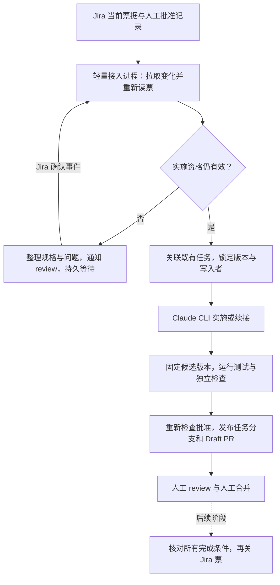

# Plan A：用原生 runtime 接起 Jira 到待审 PR

供用户 review 的规划草案 · 2026-10-16 · 当前状态：只读调查完成，未获实施批准。

建议先选一个已有、能在 Mac 上运行测试的单仓项目，以 **Jira 为唯一工作入口，用一个轻量本地进程接收变化、核验实施资格，再通过 Claude Code CLI 执行**。第一版交付到“测试和证据齐备的 Draft PR，等待人工 review”。人工合并后的核验与关票独立放在后续阶段。Codex 继续作为用户设计质询和 review 的工具；第一版不要求两个模型同时常驻。

本次只创建本文。没有实现服务、修改工程、调用模型进行实验、创建生产票据或 PR，也没有变更全局规则、启动 Plan B 或恢复暂停的 Goal。以下设计、字段、阶段和验证场景均为候选方案；批准这份方向也不自动等于批准所有生产接入和票据实施。

## 1. 哪些已经确定，哪些只是建议

| 地位 | 本计划采用的理解 |
| --- | --- |
| 已确认 | A 线复用现有工程规格与原生 runtime；前期不做大型平台。Jira 记录实施资格，分配票据不代表批准。需要人工 review 和人工合并。A 与 B 独立推进。 |
| 用户报告 | 用户重度使用 Codex App 和 Claude Code，已有长任务成功经验，Claude 实现较符合需要、Codex review 较有帮助；这些经验支持起步取舍，不是本次重验的模型排名或历史工程验收。 |
| 本次查证 | 本地规则、CLI 帮助、部分 SDK／插件源码，以及官方文档支持的接口。查证层级见第 3 节。 |
| 候选建议 | 单项目、单仓、单活跃写任务；Jira 轮询起步；Claude CLI 唯一自动执行入口；本地 SQLite 记录；Draft PR 为首个交付终点。 |
| 待确认 | 真实样板项目、Jira 站点类型与权限、仓库平台、批准人、项目级流程例外、常驻机器及通知方式。未取得这些信息不妨碍完成规划，但会限制真实接入。 |

以 [AI-HANDOFF.md 第 1–3、5–8 节](/Users/yueminjun/WorkPlace/codex/outputs/personal-agent-planning-20261016/AI-HANDOFF.md) 的最新澄清为需求依据。其十六项历史审计关注点是调查线索，不重新认定为当前缺陷，不沿用旧 P0／P1／P2 评级。

## 2. 推荐的最小闭环

### 2.1 样板范围

推荐选“**现有公司项目中一个不依赖真机、无数据库迁移、已有自动测试的普通 bug**”，而非整个蓝牙 SDK 或新的个人 harness。具体项目尚未提供，下文用 `P1` 表示待用户指定的一个项目；这不是新建 Jira 项目或远端仓库的指令。当前 Codex 源码目录只是调查与文档位置，不被选作业务试点。

起步只允许一票、一仓、一任务分支、一 PR、一个活跃代码写入者。第一张真实试点票由人明确批准规格。预授权小修先做影子判定，待规则由人确认、反例验证完成后才开启。多仓、多 PR、自动归并聊天需求、自动建票和跨项目并行暂不进入首版。



推荐先以本地定时轮询发现 Jira 变化，然后把变化转成内部事件。它仍是按事件推进任务，不需要让模型持续等待。这样无需先为 Mac 暴露公网 webhook 地址。建议试点初始轮询间隔 2–5 分钟，属于可调整的运维假设，不是承诺的响应 SLA，也不使用本轮创建的定时任务。若公司已有可信 webhook 接收设施，可替换接入模块，任务状态与资格判断保持一致。

Jira Cloud 官方当前提供增强 JQL 搜索，搜索结果可能滞后；因此搜索只用于发现，启动、续接和发布前直接重新读取目标票与批准证据。不能因为票暂时不在搜索结果里就认定它被取消。首次同步只建立快照；存量票在明确纳入试点名单前不会被批量启动。[Jira 增强搜索](https://developer.atlassian.com/cloud/jira/platform/rest/v3/api-group-issue-search/)

### 2.2 自写的薄层

只实现一个进程中的五个职责：Jira 读取器、资格与状态推进器、持久记录、CLI 子进程适配器、受控发布与通知器。默认用 Python 标准库的进程管理与 SQLite，减少引入设施；若样板项目已采用 TypeScript 或 Go，保持这些边界即可随项目选语言。这是 A 的维护取舍，不替 B 决定语言，也不要求用户先学完 Go。

保留原生 runtime 的工具调用、上下文管理、压缩、skills 和模型接入。薄层不实现自己的模型循环、向量记忆、多 agent 平台、通用插件市场或网页控制台。没有事件时不调用模型。规格整理与代码实现可以调用原生 CLI；去重、锁、重试、判断批准身份和查询 PR 状态由确定性代码完成。

### 2.3 唯一自动执行入口

推荐 **受监督的 Claude Code `-p` 子进程**。每个阶段是有限的一次运行，输出 JSONL，保存会话 ID；后续使用明确 ID 续接，不用“最近会话”。同一入口也可启动独立的只读检查会话，角色和权限分开。Codex 人工辅助 review 仍可使用现有 App；不把它默认为无人值守服务的第二个必须入口。

选择理由是用户已有 Claude 长任务实践，本机 CLI 已存在，官方提供非交互输出和续接；无需先让事件进入当前桌面聊天。下列是未来适配器的命令形态示意，**本轮没有执行**：

```text
claude -p --output-format stream-json --verbose --session-id <预登记的新 UUID>
claude -p --output-format stream-json --verbose --resume <该任务已核对的会话 UUID>
```

实际启动还要显式指定模型／effort、工作目录、允许的工具和权限模式。默认候选为 `dontAsk` 与 `--permission-prompts none`：超出已许可范围的操作留下拒绝证据并转为等待，不因为无人值守而放开全部权限。启动前核验所需 hooks／skills 的实际加载与保护覆盖，不能只看进程退出码。CLI 的这些输出和参数有文档支持，但本机组合尚未试通。[Claude 非交互运行](https://code.claude.com/docs/en/headless)

原生客户端订阅登录不等于通用 API 凭证。后续只在用户授权的原生客户端路径做小额／有限运行，先确认实际计费来源，不能因缺登录自动改用付费 API；不读取、复制或导出原生凭证。官方认证说明表明环境中的 API key 等来源可能优先于订阅登录，本轮没有读取这些值或验证账户。[Claude 认证说明](https://code.claude.com/docs/en/authentication)

## 3. 接口与本地环境：证据到了哪一层

以下分为 **D：官方文档**、**S：本地源码／规则**、**H：本机版本与帮助命令**、**E：真实端到端试通**。本轮没有任何 E 层结果。

| 路径 | 当前支持与证据 | 对 Plan A 的判断 |
| --- | --- | --- |
| Claude Code CLI | D：非交互 JSON／流输出、按会话 ID 续接、权限拒绝与初始化元数据。H：本机 `2.1.301`，帮助中有 `-p`、`--resume`、`--session-id`、`--permission-prompts`。 | 首选。尚未验证账户可用性、当前项目加载的规则、断开后续接或实际代码交付。 |
| Codex CLI／TypeScript SDK | D：SDK 支持启动、继续和恢复本地线程。S：此 checkout 的 SDK 通过 CLI 子进程传递 JSONL，保存 `thread.started` 的 ID；H：本机 CLI `0.162.1`。 | 最重要的替代方案。若试点更适合 Codex，可整体替换 runtime 适配器；不在失败后悄悄切模型并发重做。 |
| Codex Python SDK | D：当前官方 SDK 页称其通过 App Server JSON-RPC 驱动本地 runtime，发布包带固定 runtime 依赖。 | 不再假设只有 TypeScript SDK；本机未确认安装，也没有运行。不是首版必需。 |
| Codex App Server | D：线程／turn、续接、流事件、审批与中断等接口。官方仍提示 App Server 命令和 WebSocket transport 的实验性及生产限制。H：本机帮助标记 experimental。 | 需要自定义交互客户端时再选；现阶段不部署网络监听，也不把“底层协议可用”等同“当前 App 聊天可控制”。 |
| `codex queue` | D：按 UUID 或精确会话名排队文本；S：调用 `thread/queue/add`，检查共享 server 与兼容性，每次 CLI 调用新建消息 ID；H：本机帮助存在。 | 能力存在，但未知当前桌面线程是否在可达兼容 server 上。命令重试不天然带业务去重；本轮没有向任何会话发消息。 |
| Claude Channels | D：研究预览；事件进入运行中的 Claude Code 会话，要求对应认证／组织启用，不能在会话关闭时保证接收。 | 适合后续交互入口；不能替代持久接收、补查和任务账本。未安装、未开通。 |
| OpenAI MCP Events | D：支持 Work web、桌面选择 Cloud 的 Work 和 dots；要求 MCP 2.0，当前集成使用 webhook。 | 不据此推导本地 Mac task 支持同等推送。可作未来云端接入候选，本轮不创建订阅。 |
| Claude Agent SDK | D：Python／TypeScript 包封装原生能力；官方说明第三方产品的 claude.ai 登录／额度使用另有批准要求，起步示例用 API key。 | 不把用户订阅当作自建产品的免费后端。A 首版无需引入该 SDK，也不采购 API。 |

对应官方入口：[Codex SDK](https://learn.chatgpt.com/docs/codex-sdk)、[App Server](https://learn.chatgpt.com/docs/app-server)、[queue](https://learn.chatgpt.com/docs/developer-commands#codex-queue)、[Claude Channels](https://code.claude.com/docs/en/channels)、[MCP Events](https://developers.openai.com/plugins/build/mcp-events)、[Claude Agent SDK](https://code.claude.com/docs/en/agent-sdk/overview)。均于 2026-10-16 读取；本地源码、安装二进制、线上文档不是同一版本发布凭据。

### 3.1 已有插件可复用到什么程度

已发现 `codex-claude-orchestrator` 插件 `1.0.1+codex.20261015112934`，本会话工具目录也暴露 `claude_start/status/decide` 等能力。读取了 skill、guide 和进程启动／恢复相关源码，没有启动插件任务或读取无关历史会话。

可以复用其任务原件保存、运行 ID、进程监督、报告与 patch 分开、事实结果与协调者裁决分开等设计；现有人工 Codex 协调流程也可继续使用它。**不把它直接等同于 Jira 常驻服务**：当前没有找到本流程端到端成功证据，外部独立服务如何调用其 MCP 也未试通。

尤其要保留三项边界：

- `copy` 档保护原仓库和插件状态，但 guide 明示凭证、网络和其他本机路径不隔离；`web=false` 不等于 Bash 无网络。
- `write_hint`、`protected` 用来事后分类 patch，不能当成执行期文件保护。复杂任务仍需按 v2.9 核验批准基线、hook 和沙箱实际覆盖。
- 插件可能在 resume 未成功开始时退回新会话，并记录 `resume_fallback`。业务层必须核对旧执行已停止、资格仍有效和外部操作结果；不能把新会话当成新票，或把 `accepted` 裁决当成人工 review。

依据：[插件 guide](/Users/yueminjun/.codex/plugins/cache/codex-claude-team/codex-claude-orchestrator/1.0.1+codex.20261015112934/skills/codex-claude-orchestrator/references/guide.md:12)、[命令构造与进程监督](/Users/yueminjun/.codex/plugins/cache/codex-claude-team/codex-claude-orchestrator/1.0.1+codex.20261015112934/skills/codex-claude-orchestrator/scripts/bridge.py:235)。

本机 `~/.agents/skills` 仅发现 `wecom-unified`；只读了其用途与入口，未调用消息、认证或安装命令。当前 Codex 根目录没有 `.agents`、`.codex` 或根级 `AGENTS.md`。DeepSeek Harness 的 `.agents` 中存在其他技能，但属于另一工程，未读取其任务笔记或用于本计划。工具目录中存在 Atlassian 读写能力，**仅证明工具可被发现，不证明已连接目标 Jira、可查询正确项目或可供常驻服务使用**。

## 4. 职责与实施资格

### 4.1 谁能决定什么

| 角色／组件 | 职责与边界 |
| --- | --- |
| Jira 与人工负责人 | Jira 是需求和实施资格的权威记录；人批准规格、范围、基线与必要例外。PM 分配只产生待处理事实。 |
| 接入与调度程序 | 收到事件后查当前真相；去重、加锁、核验身份和版本、安排有界运行。不能用模型推断补齐缺失批准。 |
| 原生 runtime | 根据已批准任务理解和实现，提出测试、问题及证据；不能给自己签署人工批准，不能降低正式验收。 |
| 验证运行器／独立检查者 | 对冻结候选跑规定检查；独立审查新增测试及行为反例，核对受保护判据。模型检查结论仍只是工程证据。 |
| 发布器 | 仅按白名单仓库、任务分支和目标分支推送／建 Draft PR；操作前后查资格与真实远端状态。没有合并权限。 |
| 通知器 | 发给已确认的用户／渠道，携带票、当前版本、阻塞和下一动作；去重并记录发送结果。不把通知当成批准。 |
| 用户及团队 reviewer | 实际 review，并由人合并。评论意见进入原任务；评论本身不自动批准新增范围。 |

首版的通知默认建议是“Jira 票内一条可追踪评论＋本机通知”。Jira 是否会送达用户的邮件／移动端依赖实际配置，需试点验证；若需要离开 Mac 仍能收到提醒，再选一个明确渠道，不同时接 Slack、企微和邮件。本轮没有发送任何通知。

### 4.2 实施资格是完整条件，不是一个标签

建议资格判断返回 `eligible / needs_review / blocked` 和具体原因；同时满足以下条件才可开工：

1. 票在已配置项目及允许类型内，且明确进入试点范围；项目映射、工作目录、基线和验收来源均已确定。
2. 必需描述、范围、验收与依赖可用，没有尚未裁决的关键业务问题。
3. 存在当前有效的**人工批准**，或命中已由人批准的**预授权规则**；两者来源分别保存。
4. 批准对应的规格指纹与当前一致，没有撤销、暂停、取消或人工接管。
5. 必需执行权限、验收保护与测试环境已验证；无同一候选的另一写入者。

标签可作为便于用户操作的入口，例如候选 `agent-ready`，但不独立证明批准。建议同时记录批准人的稳定账号、批准时间、批准对象的版本／hash、范围、撤销记录和原始来源链接。服务账号不得作为人工批准人。若 Jira 的字段权限不能区分机器与人，必须校验可信审计记录中的操作者；不能仅依赖标签当前值。读不到批准身份或版本时转 `needs_review`，不让 agent 自行补标签。

规格指纹只覆盖影响工作契约的内容：需求正文、验收标准、明确范围、依赖的规格版本、目标仓库与基线、所采用规则版本及允许例外。普通评论、更新时间或机器人回写不自动改变指纹。首版对受控字段的任何实质变化保守地要求新确认；模型可说明影响，不能自行豁免。引用附件或文档变更也要绑定版本，避免“链接没变，内容已变”。

批准证据仍保留在 Jira 及其引用的规格中，本地账本只做可核验的镜像和执行记录，不能成为另一套人工批准真相源。

预授权候选只限已有契约下的小 bug：复现清楚、范围固定、无需新业务决策，且不涉及权限、支付、迁移、协议或正式判据语义变化。不能以文件数少或模型说“简单”直接通过。规则要带版本、批准人、有效项目与撤销办法；首次上线默认关闭。命中原因写清；不确定则回人工 review。

### 4.3 批准撤销、规格改变与边界竞态

每次取得有效资格时记录一个执行代次 `generation`。撤销、取消、规格变更或人工接管会废止旧代次：未开始的运行不启动；运行中的先请求取消，并确认子进程及其后代停止；旧代次产出保留为过期证据，不能发布或用于关票。

启动、续接、验证完成、推送／PR 写入前均重新核验。等待网络或人员期间不持续持有“永久批准”。监听不能保证瞬间得知撤销；没有 webhook 时存在轮询窗口，运行中本地改动可能继续到下次检查。发现变化后冻结发布，保留差异给人决定是否沿用。

Jira 与 Git 平台之间没有共同事务：即使发布前重查，也可能在远端操作进行时发生撤销。因此还要做发布后核验。竞态导致已经创建的 Draft PR 标为资格过期并通知用户，禁止继续推进；不自动删除 PR、回滚其他人的工作或宣称副作用从未发生。要实现更强的即时阻止，需要目标平台的权限与网关约束，不能靠提示词保证。

## 5. 关联、状态与可靠接续

### 5.1 最小记录

建议一个 SQLite 数据库配每任务的既有进度目录即可。以下是记录职责，并非要求建立同样数量的服务或固定最终表结构：

| 记录 | 必需关联 |
| --- | --- |
| 项目映射 | Jira 租户／项目 ID、仓库身份与平台、允许根目录、基线来源、测试入口、规则与版本、批准人、通知目标、发布权限范围。来源缺失时不猜 `develop/main`。 |
| 逻辑任务 | `(Jira 租户, issueId, 工作范围)` 为稳定身份；key／URL 是可更新的显示信息。外部 issue／聊天 ID 将来映射到它，不能仅凭标题相似自动并票。 |
| 执行尝试 | attempt ID、generation、会话 ID、runtime 与版本、工作目录、代码基线、当前写入者、进程身份、阶段、开始／结束与原因。一个任务可以有多次尝试。 |
| 候选与 PR | candidate ID、base/head commit、工作区差异 hash、分支与 PR ID／URL、规格及规则 hash、验证 evidence ID。 |
| 输入／操作记录 | 来源事件 ID、接收与处理状态；待发送动作的 operation ID、目标、请求摘要、确定成功／失败／结果未知及远端标识。 |

任务进度继续使用项目现有 `PROGRESS.md`；机器状态由调度程序唯一写入，Markdown 只保留摘要、原始要求链接、决定和证据入口，避免再建一套相互冲突的状态真相。未指定项目时不创建该工程目录。

### 5.2 最小状态

主路径为 `needs_review → ready → running → verifying → pr_review`。`ready` 也要在实际启动时重验资格。首版停在 `pr_review`，不把它叫 `done`。

异常可进入 `blocked`，记录类别与恢复条件；用户明确取消进入 `cancelled`。实现中断进入可对账的 `interrupted`，不自动当作失败或重新开票。后续收尾阶段增加 `merged_pending_close → closed`，它们只由远端合并与完成条件的实际证据推进。状态名称是内部候选，不要求现在修改 Jira workflow。

### 5.3 去重与外部操作

- **入站**：重复事件只登记一次；乱序通知只触发重新读当前票，旧事件不能回滚新资格。轮询使用带重叠窗口的持久游标，处理完成后再推进；恢复时还单独补查所有活跃任务，防止取消／改派后从 JQL 结果消失。全量初始同步不会执行存量任务。
- **本地调度**：数据库唯一约束与事务，保证每任务同一时刻只有一个活跃代次／写入尝试。首版再用全局单写任务限制降低共享环境冲突；锁超时本身不证明旧进程已退出。
- **发布前意图**：先持久记录 operation ID、候选 hash 和目标，再做 push／建 PR。成功后保存远端 ID；服务在两步之间崩溃时进入“结果未知”。
- **结果未知**：先按仓库、head 分支、base 分支和操作标记查已有 PR；push 后查远端 ref 的确切 SHA。找到吻合结果才记成功；冲突或查不清则停该操作，不盲目重复创建。已有关闭／合并 PR 也要查，不只查 open PR。
- **回写循环**：自己写的状态评论不产生新实施任务；需要 review 的提醒按“任务＋规格版本＋原因”去重。通知发送结果未知也先对账，不重复轰炸。

目标是“可重投、可对账、业务上不重复开工”，不承诺跨 Jira、Git 与本地数据库的严格 exactly-once。未来采用 Jira webhook 时，官方提供重试保持不变的租户内 webhook ID，可用于接收去重；动态 REST webhook 还需续期。接收后先持久落盘再确认，仍保留补查。具体 webhook 类型与认证方式取决于真实租户，不将 Cloud API 泛化到 Data Center。[Jira webhook 机制](https://developer.atlassian.com/cloud/jira/platform/webhooks/)

### 5.4 失败与恢复

| 情况 | 恢复行为与交付证据 |
| --- | --- |
| 服务重启／Mac 休眠 | 启动后先补查 Jira、进程和仓库。能证明旧运行仍活跃则接管观察；身份不明不杀进程也不开第二写入者。记录中断时间，恢复后重验资格。 |
| 运行进程异常／无 final event | 保存已有 patch、日志尾部、最后事件、真实进程状态。exit 0 也不能替代业务结果。确认停止后再判断能否按原会话 ID 续接。 |
| 会话不存在／无法恢复 | 不扫描无关会话寻找“最像的”；从本任务批准包、进度、代码、证据重建新的会话，仍关联原逻辑任务，显式记录旧新 ID 与原因。 |
| 权限拒绝／登录失效／额度不足 | `blocked`，记录确切动作、目标、拒绝原因、已完成部分和是否确定未执行。不自动提权、换付费 API 或改全局设置。 |
| 断网／Jira、Git 临时错误 | 只对可确定安全的读取使用退避和服务提供的重试提示；外部写入先对账。凭证错误和契约错误不靠高频重试解决。 |
| 测试红／环境失败 | 区分行为反例、测试缺陷、编译错误、环境缺失、跳过和未执行。实现自修最多采用现行协议的一轮，再按证据裁决；同一失败无新增信息就停止。 |
| 人工正在改同一候选 | 暂停该任务并交出写入归属。人完成后记录新 head/diff，再续接；不自动 stash、覆盖或重置。 |
| 不在授权范围内的新需求 | 保存问题与影响，回 `needs_review`；仍独立且已授权的工作可以继续，不拿缺口为理由取消全部已完成成果。 |

重启后核对进程启动时间／身份与进程组，避免 PID 重用导致误杀。取消未确认完成时保留 `cancel_pending` 原因，不能通过启动第二次运行“恢复”。保留原生压缩，不设置“压缩 N 次必须换会话”；真正重建会话时以可核验产物恢复，不能只复制上一轮摘要。

## 6. 复用现行规格时必须处理的具体差异

本轮读取了全局 W01–W12、Orchestration Protocol **v2.9**、dispatch、dev-workflow、github-pr-creator 和判据保护启用说明。它们是不同工作方式的来源；纯规划不会触发 dispatch 开工，本轮也未运行 oracle 登记或写入探针。

| 已读取内容 | 对自动化的实际影响 | 建议的项目级处理 |
| --- | --- | --- |
| dev-workflow Step 7 先批准计划，Step 10／11 人实际 review 后才 commit，Step 12 再确认 PR；PR skill 也要求描述审核后创建。 | 原样照搬会在人离开后停在 commit／PR 之前，达不到“回来有 PR 可审”。 | 在该试点项目的明确授权包中约定：有效的规格批准同时授权约定范围内实现、测试、任务分支 commit/push 和建／更新 Draft PR，人工代码 review 保留在 PR。未批准这项例外时仍按原流程停，不伪造人工 review。 |
| dev-workflow 自动 stash、固定 develop；PR skill 也固定 develop。 | 会扰动已有工作或采用错误基线。 | 按 W04 和 v2.9 不 stash；从明确项目映射取得基线，隔离工作目录。全局 skill 不修改。 |
| dev-workflow 声称 feature PR 创建后不能再更新。 | 本轮未查证它是公司的特殊规则还是历史表述。 | 不把它解释为 GitHub 通用限制；起步沿明确项目分支规则，具体原因待样板项目核实。 |
| v2.9 固定批准基线和协议 hash，保护正式判据，禁止 agent 合并 PR。 | runtime 切换不应丢失原验收与人工边界。 | 每任务记录采用版本与批准集；测试过滤、golden、阈值、skip 配置一并按正式判据保护。规则全局更新不自动改变在跑任务。 |
| dispatch 需要实际工作根目录、批准基线和 manifest 登记；保护说明有历史配置状态。 | “文件存在”“曾经开过保护”不证明新会话保护生效。 | 在试点实际会话验证必需层。历史文档中的“未启用”不能当成当前配置审计结果；本轮未读凭证／全量设置，也未执行 `--list`。 |
| v2.9 可调 dispatch 不得减少覆盖；复杂任务可有独立 review 席。 | 自动恢复不能通过跳测试或增加豁免来成功。 | 简单试点采用经批准的轻量路径；复杂票再按既有 dispatch 执行，不把所有票强行扩成多席位。 |

上述例外需要用户 review，是因为用户要求当前只交规划、未来又需要改变这些明确的项目执行步骤；不是本次读代码或写计划需要额外审批。现行 skill 原文分别写明“代码修改完成后，必须等待用户实际 review 确认”和“在用户明确确认前，绝不创建 PR”。[dev-workflow](/Users/yueminjun/.claude/skills/dev-workflow/SKILL.md:160) · [PR 创建规则](/Users/yueminjun/.claude/skills/github-pr-creator/SKILL.md:210)

项目级例外只覆盖获准的 P1 工作流，不修改全局协议、不降低正式验收、不替其他项目同意。正式启用前列出适用规则及优先级、被替代的具体步骤和保留的约束；不能仅在一次提示词里写“自动批准所有动作”。

## 7. 测试、证据与 PR 交付

### 7.1 验证必须绑定候选

每份证据至少关联：Jira issueId、批准／规格版本、generation、attempt ID、base/head commit、测试时工作区是否干净、命令与工作目录、工具链／依赖锁版本、开始结束时间与退出状态、结果摘要、必要日志及 artifact hash。尚未 commit 的测试记录须带工作树差异／内容身份；发布候选变化后，旧证据不能自动套到新 head。

Bug 应尽量展示同一场景在指定基线失败、在修复候选通过；同时覆盖正常路径和与风险相关的邻近场景。新测试由独立检查者核对预期来自需求，并运行或构造反例；不能只让实现会话写测试后宣布它自己已证明正确。已有正式测试与新增测试的地位分别记录，新增文件不会因进入测试目录就自动成为批准 oracle。

建议最小验证由确定性测试运行器执行现行 gate，再由独立只读会话检查 diff、测试语义、未运行项和规格对应关系。同一 CLI、不同会话可以满足职责分离，但不意味着同模型结论等同于人审。若样板正式规则要求其他独立测试席或真机，照该规则处理；未完成不得标“验证齐备”。

### 7.2 发布条件

只有当前批准有效、写入者已停止修改、候选身份稳定、必需测试与保护检查完成、阻断 finding 已处理，发布器才提交／推送批准的任务分支并创建或更新同一个 Draft PR。若环境不全或失败，只输出本地 review 包；确需发失败的诊断 PR 要有额外明确范围，不能伪装成成功产物。

runtime 仅产出变更和发布请求，不持有 Jira 审批操作能力；推送和 PR 写入由受控发布器完成。实施期须证明 runtime 的实际工具、系统权限、凭证可达性和网络控制不会绕过发布器。现有插件的 copy 沙箱不足以单独证明这一点。若做不到，就先停留在“本地产物＋人工发布”，不宣称首版无人值守发布已经验收。

PR 包含：原票链接、问题与实际行为变化、基线／候选 SHA、规格版本、测试证据、未执行项与原因、已知限制、独立检查结论及人工 review 入口。机器检查写作“自动检查通过／待人工 review”，不写“人工已批准”。PR 评论与修订始终关联原任务：范围内意见进入下一 attempt；范围改变重新走规格批准。

### 7.3 人工合并后的正确关票：后续阶段

首版不自动关票。后续必须同时核实：

1. Jira 对应的全部必需交付项已经完成，所有必需 PR 均由获授权的人合并到正确目标分支；一票多 PR 部分合并不能关闭。
2. 远端 PR 状态确实为 merged，记录 mergedAt、merge commit／最终目标版本；不能仅凭标题含票号、PR closed 或会话 completed。
3. 合并后的检查与项目完成定义满足。若项目要求发布、硬件、下游消费方或业务验收，则继续等待；Draft PR 打开、CI 成功都不能替代这些条件。
4. review 及测试证据对应最终内容。人工额外提交、重写、rebase 或 squash 后须核对内容和实际目标版本；旧 head 证据不能未经说明冒充 merge 后验证。
5. 没有有效撤销、阻断项、未处理的变更要求或未经批准的豁免，Jira 当前状态支持预期 transition。

关票前持久记录关闭意图，再做一次授权范围内的 Jira transition，随后重读 status／resolution。超时先查结果；已关闭则不重复，已被人重新打开则保留人工决定、停止自动关回。PR 未合并即关闭、被撤回或仅部分合并，都不触发关票。重开、revert 和事故处置采用后续明确策略，不自行再次合并或还原代码。

## 8. 分阶段实施、验证与回退

本轮仅完成阶段 0。阶段 1 及之后均须在用户 review 后明确进入实施；各阶段的外部写面如下，不一次性开启全部权限。工作包按依赖排，未获得用户可投入时间、项目规模和环境条件前不承诺日历日期。

| 阶段 | 可观察交付与通过条件 | 外部写入范围 | 回退方式 |
| --- | --- | --- | --- |
| 0 · 本次规划 | 本文；接口／规则证据；明确未知项和选型。 | 无。 | 保留草案，用户修订选择。 |
| 1 · 离线事件与资格原型 | 在未来获准的隔离目录实现记录／去重／状态，使用脱敏 fixture 与假 runtime；证明重复／乱序、批准撤销、规格改变和崩溃不会重复开工。 | 无 Jira／远端写入；无真实模型请求。 | 停进程，保留 fixture 与证据；不影响原项目。 |
| 2 · 真实只读影子接入 | 用户指定 P1 后读取票、批准身份和项目规则；并排展示“会启动／不会启动及原因”，先验证存量票默认不启动；确认部署和通知可达性。 | 默认无；如要测试通知，单独限定一条给指定目标。 | 关闭接入，保留游标与审计，未执行票不受影响。 |
| 3 · 有界原生运行 | 在获准样板／测试仓中验证 CLI 启动、会话续接、拒绝、取消与进程停止；跑一张已批准小票至本地候选，独立检查并核验证据绑定。 | 尚不 push、不建 PR；运行会消耗原生产品额度，事先确认模式。 | 停止本任务进程并保留差异；不重置主工作区。 |
| 4 · 最小 PR 闭环 | 明确批准提交／发布范围和 skill 例外后，对一张票执行至 Draft PR；重复事件不重复发布，审查意见能续原任务。 | 仅 P1 的任务分支、对应 Draft PR 和限定 Jira 状态评论／链接；无 merge、无关票。 | 关闭新任务接收和发布；保留分支／PR，恢复人工流程，不自动删远端。 |
| 5 · 合并后收尾 | 验证完整合并、部分合并、人工改动、失败 CI、重复通知、关票超时及人工重开。先影子建议关票，通过后再启用。 | 独立授权的 Jira transition 与完成证据评论；合并仍由人做。 | 禁用自动 transition；已经错误关闭的票按明确授权纠正并记录，不能偷偷改回。 |
| 6 · 按实际需求扩展 | 仓库 issue／聊天汇入 Jira、webhook、预授权 bug、更多项目；每次只增加一个变化维度。 | 逐项限定。 | 关闭新增入口或项目映射，保留原试点。 |

阶段 1–4 的必要验收情景：

| 输入／故障 | 应观察到的结果 |
| --- | --- |
| PM 新分配但未批准 | 只生成规格整理／待 review 记录和一次提醒，没有实施进程。 |
| 人工批准当前规格；重复送达 | 仅一个活跃任务，批准来源可查；重复事件只关联既有任务。 |
| 旧批准事件晚于新撤销事件到达 | 重读当前状态，仍不执行。 |
| bot 添加 ready 标签 | 不能通过人工批准校验。 |
| 符合／不符合预授权规则的样例 | 影子判定分别保留规则版本、命中和不命中原因；规则未启用时均不自动开工。 |
| 执行中改验收或撤销；旧进程迟到结果 | 旧代次不得发布，取消结果真实记录；不能修改判据去凑绿。 |
| 崩溃发生在创建 PR 成功、落账之前 | 恢复先找到原 PR，不重复创建；不确定时停止该写动作。 |
| 编译／设备缺失、测试失败、跳过 | 分类正确，报告不能标全绿；保留可恢复的本地产物。 |
| 人工修改或换 head 后沿用旧测试 | 阻止把旧证据用于新候选，补做受影响验证。 |
| 成功交付 | 唯一 Draft PR，证据对应实际 SHA，状态待人审，agent 没有合并／关票。 |

服务的总开关需分别支持“停止接新任务”和“暂停发布”；紧急停止还要能取消已知进程并确认终止。关闭接收不等于运行已停。每阶段保存配置版本和数据库迁移前备份，升级时先排空运行；禁止通过清空账本重新开工。

## 9. 本地、云端与速度

本轮遵照用户最新要求在本地环境做规划。A 的起步也推荐本地 Mac 试点，因为既有 CLI、规则和代码就在这里；最终部署尚未决定。Mac 必须保持可运行、必要网络与测试依赖可用。锁屏、休眠、断网和重启需要分别测试，不能将“App 一直打开”当成服务在线证据。

如果用户需要整夜稳定执行而日常 Mac 经常休眠，后续选一台常开的受控机器。迁移前核实工具链、私有仓库／网络、原生登录方式、公司数据规则和样板 gate；不能把本地 `.codex`／`.claude` 凭证目录直接打包搬走。没有硬件依赖的任务才适合优先迁移。

“本地 token 很慢”目前只是用户体验，未做性能归因。本地执行通常仍可能等待远端模型；移到云端不保证生成更快。应在未来获准的同一小任务、模型、effort、上下文和网络条件下，分别记录排队、首个响应、生成、工具启动、构建与测试耗时，并看总完成时间和人工接续次数。本轮没有跑付费性能实验，也不因速度疑问阻塞计划完成。

## 10. 用户 review 时最少需要决定的事项

1. **选哪一个样板项目与一张代表票？** 推荐已有自动测试、无需真机的小 bug。补充仓库／本地目录、Jira 项目与票链接即可；基线、规则和命令可继续只读调查，不要求用户抄全套配置。
2. **谁批准、批准到哪一步？** 推荐先仅由用户批准规格，并明确授权该范围内 commit/push 和创建／更新 Draft PR；人工 review／merge 保留。项目级例外生效前，旧 skill 的等待步骤仍保留。预授权小修先不开启。
3. **运行机器和提醒选什么？** 推荐先用可保持运行的 Mac＋Jira 内记录／本机提醒；若必须离机收到消息，用户指定一个目标渠道。机器不能常开时再决定专用机器；不需要本次就采购云服务。

用户的 Go 水平、每周时间与最终部署选择尚未补充。本计划不据此虚构排期或把 Go 学习作为 A 的前置条件；这些信息以后影响维护分工和推进节奏。未答复上述问题时可以继续完成离线规格讨论，但不能猜实际项目或生产批准人后上线。

## 11. 证据索引与未验证项

### 11.1 本地证据

调查基线：`/Users/yueminjun/WorkPlace/codex`，HEAD `f82e36592278a0a782fb0d0fc97e5fa10e832ac2`。调查开始与写文档前 `git status --short` 均只显示 `?? outputs/`；没有修改既有受跟踪工程文件。没有查询其他任务内容、凭证、聊天历史或恢复 Goal。

| 证据 | 支持的结论 |
| --- | --- |
| [全局 AGENTS](/Users/yueminjun/.codex/AGENTS.md) | W04 基线与保留工作、W06 判据、W09 写入归属、W10 授权、W11 恢复等适用于本次规划与未来任务。 |
| [协议 v2.9](/Users/yueminjun/.claude/protocols/orchestration-protocol.md) 与 [dispatch](/Users/yueminjun/.claude/skills/dispatch/SKILL.md) | 冻结批准身份、按任务固定协议、禁止自动合并、复杂任务执行边界。 |
| [判据保护说明](/Users/yueminjun/.claude/protocols/oracle-protection-setup.md) | 批准基线和具体保护集的接线要求；其中历史状态不证明本机当前已启用。 |
| [dev-workflow](/Users/yueminjun/.claude/skills/dev-workflow/SKILL.md) 与 [PR skill](/Users/yueminjun/.claude/skills/github-pr-creator/SKILL.md) | 三个人工确认点、默认 stash／develop 与无人值守目标的具体差异。 |
| [TypeScript SDK README](/Users/yueminjun/WorkPlace/codex/sdk/typescript/README.md)、[exec.ts](/Users/yueminjun/WorkPlace/codex/sdk/typescript/src/exec.ts:95)、[thread.ts](/Users/yueminjun/WorkPlace/codex/sdk/typescript/src/thread.ts:106) | CLI／JSONL 封装、resume 参数、线程 ID 记录；不是本机 SDK 调用成功记录。 |
| [queue CLI](/Users/yueminjun/WorkPlace/codex/codex-rs/cli/src/queue_cmd.rs:30)、[queue 实现](/Users/yueminjun/WorkPlace/codex/codex-rs/tui/src/session_queue_commands.rs:27) | server 发现、兼容性错误、`thread/queue/add` 与每次新消息 ID。 |
| [插件 skill](/Users/yueminjun/.codex/plugins/cache/codex-claude-team/codex-claude-orchestrator/1.0.1+codex.20261015112934/skills/codex-claude-orchestrator/SKILL.md) 与第 3.1 节源码 | 原话／输入证据、运行与裁决分离、copy 权限边界、恢复行为。 |

本次读取时的 SHA-256，供以后核对规则是否变化，不代表冻结未来任务：

```text
~/.codex/AGENTS.md
f1abf1daef3a24bd48367db271787c052b3d9e4d29ab69d0fcf4456a13de069d
~/.claude/protocols/orchestration-protocol.md
63479da00c8cf9a2467d0efe860fe327a364fb51b7592eece18266319cd6a17b
~/.claude/skills/dev-workflow/SKILL.md
b3539db291242c891033f26f7d9e95f66302bb933cddb5cff4ed939590f008da
~/.claude/skills/github-pr-creator/SKILL.md
ef1cc1c27d04849f92a041952e38da38c3b2a2667fb33354949d28c72474fdce
```

实际执行的运行时检查仅为 `command -v`、`codex --version`、`claude --version`、`codex queue --help`、`codex app-server --help`、`claude --help`。Codex 帮助／版本命令返回成功，但提示自动创建 PATH aliases 时遇到 `Operation not permitted`；未为此提权或修配置。它不影响读取帮助，也不是模型运行成功的证据。

### 11.2 尚未验证，不应在实施中默认为真

- 样板项目、正式基线、构建／测试入口、Jira Cloud 或 Data Center、真实字段与批准人、PR 平台及仓库策略。
- Jira／仓库／通知账户的实际连接和最小权限；工具目录中有能力不等于未来本地服务可复用同一认证。
- Claude／Codex 当前登录、模型可用性、实际计费来源、组织策略、CLI 无人值守组合、hook／沙箱加载以及必需正式判据保护。
- 当前桌面任务能否接受 `codex queue`；没有调用 queue、App Server RPC、Channels 或 MCP events 进行注入试验。
- 服务重启、子进程取消、会话恢复、重复／乱序、撤销竞态、未知外部结果与 PR 交付的集成行为。
- 人工合并后各种场景的关票条件与 transition；本轮只给设计与未来验证用例。
- Mac 睡眠／网络可用性和所谓本地 token 慢的原因；没有速度比较或吞吐承诺。

规划阶段无剩余阻塞。真实实施目前处于**待用户 review 与项目补充**，没有已经批准却被拒绝的工程／外部写入操作，也没有结果不明的生产操作。后续若受阻，应按“具体动作、目标、原因、已完成部分、被拒绝／待确认／结果未知”记录，不通过更换入口绕过限制。
