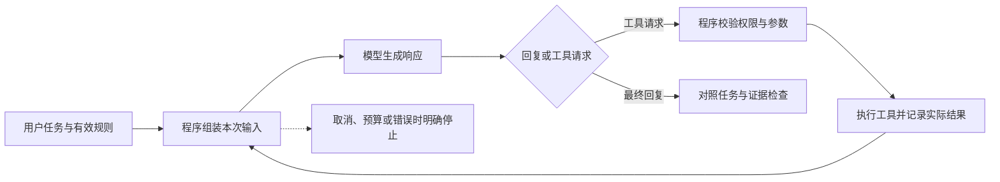

# Plan B：边学边做个人多用途 Harness

日期：2026-10-16。状态：**用户已认可学习路线整体方向；已按本轮反馈更新语言背景与客户端方向。单元细节仍可调整，未启动实施或模型实验。**

建议从一个 Go 命令行小程序开始，分两步看清“一次模型请求”和“模型请求工具、程序执行、结果返回模型”。先用公开或合成资料完成一个资料问答任务，再把相同机制迁移到代码阅读。这样从第一单元就服务于多用途个人 agent，同时保持每次要理解的机制足够小。

学习过程固定保留你的设计和动手位置：**必要概念与少量资料 → 你先设计 → Codex 质询 → 你修订并动手关键机制 → Claude 辅助实现、首轮讲解 → 先预测再运行对照 → Codex 独立 review、补充教学。** 哪个机制由你写、哪些代码由 Claude 完成，逐单元确定；不规定手写比例，也不提前冻结完整架构。

本计划只完成 B 线。Plan A 不需要等 B 成熟，B 也不以替换现有工具或证明更便宜、更快为开工条件。用户已认可 U 系列路线整体没有大问题；接下来按需补齐首单元条件，后续细节继续随实际学习调整，不必重复确认已认可的总体方向。

## 1. 确认范围与当前事实

| 地位 | 本计划采用的内容 | 对安排的影响 |
| --- | --- | --- |
| 已确认方向 | 多用途个人 agent；coding 是一种能力；倾向 Go，允许模块采用其他语言 | 共用机制围绕请求、工具、上下文、运行状态设计；不把 Jira、Git、PR 塞进所有日常任务 |
| 最新确认的语言背景 | 用户主要使用 Kotlin，目前不会 Go；语言学习不构成本规划的阻塞 | 用熟悉的 Kotlin 概念帮助理解，Go 差异在具体机制中按需补，不另设完整语言课程作为门槛 |
| 最新确认的产品方向 | 后续希望区分运行能力与 CLI、TUI／UI 等客户端 | 建议让不同客户端复用同一运行内核；具体协议、进程划分、UI 技术栈留到设计时决定 |
| 已确认学习方式 | 用户先构思、接受质询、修订并实际动手；Claude 辅助实现与首轮讲解；Codex 质询、独立复核和增量教学 | AI 不先交付完整设计与代码，再用事后讲解替代学习过程 |
| 用户报告 | 已有 DeepSeek、Gemini API；有 Codex、Claude 订阅；既有工作流和长期工程实践有效；正常模式下感觉 token 很慢 | 可以规划后续真实 API 实验；本轮没有核验账号、余额、历史工程或慢速原因 |
| 候选建议 | Go、本地 CLI、资料问答、先一家模型、先可控回放再少量真实请求 | 都是方便开始的默认值，允许你的初版设计提出有依据的替代 |
| 待确认 | 真实样板任务、未来工程路径、API 所属服务及可用模型、实验预算、最终部署地点；可用时间按学习过程调整 | 不阻塞本规划；仅在依赖这些条件的实施或付费调用前补齐，不再询问已明确的语言背景 |

需求依据是已完整读取的 [AI-HANDOFF.md](./AI-HANDOFF.md) 第 1–2、4–8 节、本活动的只规划授权，以及 2026-10-16 用户对本计划的上述反馈；最新反馈优先。旧咨询中的“所有核心必须手写”“缺少 API”“Codex 默认主导”均不再作为要求。“75–85 分”保留为实用质量愿望，当前没有量表，不能变成验收承诺。

本机的已保存项目 **harness** 对应 `/Users/yueminjun/WorkPlace/codex`，由项目列表只读核对确认。这个名称和目录并不代表未来 Go 工程已经选定：当前目录是 Codex 源码研究材料，本次唯一写入文件是本计划。未来建议另选隔离的学习工程目录；实际路径由你确认后再创建。

本轮观察到：当前执行 shell 中 `command -v go` 无输出，`GOTOOLCHAIN=local go version` 返回 `command not found`。这只说明该 shell 的 PATH 无可用 Go，不能证明整台 Mac 未安装；后续先核对安装位置与兼容版本，再决定是否安装。本轮未安装依赖或运行仓库测试。

## 2. 首单元：让一次工具往返可以被解释和验证

**建议任务。** 给定少量公开或合成的规则笔记，回答“新旧规则有什么冲突，结论依据是哪一份材料”。工具先按资料标识返回指定内容和版本信息，避免首课同时引入任意文件访问、外部搜索或真实业务写入。题材可以换成你熟悉的 SDK 规则、个人学习笔记或项目说明；工具数量由你的任务设计决定。

第一小步只发一次模型请求，观察真正发出的输入、收到的响应、错误和用量。第二小步让模型提出工具请求，由程序校验并执行，再把结果送回模型。最终回复与“任务确实完成”分别判断。只运行一条成功路径不算工具循环已被验证。



这是教学信息流，不是模块目录、类图或最终接口。首单元不需要数据库、插件系统、多 agent、常驻调度、GUI、向量库或自动压缩。也不需要先读完一个成熟 harness。

**你先交什么。** 用半页文字、图或伪代码回答以下问题即可，AI 不先填好答案：

1. 用户输入、有效规则、工具定义与历史分别从哪里来，模型这次实际看见哪些？
2. 模型提出工具请求后，谁负责校验、执行、保留结果，下一次请求要带回什么？
3. 一次调用、一次循环步骤、一次用户任务怎么区分？什么时候结束，谁决定停止？
4. 资料不存在、参数不合法、模型反复请求同一资料时，程序怎样表现？
5. 你准备亲手实现或修改哪一段机制；预测一个正常轨迹和一个失败轨迹。

Codex 首轮只追问影响当前目标的两三处缺口，例如：“工具调用 ID 与结果配错会怎样？”“回复写着已经完成，实际没有执行工具怎么办？”“模型一直请求工具时谁约束总开销？”先给反例，必要时给提示。你修订后，有可实施方案就进入动手；非阻断问题留到后面，避免一直扩题。

**首单元候选完成证据。** 一份你的初版与修订理由、一处你亲手完成的有意义机制、一份可运行版本，以及正常结束、工具失败、程序主动停止的轨迹。控制流先用手工构造响应验证；后续授权的小额真实调用确认实际接口与模型行为。模拟通过、真实 API 通过、任务质量通过三者分别记录。

## 3. 技术起点与模型接入取舍

建议 Go 承担首版 CLI、请求发送、工具执行、取消和轨迹记录。先使用能看见请求与结果的薄调用层；HTTP/JSON 学习与 agent 循环学习可以分开，Claude 可辅助 HTTP 样板、错误解析和打印。无需为“学习”重新实现 TLS、完整 SDK 或每个底层库，也不先创建面向所有厂商的巨大接口。

你的 Kotlin 经验可用于表达设计、画流程和写初版伪代码。实现时按需解释 Go 的错误处理、接口、资源生命周期与并发取消等差异，不把语法熟练度当作 harness 理解程度。AI 可以辅助转换和样板；你动手的重点仍是当前机制及其可观察行为。

**运行内核与客户端的长期方向。** 建议让 CLI、TUI 和未来图形／Web 客户端共用运行内核。内核负责模型循环、工具执行、上下文、权限和运行状态；客户端接收用户输入、展示进度与结果，并把取消或人工决定送回内核。执行是否获准仍由内核落实，不依赖某个界面按钮是否隐藏。

```text
CLI：命令、参数、脚本输入输出 ─┐
TUI：终端中的交互界面       ├─ 运行内核 ─ 模型、工具、上下文与状态
图形／Web 等客户端         ─┘
```

这里是职责方向，具体边界仍由你在单元设计中提出。TUI 是终端 UI，CLI 命令也可以启动 TUI；它们不一定是不同程序或仓库。首版可以在同一 Go 进程中保留清楚的调用边界，先让命令行入口调用内核、接收运行事件即可。需要独立桌面客户端或远程访问时，再决定是否增加本地服务、进程间通信或网络 API，不从第一课开始搭完整前后端。UI 也不必使用 Go，届时可以根据平台使用你熟悉的语言和框架。

客户端开发可在 U1／U2 的基本循环与运行事件稳定后，按实际交互需求插入一个小单元；不必等全部 U 单元结束，也不作为当前起步前置条件。届时仍由你先设计命令和事件，Claude 辅助界面实现，Codex 检查不同客户端是否复用相同执行规则。验证重点是同一任务通过不同入口时得到一致的运行语义，而不仅是界面能显示文字。

**起步默认推荐 Gemini，DeepSeek 紧随其后。** 理由是本次能够核对到 Google 官方 Go SDK 及完整 function calling 往返文档，便于把时间放在控制流。若你的 DeepSeek 接入实际更顺手，取得当前工具调用契约后可以交换顺序。这个推荐依据是资料可获得性和 Go 起步便利，不是质量、速度、价格排名。Google 官方列出的 Go SDK 为 `google.golang.org/genai`；正式实施时仍需记录选用的版本与 API 路线。[Google SDK 文档](https://ai.google.dev/gemini-api/docs/libraries)

Gemini 当前 function calling 文档示例包含 `function_call`、带 `call_id` 的 `function_result`，并展示服务端接续与手工历史方式。教学时优先选择能观察完整往返的方式，先理解历史由谁维护，再研究便捷会话封装。不要将不同 API 的字段混合。[Gemini function calling](https://ai.google.dev/gemini-api/docs/function-calling)

DeepSeek 官方首页当前提供 OpenAI／Anthropic 兼容的接入入口与非流式请求示例，支持从透明的 HTTP 请求入手；使用兼容协议不要求采购 OpenAI／Anthropic API。旧 `guides/tool_calls` 页面本次抓取超时，Anthropic 兼容接口子页也未取到正文。因而本计划不把旧工具字段、strict 模式或思考内容回传要求定为已核验事实；实现 DeepSeek 工具循环前需要按所选模型与端点补查。[DeepSeek 首次调用文档](https://api-docs.deepseek.com/)

模型接入开始前，只确认非秘密信息：服务商或代理来源、模型标识、API 路线、单次实验允许的请求/输出/时间/费用范围。密钥由你通过本地受保护配置提供；不贴进计划，不读取原生订阅客户端凭证，不把 Claude/Codex 订阅当通用 API 额度。本轮没有尝试读取或验证任何密钥。

每次真实实验卡写明目的、所用材料、模型与配置、预期调用链、停止条件、预算上限及预计返回证据。请求次数、输出上限、总时长、重试都计入同一实验范围；具体数值由首单元设计与预算共同决定，不先冻结全项目循环上限。没有预算确认时可以继续纸面设计和离线回放，不自动发起真实调用。费用记录采用服务方实际 usage/账单可得数据，未知项写未知，不伪造精确成本。

**原生 CLI 编排与自建 runtime 的学习收益不同。** 本地 Codex TypeScript SDK 通过 CLI 子进程与 JSONL 事件工作；它适合研究启动、续接和外部观测，内部循环仍由原生 runtime 管理。自己直接调用已有 API，才能亲手决定上下文、工具校验、循环与停止。前者可作为后续能力适配器，不替代首单元内部机制练习。依据：[SDK 说明](/Users/yueminjun/WorkPlace/codex/sdk/typescript/README.md:1)、[Thread 调用实现](/Users/yueminjun/WorkPlace/codex/sdk/typescript/src/thread.ts:65)。本轮没有启动 CLI 任务或验证订阅下的程序化调用资格。

## 4. 依赖顺序与每单元的职责

下面是一条可调整的学习路线。首单元决定最小数据形态，后续用失败案例推动抽象。每一行都遵循前述完整学习流程；“用户动手”是建议的机制选择，不是强制所有核心手写。“Claude”均指未来实施阶段的辅助，本次未调用 Claude。

```text
U0 选择样板、准备 Go 与首版设计
  → U1a 一次请求 → U1b 工具循环 → U2 生命周期与失败
                                      ├→ U3 上下文选择
                                      ├→ U4 权限与执行边界
                                      └→ U6 第二模型适配
                         U2 + U3 + U4 → U5 持久化与恢复
                         U3 + U4 + U5 + U6 → U7 第二类能力
                         U5 + U7 → U8 按需求扩展协作与部署
```

U3、U4、U6 的先后可按兴趣调整，不表示同时开多个学习任务。U1 已包含基本输入校验、工具允许范围、取消与有界运行；U4 是深化这些机制，不能等到 U4 才开始限制执行。真实副作用能力至少依赖 U4，并需明确操作结果未知时的恢复策略。

### U0：把学习题目和环境缩到可开始

- **必要概念与资料：** 以已有 Kotlin／软件开发经验为起点，仅补当前例子需要的 Go 表达与错误处理；JSON、函数等熟悉内容直接跳过。旧教材第一课按需阅读，不以完成整套 Go 课程为前置。
- **你先设计与动手：** 选一个熟悉的小任务，先用图、文字或 Kotlin 风格伪代码表达输入输出；后续在 Go 中跑通并修改实际机制，必要时由 Claude 协助语法。U0 是起步准备，不单独考核语言熟练度。
- **AI 职责：** Codex 检查题目是否同时塞入过多机制；Claude 可在获准实施后协助环境和样板。AI 不替你选择全部产品功能。
- **软件验证：** 在选定目录可重复运行、错误能被观察；记录工具链版本。**理解验证：** 你能说出哪些工作由程序做，哪些由模型做，API key 为什么不同于订阅登录。产物是样板说明与待修订初稿；本轮未执行。

### U1a／U1b：一次请求与工具往返

- **必要概念与资料：** 本次上下文、响应、工具声明、参数、调用 ID、工具结果、终止。资料最多选旧教材相关段落和一家官方 API 示例；源码在你先形成设计后再看。
- **你先设计与动手：** 按第 2 节提交初稿；建议亲手写或实质修改“响应分类 → 工具执行 → 匹配结果进入下一轮”中的关键一段，并说明数据怎样变化。工具数量和数据结构由你的设计提出。
- **AI 职责：** Codex 用缺失结果、未知工具、无工具回复、持续请求工具等反例质询；Claude 辅助 SDK/HTTP 样板、夹具和首轮讲解。写完后 Codex 直接检查实际代码和轨迹，不仅阅读 Claude 的总结。
- **软件验证：** 用构造响应覆盖正常结束、非法参数、未知工具、工具错误、停止上限；校验失败不执行工具。真实调用另证服务可用与调用往返。**理解验证：** 你能不看实现画出两次请求之间新增了什么，预测去掉工具结果会出现哪类问题，并把资料问答迁移到只读代码解释。产物是第一条完整可追踪运行。

### U2：生命周期、取消、失败与可观察性

- **必要概念与资料：** 用户任务、运行尝试、单步、工具操作；请求已发出与结果已确认的区别。Go `context` 用于传播 deadline、取消信号，不能被当作自动回滚机制。[Go context 文档](https://pkg.go.dev/context)
- **你先设计与动手：** 自己画运行状态与终止原因；选择取消传播或错误分类作为动手点。先预测“等待模型时取消”和“工具正在工作时取消”有什么不同。
- **AI 职责：** Codex 追问取消后是否还有在途操作、超时能否安全重试、谁负责关闭资源；Claude 协助事件记录、模拟延迟与首轮讲解。流式输出可拆成 U2 的下一小节，不与所有错误场景一次加入。
- **软件验证：** 可控延迟下取消能收束；工具错误、模型/API 错误、解析错误分开；重复重试有界；不完整工具参数不执行。**理解验证：** 你能根据轨迹定位层次、说明“超时不代表外部一定没做”，预测流式半截 JSON 的处理。产物是失败分类与能重现的一组小轨迹。

### U3：上下文选择，随后才是摘要与压缩

- **必要概念与资料：** 存下的信息、检索出的信息、进入请求的信息、仍有效的信息是四回事。先比较保留历史与简单选择，遇到确切容量或相关性问题再试摘要。
- **你先设计与动手：** 写清哪些规则始终要保留、哪些旧内容可丢、矛盾如何判定；亲手修改一次选择逻辑，运行前预测哪些依据会消失。存储方式与压缩算法暂不冻结。
- **AI 职责：** Codex 给“旧摘要与新规则冲突”“工具请求和结果被切断”的反例；Claude 辅助统计、请求预览和摘要样板。原始证据、有效规则和摘要的关系由你解释。
- **软件验证：** 请求预览与实际发送一致；来源版本可追溯；工具配对保留；旧规则不会因被摘要而变成当前授权。**理解验证：** 你能区分遗漏、过期、检索失败与模型未用对资料，并设计区分它们的对照。产物是上下文选择版本与前后对照，不以“token 变少”单独验收。

### U4：权限在执行处生效

- **必要概念与资料：** 工具可见、请求通过校验、获准执行、执行成功不是同一状态。提示词说明可帮助模型选择，但实际执行者仍要检查参数与授权。
- **你先设计与动手：** 先把资料标识工具扩为限定工作区的只读读取，写明允许目标；亲手实现或修改路径范围/参数校验中的一项，并预测越界请求。引入写入时另明确目标与回退范围，不一次开放通用 shell。
- **AI 职责：** Codex 追问替代入口、路径规范化、符号链接以及工具内容中夹带操作指令的情况；Claude 辅助测试夹具和错误输出。系统沙箱与应用校验分别说明覆盖，不能用“有权限类”代替生效证据。
- **软件验证：** 经真实执行入口检查合法读取与越界拒绝，拒绝后验证目标未被操作；允许和拒绝都留可理解记录。**理解验证：** 你能解释模型建议、用户授权、运行器策略各由谁负责；能迁移到“可生成邮件草稿但尚无发送授权”的场景。产物是小而明确的权限约定与正反例。

### U5：可解释的持久化与恢复

- **必要概念与资料：** 会话历史与任务状态、工具结果与外部效果、持久化成功与仅打印日志的区别。先支持单运行恢复，再考虑并发写入或数据库选择。
- **你先设计与动手：** 画出“执行前记录、执行、执行后记录”的中断位置；选择一个恢复判定或持久化提交点作为动手机制。思考哪些操作能重放，哪些必须查询外部结果，哪些需要停下。
- **AI 职责：** Codex 用结果未落盘、记录截断、重复恢复、已暂停任务等反例质询；Claude 辅助存储读写与故障注入。不得把真实未知结果改写成成功或当作从未执行。
- **软件验证：** 在已知中断点重新启动，恢复同一任务而非重复创建；没有确定安全性的操作不盲目重放；暂停状态不会仅因重启自动继续。**理解验证：** 你能解释为什么不能仅靠“重试一次”保证恰好执行一次，能指出恢复需要的外部证据。产物是恢复说明、版本化记录和中断对照。本单元不会恢复本机任何既有暂停 Goal。

### U6：第二家模型与适配边界

- **必要概念与资料：** 共同语义、厂商请求/响应、能力差异、usage、流式事件和不透明的续接元数据。Gemini 官方资料明确区分 Interactions 与 generateContent 中思考签名的承载方式；不可粗暴只保留文本，也不把签名当可解释教学材料。[Gemini thinking](https://ai.google.dev/gemini-api/docs/thinking)
- **你先设计与动手：** 先对照两家实际请求/响应，再决定需要哪些公共类型与厂商保留字段；亲手完成一个映射或能力不支持的显式处理。不先追求无损转换所有历史。
- **AI 职责：** Codex 质询“兼容协议是否等于所有语义相同”“切模型后旧历史是否仍能用”；Claude 辅助第二接入与讲解。模型无法支持的功能明确返回或另行设计，不静默吞字段。
- **软件验证：** 同一确定性工具场景在两个适配器的离线夹具中满足相同控制流约定；真实请求分别验证，记录语义、延迟和用量差异。**理解验证：** 你能说明故障属于转换、历史构造还是模型选择，并提出有效对照。产物是实际差异表与最小适配界面，不是模型能力排名。

### U7：加入第二类个人能力

- **必要概念与资料：** 任务完成条件、能力描述、产物、权限、错误与来源；MCP、skill、插件是可以评估的接入形式，不自动提供授权或质量保证。
- **你先设计与动手：** 根据首个真实样板选择另一类任务，例如从资料问答扩为代码只读解释，或从资料整理扩为表格分析。先定义输入、产物与判断依据，亲手完成能力契约的一项关键变化。
- **AI 职责：** Codex 判断哪些机制确实可复用、哪些属于业务差异；Claude 辅助格式处理和适配。接入外部系统前，先用本地样本验证同样的信息流。
- **软件验证：** 两类任务共享必要 runtime 机制，各自满足完成条件；旧任务回归不退化。**理解验证：** 你能说明为什么文档整理不必经过 Jira，为什么某能力不应直接拥有全部工具。产物是第二类能力与真实任务评估卡。开源前再核查实际采用依赖与代码的许可证，本次没有完成许可证审计。

### U8：有证据再加入多 agent、后台运行与部署

- **必要概念与资料：** 进程并发与协作质量、任务归属与结果验证、监督者与运行尝试。先找单 agent 确有不足的任务，再比较拆分收益。
- **你先设计与动手：** 提出一个能独立验证的子任务及交付约定，亲手实现或修改取消传递、唯一写入者或合并结果中的一项。先纸面比较单运行和委派，不默认多 agent 更优。
- **AI 职责：** Codex 追问信息损失、重复工作、写入冲突、失败上报和总成本；Claude 辅助进程管理、运行包装与首轮讲解。没有独立收益就保留单 agent。
- **软件验证：** 子任务失败/取消可被观察；共享产物不被并发覆盖；最终结论核对原始证据。后台部署前验证重启、网络中断和暂停语义。**理解验证：** 你能解释新增协作在当前任务中带来的收益和代价，并据此选择 Mac、常开主机或云端。产物是小范围对照和部署决策；本轮不建立服务。

## 5. 怎样让软件进度与学习进度各自可信

一个单元可以“软件通过、理解待补”，也可以“解释正确、实现仍失败”。这两种情况记录后分别处理，不让 AI 继续堆功能来掩盖理解缺口，也不因一次术语回答不流利而重做所有代码。

| 观察面 | 需要的证据 | 不足以说明通过的材料 |
| --- | --- | --- |
| 软件行为 | 指定版本、输入、命令/配置、实际输出、失败与停止状态；能区分错误实现的反例 | 只有编译成功、AI 自述完成、只照抄实现预期的测试 |
| 用户理解 | 运行前预测；能画信息流、定位失败责任、解释偏差；完成一个相邻场景迁移 | 仅听完讲解、复述术语、把成功结果当作原因 |
| 任务质量 | 对事实依据、完成条件、需要人工纠正之处逐项查看；累计熟悉任务的小样本 | 将一次满意回答当作稳定质量，或虚设 75–85 分阈值 |
| 推进成本 | 实际学习用时、返工、重复讲解、模型请求与工具耗时、可得 usage | 只比 token 输出速度或代码行数 |

Codex 的独立 review 接收任务目标、你的设计演变、真实 diff/版本和运行证据；先自行检查，再核对 Claude 的说明。关注“触发条件—行为—后果—证据”。有新发现才补充教学，没有重要增量就简短确认。正式已确认验收不因实现失败被改低；设计中的临时假设可依据新证据修订并说明。

首单元可拆成三次会话：概念与初稿、质询与实现、运行对照与复核。暂用每次约 30–60 分钟作为可调整的组织建议，不是课时承诺；按真实可用时间与当次遇到的语言差异调整拆分，不将不会 Go 视为规划阻塞。第一次结束后依据实际吸收和用时调整，不承诺固定周产出。停在“设计已形成、待实现”也可以接续，不必为赶进度由 AI 包办。

## 6. 源码与资料怎么读：每次只追一个问题

旧教材用于建立概念；官方文档用于核对实际 API；成熟源码用于寻找反例与工程取舍。建议每单元先读一小段概念、写自己的设计，再读一个相关实现片段。下面是按需索引，不是入门前必须读完的清单；本轮只做了对应片段静态阅读，没有编译或运行这些实现。

| 单元 | 入口 | 只追这个问题 |
| --- | --- | --- |
| U0–U1 | [已有第一课](/Users/yueminjun/.codex/worktrees/2063/engine-context-state/docs/learning/01-model-and-agent.md:1)；[学习目录说明](/Users/yueminjun/.codex/worktrees/2063/engine-context-state/docs/learning/README.md:1) | “已保存”和“模型这次可用”有什么差别，工具是谁执行的？旧时间估算不作为本计划承诺 |
| U1–U2 | [DeepSeek Harness 的单步处理](/Users/yueminjun/WorkPlace/deepseek-harness/packages/core/agent-loop/src/agent.ts:400)，重点看请求发送及响应完成后的工具分支 | 程序在哪一步保存模型消息、区分结束与工具调用？ |
| U2 | [工具调度 executeToolCalls](/Users/yueminjun/WorkPlace/deepseek-harness/packages/core/agent-loop/src/tool-calls.ts:60)；[Tianshu 不完整参数拒绝](/Users/yueminjun/WorkPlace/Tianshu-harness/src/agent/tool-pipeline.ts:703) | 工具尚未开始、已开始和已结束能否使用同一种取消结果？不完整参数为什么不能执行？ |
| U2、U8 选读 | [Codex run_turn](/Users/yueminjun/WorkPlace/codex/codex-rs/core/src/session/turn.rs:164)，关注 `needs_follow_up`；[工具运行器](/Users/yueminjun/WorkPlace/codex/codex-rs/core/src/tools/parallel.rs:38) | 下一步是否仅由模型决定？上下文和取消为什么要跟随相应步骤？ |
| U3 | [Codex history 规范化](/Users/yueminjun/WorkPlace/codex/codex-rs/core/src/context_manager/history.rs:966)；[DeepSeek 压缩区域类型与事务入口](/Users/yueminjun/WorkPlace/deepseek-harness/packages/compaction/compaction-basic/src/region.ts:1) | 削减历史时哪些配对和版本关系必须保留？后者本轮仅查阅开头类型与责任说明，实际提交过程待到本单元追查 |
| U4 | [Tianshu 工具执行入口](/Users/yueminjun/WorkPlace/Tianshu-harness/src/agent/tool-pipeline.ts:672) | 参数、别名与执行限制在什么顺序处理？这里只作机制参照，未完成权限安全审计 |
| U5 | [Tianshu 会话选择](/Users/yueminjun/WorkPlace/Tianshu-harness/src/agent/session-recovery.ts:97)；[持久化 revision 定义](/Users/yueminjun/WorkPlace/deepseek-harness/packages/session/session-persistence/src/revision.ts:1) | 显式恢复与自动继续如何区分，如何识别记录版本？实际持久化提交与崩溃恢复仍需后续跟读 |
| U6 | [DeepSeek serialize](/Users/yueminjun/WorkPlace/deepseek-harness/packages/llm/llm-deepseek/src/serialize.ts:56)，重点看工具 ID 校验与 native replay 数据保留 | 公共消息怎样变成厂商消息？本地仓库实现不是你账户所用 API 的最终规范 |

本次源码快照：Codex `f82e36592278a0a782fb0d0fc97e5fa10e832ac2`；Tianshu `05cef587f24157360059e62cd7ed7146cbb87c86`；DeepSeek Harness `d743267388641bc76f17c45ce8b4c231aed1d32c`。这与交接记录一致，不代表远端最新版本。两份参考 harness 在调查时 `git status --short` 为空；Codex 已有未跟踪的 `outputs/`，因此保留现有内容，只新增自己的文件。

源码静态观察支持以下安排：DeepSeek 的步骤实现明确把模型回复和工具执行相接；Tianshu 在工具参数流不完整时拒绝执行，并为缺结果的工具请求补错误记录；Codex 在历史规范化时处理调用/结果配对。它们共同说明“成功回复、工具执行、有效历史”需分开学习；不证明本地项目已被完整验收，也不要求照搬这些成熟系统的全部复杂性。

## 7. 规则适用与跨会话接续

本轮已读取全局 [AGENTS.md](/Users/yueminjun/.codex/AGENTS.md)、[编排协议 v2.9](/Users/yueminjun/.claude/protocols/orchestration-protocol.md)，以及两个参考仓库的根规则、DeepSeek `packages/AGENTS.md` 和相关 `.agents/skills/dsh-code-review`、`dsh-error-handling`。后两项用于理解该仓库的 review 与失败语义，没有启动 PR 审查流程或外部咨询。表达采用 [technical-report-writing](/Users/yueminjun/.codex/skills/technical-report-writing/SKILL.md)。

当前 Codex 根目录、输出目录及已检查父目录未发现额外 AGENTS.md；当前仓库没有 `.agents/`。Tianshu 没有 `.agents/`；DeepSeek 有上述相关 skill。Codex 仓库发现的两个局部 AGENTS.md 位于本次未进入的 TUI bottom_pane 与 exec-server sandbox_integrity 子目录，不支配本次输出文件。其他技能、测试夹具中的规则和无关会话未作为当前任务输入。

全局 W04/W06/W09/W10/W11 的实际约束在这里是：保留基线与他人工作、不降低已确认判据、明确写入者、只在当前规划授权内工作、按任务接续。v2.9 的 delta/dispatch、基线 gate 等用于正式执行计划；本轮是规划文档，不制造已批准 delta，不复制协议进未来工程，也不为了写计划创建 worktree 或运行工程 gate。未来是否采用完整编排规格，按真实工程复杂度和届时适用规则决定，不把所有个人事务变成多席位工程任务。

**接续方式建议。** 当前规划阶段，本文件就是 B 线入口，不另设重复进度文档。实施获准后，在选定学习工程中沿用一个任务级 `PROGRESS.md`，各单元保留设计与证据引用；如果项目已有目录约定就沿用。Claude 与 Codex 共用同一入口，一个候选同一时间明确一位写入者，不分别维护互相冲突的“真相”。

每次会话结束只更新发生变化的内容：

- 当前单元、目标与尚未做的部分；软件状态与理解状态分别写。
- 你的初版设计及修订理由；已确认决定、候选建议、已否定方案及原因。
- 实际代码 commit；未提交时用准确 diff/文件摘要标识。记录模型/SDK/配置、夹具版本与运行编号，不记录密钥。
- 预测、实际观察、解释修正、review 结论；未运行、环境失败、行为失败与通过分开。
- 当前写入者、仍在运行的真实任务 ID（若无则写无）、下一次只做的一小步、授权与预算边界。

恢复时先读规则与这个入口，核对真实工作区和对应证据，再让你用几句话说出上次的关键机制。回答已熟练就进入新内容，含糊处只补那一段；不从头重讲，不凭摘要自动恢复已暂停执行，不以固定压缩次数触发换会话。日志保存了不表示模型已读入，模型读入了也不表示用户已理解。

供下一次会话使用的最小交接文字可以是：

> 继续 Plan B 的 U__。当前只获准做__，工作目录__，进度入口__，代码版本__，当前写入者__。已验证__；理解仍不确定__。先读我的设计与对应运行记录，再质询__；请勿提前实现后续单元。预算__；运行中的任务__。

未来可以把稳定、反复有效的教学流程写成 skill；先经历几个真实单元再归纳。本轮不创建教学 skill 或修改全局协议。

## 8. 本地与云端、以及你需要补充的少量信息

**本阶段留在本地合适。** 规则、源码、学习资料都在 Mac，直接对照文件和版本可减少搬运与接续工作。这里是执行位置建议，不是“本地 token 更快”的判断。模型请求仍会访问对应服务；把 harness 从 Mac 移到云端，不会自动提高模型生成速度。

你报告的正常模式慢，目前没有同模型、同输入、同配置的时间数据，不能判定原因。后续经授权的实验分别记录开始请求、首个事件/首个文本、响应完成、工具耗时、重试和总时长。非流式请求无法从客户端直接观察逐 token 生成速度；跨厂商 token 口径也不能简单互比。先定位耗时，再决定是减上下文、调整调用方式、改变模型配置还是改变部署位置。本轮没有跑测速或确认云端更快。

最终部署暂缓：单用户学习默认手动运行本地 CLI；需要离开 Mac 后继续执行时再评估常开主机或云端。文件访问、网络、恢复和权限已经有实际需求与证据后再作这个决定，不要求你现在定服务器或平台。

整体学习路线已获认可。下一步按需要补齐以下信息；语言背景已经明确，不再作为待回答项。没回答的部分按下列默认继续规划，不视为自动批准实施：

| 关键问题 | 建议默认 | 影响与何时必须明确 |
| --- | --- | --- |
| 你最想拿哪个小任务做样板？未来 Go 工程新建在哪里，还是已有可复用项目？ | 合成规则笔记问答；学习工程独立于现有源码研究仓 | 决定首单元输入和动手范围；写工程前确认路径，不动现有暂停 Goal |
| 每次适合投入多少时间？此项可在开始学习后再调整 | 一次只推进一个机制，按需拆会话 | 仅用于调整节奏，不作为规划或设计的前置条件，不据此强制课时或手写比例 |
| Gemini 与 DeepSeek 哪个服务/模型目前最容易用？首轮实验愿意给多少调用或费用预算？ | 先 Gemini 官方 Go SDK 路线；预算未明确时只做离线设计与回放 | 实际 API 试验前必须明确；不需要提供 key，也不要求采购新 API |

下一步仍是选定 U1 的题目、补齐必要概念、由你写初稿，再进行设计质询；不会直接开始造完整 harness。后续实施、真实模型调用和部署按届时明确授权范围推进，不重复确认已经认可的总体路线。

## 9. 本轮证据、未验证项与实际交付

**已完成：** 完整交接阅读；本地项目映射与三仓 HEAD 核对；适用规则及相关 skill 调查；上述源码片段阅读；Google function calling、Go SDK、thinking，DeepSeek 首页与 Go context 官方资料核对；本计划写作与文档检查。

**未验证：** 用户 API 账户、代理来源、实际模型权限、额度与延迟；Go 的整机安装状态；任一参考 harness 的运行质量、完整权限和恢复保证；未来源码复用的许可证条件；真实样板任务和最终部署。代码阅读不是行为测试，网页内容不是账号可用性的证明。旧工具调用页无法访问，不阻塞规划；只影响 DeepSeek 实际适配前的字段核对。

| 未完成动作/目标 | 原因与状态 | 已完成部分与后续安全动作 |
| --- | --- | --- |
| 抓取 DeepSeek 旧工具调用与 Anthropic 兼容子页正文 | 网页抓取超时；结果未取得，非权限拒绝 | 已读官方首页和本地 provider 片段；实现前核对当前文档，不把仓库实现冒充账户契约 |
| 在当前 shell 检查 Go 版本 | 命令不存在；执行未成功，非安装尝试 | 已记录 PATH 层面的缺口；U0 核对安装位置，当前不安装 |
| 模型实验、课程代码、服务部署、远端写入、Claude 咨询 | 本轮明确不执行；不是失败或待运行任务 | 仅提供后续计划；未发起对应操作，无不确定外部副作用 |

本轮没有读取凭证或无关会话，没有启动 Plan A，没有改其他计划、工程代码、协议或暂停 Goal，没有外部写入或付费模型调用。不存在等待中的实施进程或审批。

交付文件：`/Users/yueminjun/WorkPlace/codex/outputs/personal-agent-planning-20261016/PLAN-B.md`。本文件记录的是下一步可 review 的计划，不是工程或学习完成证明。
